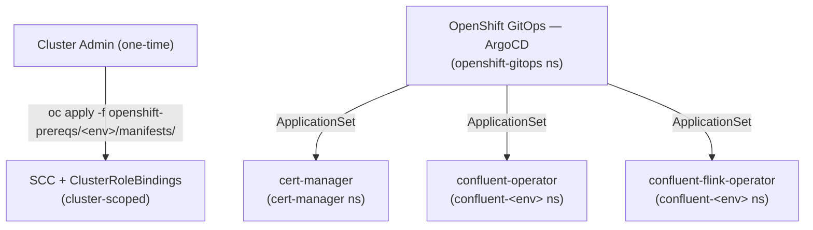
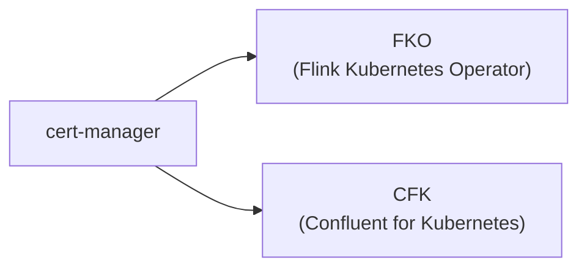
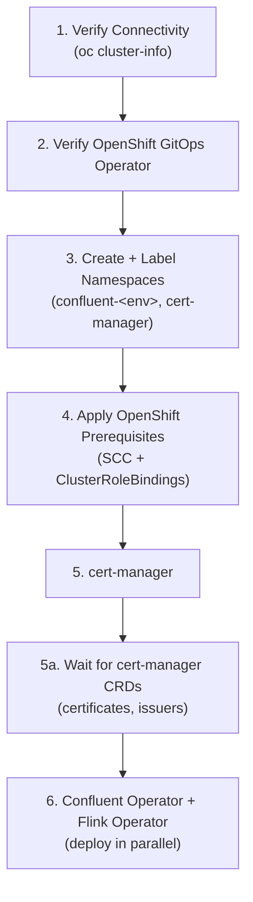

# Phase-I — Operators on OpenShift

Deployment guide for Phase-I: **cert-manager**, **Confluent Operator (CFK)**, and **Flink Kubernetes Operator** on Red Hat OpenShift. Confluent Platform continues to run on VMs.

> **Status:** Complete.

---

## Table of Contents

- [Scope](#scope)
- [Architecture](#architecture)
- [Components](#components)
- [CRD Dependency Chain](#crd-dependency-chain)
- [Artifacts](#artifacts)
- [Deployment Order](#deployment-order)
- [Deployment Guide](#deployment-guide)
  - [Step 1 - Verify Connectivity](#step-1---verify-connectivity)
  - [Step 2 - Verify OpenShift GitOps Operator](#step-2---verify-openshift-gitops-operator)
  - [Step 3 - Create and Label Namespaces](#step-3---create-and-label-namespaces)
  - [Step 4 - Apply OpenShift Prerequisites (SCCs)](#step-4---apply-openshift-prerequisites-sccs)
  - [Step 5 - Deploy cert-manager](#step-5---deploy-cert-manager)
  - [Step 6 - Deploy Confluent Operator (CFK) and Flink Operator](#step-6---deploy-confluent-operator-cfk-and-flink-operator)
- [Verification](#verification)
- [Rollback Strategy](#rollback-strategy)
- [Helm Charts Reference](#helm-charts-reference)

---

## Scope

| What | Detail |
|------|--------|
| **cert-manager** | X.509 certificate management — required by Flink operator webhooks |
| **CFK** | Confluent for Kubernetes operator — manages Confluent Platform CRDs |
| **Flink Operator** | Confluent's Flink Kubernetes operator — manages Flink workloads |
| **Where** | OpenShift 4.12+ (all environments: dev, qa, stg, prd) |
| **Confluent Platform** | Runs on VMs — not deployed on Kubernetes in this phase |
| **Not in scope** | CMF, Flink workloads, Confluent Platform CRDs (see [Phase-II](README-PHASE-II.md)) |

---

## Architecture



---

## Components

| Component | Description |
|-----------|-------------|
| **cert-manager** | X.509 certificate management -- required by Flink operator webhooks |
| **Confluent Operator (CFK)** | Confluent for Kubernetes operator -- manages Confluent Platform CRDs |
| **Flink Operator** | Confluent's Flink Kubernetes operator -- manages Flink workloads |

> **Why deploy CFK in Phase-I if Confluent Platform stays on VMs?** CFK is included now to establish a consistent operator footprint, RBAC model, and GitOps pattern across all environments before the CP migration in Phase-III. Installing it early ensures the CRDs, namespace conventions, and SCC bindings are validated end-to-end alongside cert-manager and the Flink operator. Deferring CFK to a later phase would require re-validating the operator baseline, SCCs, and ArgoCD ApplicationSets at that time -- adding risk to the critical path.

All components except SCCs are deployed **through ArgoCD** via ApplicationSet resources in `gitops-config/openshift/`. OpenShift prerequisites (SCCs + ClusterRoleBindings) are applied directly as a one-time cluster setup.

---

## CRD Dependency Chain



cert-manager must be fully running (CRDs established) before deploying either operator. CFK and FKO can be deployed in parallel once cert-manager CRDs are ready.

---

## Artifacts

### Directories

```
apps/cert-manager/                                # cert-manager Helm values
├── openshift-overlay.yaml                        # OpenShift: null security contexts for SCC
├── dev/values.yaml
├── qa/values.yaml
├── stg/values.yaml
└── prd/values.yaml

apps/confluent-operator/                          # CFK operator Helm values
├── openshift-overlay.yaml
├── dev/values.yaml
├── qa/values.yaml
├── stg/values.yaml
└── prd/values.yaml

apps/confluent-flink-operator/                    # Flink operator Helm values
├── openshift-overlay.yaml
├── dev/values.yaml
├── qa/values.yaml
├── stg/values.yaml
└── prd/values.yaml

openshift-prereqs/                                # SCC + ClusterRoleBindings
├── dev/manifests/
├── qa/manifests/
├── stg/manifests/
└── prd/manifests/
```

### ApplicationSets (per env)

```
gitops-config/openshift/{dev,qa,stg,prd}/
├── cert-manager-application-set.yaml              # cert-manager Helm (multi-source)
├── confluent-operator-application-set.yaml        # CFK Helm (multi-source)
└── confluent-flink-operator-application-set.yaml  # FKO Helm (multi-source)
```

### Key configuration files

| File | Purpose |
|------|---------|
| `apps/cert-manager/*/values.yaml` | cert-manager Helm values per environment |
| `apps/confluent-operator/*/values.yaml` | CFK operator Helm values per environment |
| `apps/confluent-flink-operator/*/values.yaml` | Flink operator Helm values per environment |
| `openshift-prereqs/*/manifests/` | SCC and ClusterRoleBindings per environment |
| `scripts/deploy-openshift-dev.sh` | Full deploy: Phase-I + Phase-II |
| `scripts/destroy-openshift-dev.sh` | Full teardown (reverse order) |

---

## Deployment Order



---

## Deployment Guide

Set the environment variables:

```bash
ARGOCD_NS=openshift-gitops
ENV=dev                       # Change to qa, stg, or prd as needed
```

### Step 1 - Verify Connectivity

```bash
oc whoami
oc cluster-info
oc version
```

### Step 2 - Verify OpenShift GitOps Operator

```bash
oc get pods -n openshift-gitops -l app.kubernetes.io/name=openshift-gitops-server
oc get argocd -n openshift-gitops
```

If the operator is not installed, see [ArgoCD Setup](README.md#argocd-setup) in the root README.

### Step 3 - Create and Label Namespaces

```bash
# Create namespaces
oc create namespace confluent-${ENV} --dry-run=client -o yaml | oc apply -f -
oc create namespace cert-manager --dry-run=client -o yaml | oc apply -f -

# Label for OpenShift GitOps management
oc label namespace confluent-${ENV} argocd.argoproj.io/managed-by=${ARGOCD_NS} --overwrite
oc label namespace cert-manager argocd.argoproj.io/managed-by=${ARGOCD_NS} --overwrite
```

### Step 4 - Apply OpenShift Prerequisites (SCCs)

```bash
oc apply -f openshift-prereqs/${ENV}/manifests/
```

Verify:

```bash
oc get scc confluent-scc
oc get clusterrolebinding | grep confluent-scc
```

### Step 5 - Deploy cert-manager

> **Do not install Jetstack cert-manager if the Red Hat cert-manager Operator is already present -- choose one.**
> ```bash
> oc get pods -n cert-manager 2>/dev/null || oc get pods -n openshift-cert-manager 2>/dev/null
> ```
> If either returns running pods, **skip this step entirely**.

```bash
oc apply -f gitops-config/openshift/${ENV}/cert-manager-application-set.yaml
oc wait --for=jsonpath='{.status.health.status}'=Healthy \
  application/cert-manager-${ENV} -n ${ARGOCD_NS} --timeout=180s
```

**Verify CRDs are established** before proceeding:

```bash
oc wait --for=condition=Established crd/certificates.cert-manager.io --timeout=60s
oc wait --for=condition=Established crd/issuers.cert-manager.io --timeout=60s
```

### Step 6 - Deploy Confluent Operator (CFK) and Flink Operator

```bash
oc apply -f gitops-config/openshift/${ENV}/confluent-operator-application-set.yaml
oc apply -f gitops-config/openshift/${ENV}/confluent-flink-operator-application-set.yaml
oc wait --for=jsonpath='{.status.health.status}'=Healthy \
  application/confluent-operator-${ENV} \
  application/confluent-flink-operator-${ENV} \
  -n ${ARGOCD_NS} --timeout=180s
```

---

## Verification

Run the verification script to check all components:

```bash
./scripts/verify-openshift-dev.sh
```

To manually inspect ArgoCD application status:

```bash
oc get applications -n ${ARGOCD_NS} -o custom-columns=\
NAME:.metadata.name,\
HEALTH:.status.health.status,\
SYNC:.status.sync.status,\
NAMESPACE:.spec.destination.namespace
```

---

## Rollback Strategy

Phase-I is the foundation layer. To roll back, delete the ApplicationSets in reverse order:

```bash
# Remove Phase-I ApplicationSets (reverse order)
oc delete applicationset confluent-flink-operator-dev -n openshift-gitops --ignore-not-found
oc delete applicationset confluent-operator-dev -n openshift-gitops --ignore-not-found
oc delete applicationset cert-manager-dev -n openshift-gitops --ignore-not-found

# Wait for ArgoCD to clean up
oc wait --for=delete application/confluent-flink-operator-dev -n openshift-gitops --timeout=120s 2>/dev/null || true
oc wait --for=delete application/confluent-operator-dev -n openshift-gitops --timeout=120s 2>/dev/null || true
oc wait --for=delete application/cert-manager-dev -n openshift-gitops --timeout=120s 2>/dev/null || true
```

> **Warning:** Rolling back Phase-I removes operator CRDs that Phase-II depends on. Ensure Phase-II is rolled back first if deployed.

**Full teardown:** `./scripts/destroy-openshift-dev.sh`

---

## Helm Charts Reference

| Chart | Repository | Used For |
|-------|-----------|----------|
| `cert-manager` | `https://charts.jetstack.io` | TLS certificate management |
| `confluent-for-kubernetes` | `https://packages.confluent.io/helm` | Confluent Platform operator |
| `flink-kubernetes-operator` | `https://packages.confluent.io/helm` | Flink Kubernetes operator |
