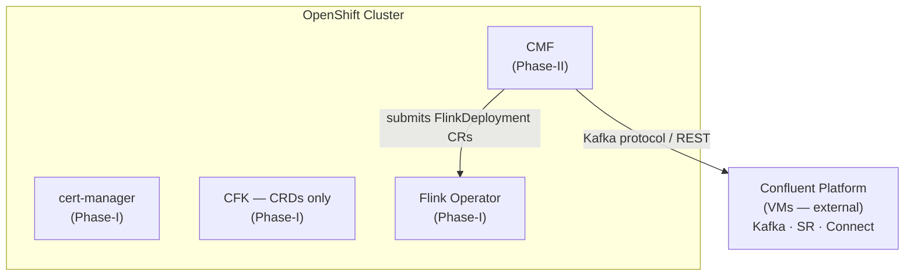
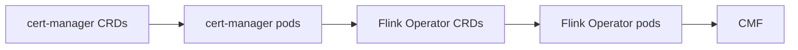
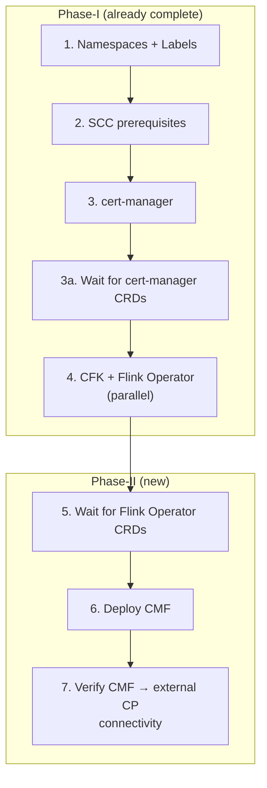

# Phase-II — CMF + Flink on K8s, CP on VMs

Planning document for Phase-II: deploying **Confluent Manager for Apache Flink (CMF)** on OpenShift while Confluent Platform remains on VMs.

> **Status:** Pre-kickoff. This document captures open decisions, feedback, and a readiness checklist that must be resolved before implementation begins.

---

## Table of Contents

- [Scope](#scope)
- [Architecture](#architecture)
- [Open Decisions](#open-decisions)
  - [1 — CRD readiness and sync ordering](#1--crd-readiness-and-sync-ordering)
  - [2 — ArgoCD Projects for environment isolation](#2--argocd-projects-for-environment-isolation)
  - [3 — CMF deployment method](#3--cmf-deployment-method)
  - [4 — External Kafka connectivity](#4--external-kafka-connectivity)
  - [5 — CMF service account and SCC bindings](#5--cmf-service-account-and-scc-bindings)
  - [6 — Secret management for external CP credentials](#6--secret-management-for-external-cp-credentials)
  - [7 — Namespace strategy — shared or dedicated](#7--namespace-strategy--shared-or-dedicated)
  - [8 — Flink compute pools](#8--flink-compute-pools)
- [Prerequisites (from Phase-I)](#prerequisites-from-phase-i)
- [Readiness Checklist](#readiness-checklist)
- [Artifacts to Create](#artifacts-to-create)
- [Deployment Order](#deployment-order)
- [Rollback Strategy](#rollback-strategy)

---

## Scope

| What | Detail |
|------|--------|
| **Deploy** | Confluent Manager for Apache Flink (CMF) |
| **Where** | OpenShift 4.12+ (same clusters as Phase-I operators) |
| **Kafka** | External — Confluent Platform on VMs |
| **Flink** | On Kubernetes, orchestrated by CMF via Flink Operator CRDs |
| **Not in scope** | Migrating CP onto K8s (that is Phase-III) |

---

## Architecture



---

## Open Decisions

### 1 — CRD readiness and sync ordering

**Feedback received:** Operators often report "Healthy" in ArgoCD before their CRDs are fully established. The Flink operator's webhook certificates depend on cert-manager CRDs, and CMF will depend on Flink operator CRDs. This chain needs to be deterministic.

**What we already did (Phase-I):**
- Added explicit `oc wait --for=condition=Established` gates for cert-manager CRDs in the deploy script and deployment guide.
- The deploy script enforces ordering: cert-manager → CRD gate → operators.

**What Phase-II adds to the chain:**



**Decision needed:**

| Option | Pros | Cons |
|--------|------|------|
| **A. Script-level gating (current pattern)** | Simple, proven in Phase-I, no ArgoCD config changes | Relies on imperative script; manual deploys can skip gates |
| **B. ArgoCD sync waves** | Declarative, enforced by ArgoCD regardless of deploy method | Requires all apps in a single Application or App-of-Apps; doesn't work across separate ApplicationSets |
| **C. Both (belt and suspenders)** | Maximum safety | Slightly more complexity |

**Recommendation:** Option A is sufficient if all deploys go through the script or documented steps. If teams may deploy ad-hoc via ArgoCD UI, consider adding sync-wave annotations inside the Helm charts where possible (Option C). ArgoCD sync waves only order resources *within* a single Application, so cross-Application ordering (cert-manager → Flink operator → CMF) must remain script-level or use an App-of-Apps pattern.

> **Action:** Decide whether to adopt App-of-Apps for Phase-II or keep the current per-component ApplicationSet model with script-level ordering.

---

### 2 — ArgoCD Projects for environment isolation

**Feedback received:** All ApplicationSets currently use `project: default`. For customer engagements, dedicated ArgoCD `AppProject` resources per environment prevent accidental cross-env deploys.

**What we already did:** Added an [ArgoCD Projects (Optional Hardening)](README.md#argocd-projects-optional-hardening) section to the main README with a sample `AppProject` manifest.

**Decision needed:** Is this optional or required for Phase-II?

| Option | Pros | Cons |
|--------|------|------|
| **A. Keep `project: default`** | Zero config change, simpler | No guardrail against deploying dev manifests to prd |
| **B. Require per-env AppProjects** | Hard namespace/cluster boundary per env; audit-friendly | Extra manifests to maintain; must update every ApplicationSet |

**Recommendation:** Adopt Option B for Phase-II. Phase-I deployed only operators (low blast radius). Phase-II deploys workload infrastructure (CMF + Flink jobs) where a cross-env mistake has real data impact. The cost is one `AppProject` manifest per environment.

> **Action:** Confirm whether AppProjects are required or remain optional. If required, create them before the first Phase-II ApplicationSet is applied.

---

### 3 — CMF deployment method

CMF can be deployed as a Helm chart or as raw Kubernetes manifests.

| Option | Pros | Cons |
|--------|------|------|
| **A. Helm chart via ArgoCD** | Consistent with Phase-I operators; values-per-env pattern already established | Requires a published CMF Helm chart from Confluent |
| **B. Raw manifests via ArgoCD** | Works even if no Helm chart exists; full control | More YAML to maintain per environment |

> **Action:** Confirm whether Confluent publishes a CMF Helm chart to `packages.confluent.io/helm`. If yes, follow Option A. If not, use Option B with a Kustomize overlay or plain manifests.

---

### 4 — External Kafka connectivity

CMF must reach the Confluent Platform brokers running on VMs.

**Questions to answer:**

- [ ] What are the broker bootstrap endpoints per environment?
- [ ] Is the connection PLAINTEXT, SSL/TLS, or SASL?
- [ ] Does CMF need Schema Registry access? If so, what endpoint?
- [ ] Are there firewall rules or network policies between the OpenShift cluster and the VM network?
- [ ] Is DNS resolution available for the broker hostnames from inside the cluster, or are static IPs required?

> **Action:** Collect endpoint and auth details for each environment (dev/qa/stg/prd). Document in `hosts.yaml` or a dedicated config map.

---

### 5 — CMF service account and SCC bindings

Phase-I created the custom `confluent-scc` and binds specific service accounts to it. CMF will introduce new pods that need SCC bindings.

**Questions to answer:**

- [ ] What service account name does CMF use? (Check the Helm chart or deployment manifest defaults.)
- [ ] Does CMF require `anyuid` or is `restricted` sufficient?
- [ ] Do Flink job pods (submitted by CMF) need their own SCC binding, or do they inherit the Flink operator's SA?

> **Action:** Add CMF service account(s) to `openshift-prereqs/<env>/manifests/scc-bindings.yaml` before deploying CMF.

---

### 6 — Secret management for external CP credentials

If the external Confluent Platform requires authentication (SASL, mTLS, API keys), CMF needs access to credentials.

| Option | Pros | Cons |
|--------|------|------|
| **A. Kubernetes Secrets (manual)** | Simple, works everywhere | Secrets in Git (even encrypted) need careful handling |
| **B. Sealed Secrets / SOPS** | Encrypted at rest in Git | Requires extra tooling (Bitnami Sealed Secrets or SOPS + age/GPG) |
| **C. External secret store (Vault, AWS SM)** | Industry standard, rotation-friendly | Requires External Secrets Operator or CSI driver |

> **Action:** Decide on a secrets strategy. For a PoC, Option A is fine. For production, Option B or C is recommended.

---

### 7 — Namespace strategy — shared or dedicated

Phase-I places CFK and Flink operator in `confluent-<env>`. CMF could go in the same namespace or a separate one.

| Option | Pros | Cons |
|--------|------|------|
| **A. Shared (`confluent-<env>`)** | Simple RBAC, single SCC binding set, matches Phase-I | All workloads share resource quotas; noisier namespace |
| **B. Dedicated (`confluent-flink-<env>`)** | Clean separation of operator plane vs workload plane | Extra namespace, labels, SCC bindings, AppProject destinations |

**Recommendation:** Start with Option A (shared namespace) to match Phase-I conventions. Split later if resource quotas or RBAC isolation become a concern.

> **Action:** Confirm namespace strategy before creating ApplicationSets.

---

### 8 — Flink compute pools

CMF uses **compute pools** to allocate and isolate resources for Flink jobs. A compute pool defines the resource boundaries (CPU, memory, task slots) for a group of Flink deployments.

**Questions to answer:**

- [ ] How many compute pools per environment? (e.g., one shared pool for dev, dedicated pools per team/workload in prd)
- [ ] What are the resource limits per pool? (CPU, memory, parallelism)
- [ ] Do compute pool pods need dedicated SCC bindings or do they run under the Flink operator SA?
- [ ] Are there OpenShift `ResourceQuota` or `LimitRange` policies that constrain pod resource requests in `confluent-<env>`?
- [ ] Should compute pools be defined declaratively in Git (as CRDs or Helm values) or managed dynamically through CMF?

**What this affects:**

| Concern | Impact |
|---------|--------|
| **Node sizing** | Compute pool pods may need dedicated node pools or tolerations for GPU/high-memory workloads |
| **SCC bindings** | Flink job TaskManager/JobManager pods may run under a different SA than the operator |
| **Resource quotas** | The namespace `ResourceQuota` must accommodate operator pods *and* compute pool pods |
| **Autoscaling** | If compute pools autoscale, the OpenShift cluster autoscaler must be configured with headroom |

> **Action:** Define compute pool sizing per environment and confirm that namespace resource quotas can accommodate them. Add compute pool resource estimates to `hosts.yaml` or a capacity planning doc.

---

## Prerequisites (from Phase-I)

The following must be healthy before Phase-II can begin:

| Component | How to verify |
|-----------|---------------|
| cert-manager | `oc get pods -n cert-manager` |
| cert-manager CRDs | `oc wait --for=condition=Established crd/certificates.cert-manager.io` |
| Confluent Operator (CFK) | `oc get pods -n confluent-<env> -l app=confluent-operator` |
| Flink Operator | `oc get pods -n confluent-<env> -l app.kubernetes.io/name=flink-kubernetes-operator` |
| Flink Operator CRDs | `oc get crd flinkdeployments.flink.apache.org` |
| SCC bindings | `oc get clusterrolebinding \| grep confluent-scc` |
| Network path to external CP | `oc run nettest --rm -it --image=busybox -- nc -zv <broker-host> <broker-port>` |

---

## Readiness Checklist

All items must be resolved or explicitly deferred before Phase-II implementation starts.

### Decisions

- [ ] Sync ordering strategy: script-only, sync waves, or App-of-Apps? → [Decision 1](#1--crd-readiness-and-sync-ordering)
- [ ] ArgoCD Projects: optional or required? → [Decision 2](#2--argocd-projects-for-environment-isolation)
- [ ] CMF deployment method: Helm chart or raw manifests? → [Decision 3](#3--cmf-deployment-method)
- [ ] Namespace: shared `confluent-<env>` or dedicated? → [Decision 7](#7--namespace-strategy--shared-or-dedicated)
- [ ] Secrets strategy: manual, Sealed Secrets, or external store? → [Decision 6](#6--secret-management-for-external-cp-credentials)
- [ ] Compute pool sizing and resource quota strategy → [Decision 8](#8--flink-compute-pools)

### Information Gathering

- [ ] External Kafka broker endpoints per environment → [Decision 4](#4--external-kafka-connectivity)
- [ ] Authentication method for external CP (PLAINTEXT/SSL/SASL)
- [ ] Schema Registry endpoint (if applicable)
- [ ] CMF Helm chart availability and version
- [ ] CMF service account name(s) and security requirements → [Decision 5](#5--cmf-service-account-and-scc-bindings)
- [ ] Flink job pod SCC requirements
- [ ] Compute pool resource requirements (CPU, memory, parallelism per pool) → [Decision 8](#8--flink-compute-pools)

### Infrastructure

- [ ] Phase-I operators healthy on target cluster(s)
- [ ] Network connectivity from OpenShift pods to external CP brokers verified
- [ ] DNS resolution for broker hostnames verified from inside the cluster
- [ ] `hosts.yaml` updated with external CP endpoints
- [ ] Namespace `ResourceQuota` / `LimitRange` reviewed for compute pool headroom

### Artifacts

- [ ] CMF Helm values or manifests created under `apps/confluent-flink/`
- [ ] OpenShift overlay for CMF (`apps/confluent-flink/openshift-overlay.yaml`)
- [ ] Per-env values files (`apps/confluent-flink/<env>/values.yaml`)
- [ ] ApplicationSet created (`gitops-config/openshift/<env>/confluent-flink-application-set.yaml`)
- [ ] SCC bindings updated for CMF service account(s)
- [ ] (If required) ArgoCD `AppProject` manifests created per environment
- [ ] Deploy script updated to include CMF step
- [ ] Destroy script updated to remove CMF

---

## Artifacts to Create

```
apps/confluent-flink/
├── openshift-overlay.yaml                    # OpenShift security context nullification
├── dev/values.yaml                           # CMF Helm values — dev
├── qa/values.yaml                            # CMF Helm values — qa
├── stg/values.yaml                           # CMF Helm values — stg
└── prd/values.yaml                           # CMF Helm values — prd

gitops-config/openshift/
├── dev/confluent-flink-application-set.yaml
├── qa/confluent-flink-application-set.yaml
├── stg/confluent-flink-application-set.yaml
└── prd/confluent-flink-application-set.yaml

openshift-prereqs/<env>/manifests/
└── scc-bindings.yaml                         # Updated with CMF service account(s)
```

---

## Deployment Order

Extends Phase-I with a new step:



**Phase-II commands:**

```bash
# Step 5 — Wait for Flink Operator CRDs
oc wait --for=condition=Established crd/flinkdeployments.flink.apache.org --timeout=60s

# Step 6 — Deploy CMF
oc apply -f gitops-config/openshift/${ENV}/confluent-flink-application-set.yaml
oc wait --for=jsonpath='{.status.health.status}'=Healthy \
  application/confluent-flink-${ENV} -n ${ARGOCD_NS} --timeout=180s

# Step 7 — Verify CMF → external CP connectivity
# (smoke test: submit a test Flink SQL job or verify CMF health endpoint)
```

---

## Rollback Strategy

CMF is additive — it does not modify Phase-I components. Rollback is:

```bash
# Remove CMF ApplicationSet
oc delete -f gitops-config/openshift/${ENV}/confluent-flink-application-set.yaml

# Wait for ArgoCD to clean up
oc wait --for=delete application/confluent-flink-${ENV} -n ${ARGOCD_NS} --timeout=120s
```

Phase-I operators remain unaffected.
