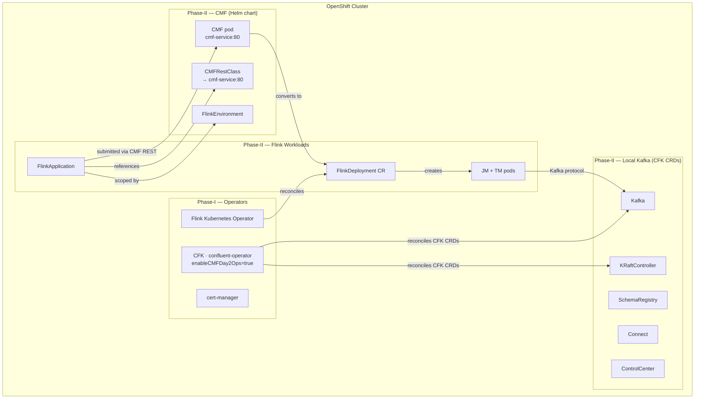
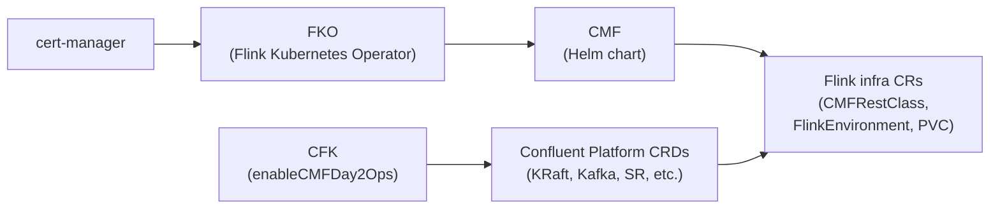
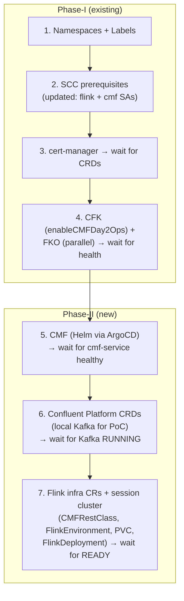

# Phase-II — CMF + Local Kafka + Flink on OpenShift

Deployment guide for Phase-II: **Confluent Manager for Apache Flink (CMF)** as a standalone Helm chart, with **local Kafka on K8s** (via CFK CRDs) for the PoC.

> **Status:** Implementation complete. All artifacts created and deployment scripts updated.

---

## Table of Contents

- [Scope](#scope)
- [Architecture](#architecture)
- [Key Corrections from Phase-I Planning](#key-corrections-from-phase-i-planning)
- [Components](#components)
- [CRD Dependency Chain](#crd-dependency-chain)
- [Artifacts](#artifacts)
- [Deployment Order](#deployment-order)
- [Verification](#verification)
- [Rollback Strategy](#rollback-strategy)

---

## Scope

| What | Detail |
|------|--------|
| **CMF** | Standalone Helm chart (`confluent-manager-for-apache-flink`) deployed via ArgoCD — **not** a CFK-managed CR |
| **CFK** | Optional for CMF. Enabled with `enableCMFDay2Ops=true` to provide Day2Ops and local Kafka CRDs |
| **Kafka** | Local on K8s — CFK CRDs (KRaftController, Kafka, SchemaRegistry, Connect, ControlCenter) for PoC |
| **Flink** | FlinkApplication submitted via CMF REST API. CMF converts to FlinkDeployment CR. FKO reconciles JM/TM pods |
| **Where** | OpenShift 4.12+ (same clusters as Phase-I operators) |
| **Not in scope** | External CP on VMs (deferred — customer uses VMs but PoC uses local K8s Kafka) |

---

## Architecture



**Data flow:** `FlinkApplication` → CMF REST API (`cmf-service:80`) → CMF converts to `FlinkDeployment` CR → FKO reconciles → JM/TM pods → Kafka (local).

---

## Key Corrections from Phase-I Planning

| What was wrong | Corrected understanding |
|----------------|------------------------|
| CMF is a CFK-managed CR (`kind: CMF`) | CMF is a **standalone Helm chart** (`confluentinc/confluent-manager-for-apache-flink`) |
| CFK required for CMF | CFK is **optional** — CMF works independently via its REST API. CFK can optionally enable Day2Ops (`enableCMFDay2Ops=true`) |
| CMFRestClass points to CFK port 7778 | CMFRestClass points to **CMF's own service** (`cmf-service:80`) |
| CMF runs inside confluent-operator pod | CMF has its **own pod** deployed by its Helm chart |
| External Kafka on VMs | **Local Kafka on K8s** via CFK CRDs for PoC |

Source: Discussion with Akhil (Confluent) + Flink-Training materials.

---

## Components

### CMF (Confluent Manager for Apache Flink)

- **Chart:** `confluent-manager-for-apache-flink` from `https://packages.confluent.io/helm`
- **Version:** 2.2.0
- **Deployed via:** ArgoCD ApplicationSet (Helm multi-source, same pattern as Phase-I operators)
- **Values:** `apps/confluent-cmf/{dev,qa,stg,prd}/values.yaml` + `openshift-overlay.yaml`
- **Service:** `cmf-service:80` in `confluent-<env>` namespace

### Local Kafka (CFK CRDs)

- **Deployed via:** ArgoCD ApplicationSet (Git/Kustomize source)
- **Manifests:** `apps/confluent-platform/base/` + per-env overlays
- **Components:** KRaftController, Kafka, SchemaRegistry, Connect, ControlCenter, KafkaRestClass
- **Versions:** CP 8.1.1, init-container 3.1.1
- **Dev/QA:** Single replica. **Stg/Prd:** 3 Kafka/KRaft replicas, 2 SR replicas.

### Flink Infrastructure CRs

- **Deployed via:** ArgoCD ApplicationSet (Git/Kustomize source)
- **Manifests:** `apps/confluent-flink/base/` + per-env overlays
- **CRs:** CMFRestClass, FlinkEnvironment, FlinkDeployment (session cluster), KafkaCatalog (commented out), PVC (10Gi ReadWriteMany)

---

## CRD Dependency Chain



---

## Artifacts

### New directories

```
apps/confluent-cmf/                              # CMF Helm values
├── openshift-overlay.yaml                        # Nullify podSecurityContext for SCC
├── dev/values.yaml
├── qa/values.yaml
├── stg/values.yaml
└── prd/values.yaml

apps/confluent-platform/                          # Local Kafka CFK CRDs (Kustomize)
├── base/
│   ├── kustomization.yaml
│   ├── kraft-controller.yaml
│   ├── kafka.yaml
│   ├── schema-registry.yaml
│   ├── connect.yaml
│   ├── control-center.yaml
│   └── kafka-rest-class.yaml
├── dev/kustomization.yaml
├── qa/kustomization.yaml
├── stg/kustomization.yaml
└── prd/kustomization.yaml

apps/confluent-flink/                             # Flink infra CRs (Kustomize)
├── base/
│   ├── kustomization.yaml
│   ├── cmf-rest-class.yaml
│   ├── flink-environment.yaml
│   ├── flink-pvc.yaml
│   ├── flink-session-cluster.yaml                # FlinkDeployment — Flink session cluster
│   └── kafka-catalog.yaml                        # (commented out — requires cmf.confluent.io CRD)
├── dev/kustomization.yaml
├── qa/kustomization.yaml
├── stg/kustomization.yaml
└── prd/kustomization.yaml
```

### New ApplicationSets (per env)

```
gitops-config/openshift/{dev,qa,stg,prd}/
├── confluent-cmf-application-set.yaml            # CMF Helm (multi-source)
├── confluent-platform-application-set.yaml        # CP CRDs (Git/Kustomize)
└── confluent-flink-application-set.yaml           # Flink infra (Git/Kustomize)
```

### Modified files

| File | Change |
|------|--------|
| `apps/confluent-operator/*/values.yaml` | Added `enableCMFDay2Ops: true` |
| `openshift-prereqs/*/manifests/scc-bindings.yaml` | Added `flink` and `cmf` service accounts |
| `scripts/deploy-openshift-dev.sh` | Added Phase-II steps (CMF, CP, Flink infra) |
| `scripts/destroy-openshift-dev.sh` | Added Phase-II teardown (reverse order) |
| `scripts/discover-charts-and-images.sh` | CMF `helm template` now uses values files |

---

## Deployment Order



**Run:** `./scripts/deploy-openshift-dev.sh`

---

## Verification

Run the verification script to check all Phase-I and Phase-II components:

```bash
./scripts/verify-openshift-dev.sh
```

This checks cluster connectivity, all 6 ArgoCD applications, CMF pod, Kafka status, Confluent Platform pods, Flink infrastructure CRs, Flink session cluster, and cert-manager pods. See [scripts/README.md](scripts/README.md) for the full list of checks.

To manually inspect individual components:

```bash
# CMF pod running
oc get pods -n confluent-dev -l app=cmf

# Kafka and CP components running
oc get pods -n confluent-dev
oc get kafka kafka -n confluent-dev -o jsonpath='{.status.phase}'  # → RUNNING

# Flink infra CRs
oc get cmfrestclass default -n confluent-dev
oc get flinkenvironment flink-env1 -n confluent-dev
oc get pvc flink-pvc -n confluent-dev

# Flink session cluster
oc get flinkdeployment flink-session -n confluent-dev -o jsonpath='{.status.jobManagerDeploymentStatus}'  # → READY

# ArgoCD applications healthy
oc get applications -n openshift-gitops
```

---

## Rollback Strategy

Phase-II is additive — it does not modify Phase-I operators. Rollback:

```bash
# Remove Phase-II ApplicationSets (reverse order)
oc delete applicationset confluent-flink-dev -n openshift-gitops --ignore-not-found
oc delete applicationset confluent-platform-dev -n openshift-gitops --ignore-not-found
oc delete applicationset confluent-cmf-dev -n openshift-gitops --ignore-not-found

# Wait for ArgoCD to clean up
oc wait --for=delete application/confluent-flink-dev -n openshift-gitops --timeout=120s 2>/dev/null || true
oc wait --for=delete application/confluent-platform-dev -n openshift-gitops --timeout=120s 2>/dev/null || true
oc wait --for=delete application/confluent-cmf-dev -n openshift-gitops --timeout=120s 2>/dev/null || true
```

Phase-I operators remain unaffected. To revert CFK's `enableCMFDay2Ops`, remove the line from values and let ArgoCD sync.

**Full teardown:** `./scripts/destroy-openshift-dev.sh`
