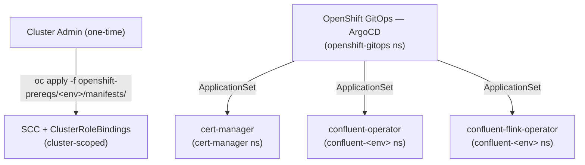
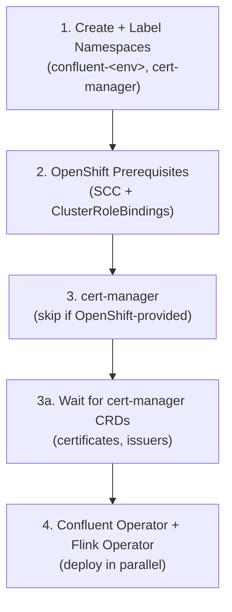

# Flink on OpenShift with Confluent

GitOps repository for deploying **Confluent and Flink operators** on **Red Hat OpenShift** using **ArgoCD** (OpenShift GitOps). Confluent Platform runs externally on VMs; this repo manages only the Kubernetes operators needed for Flink workloads.

---

## Table of Contents

- [Overview](#overview)
- [Architecture](#architecture)
- [Environments](#environments)
- [Prerequisites](#prerequisites)
- [Assumptions](#assumptions)
- [Repository Structure](#repository-structure)
- [ArgoCD Setup](#argocd-setup)
  - [Option A - OpenShift GitOps Operator (Recommended)](#option-a---openshift-gitops-operator-recommended)
  - [Option B - Standalone ArgoCD via Helm](#option-b---standalone-argocd-via-helm)
- [Deployment Guide](#deployment-guide)
  - [Step 1 - Create and Label Namespaces](#step-1---create-and-label-namespaces)
  - [Step 2 - Apply OpenShift Prerequisites (SCCs)](#step-2---apply-openshift-prerequisites-sccs)
  - [Step 3 - Deploy cert-manager](#step-3---deploy-cert-manager)
  - [Step 4 - Deploy Confluent Operator (CFK) and Flink Operator](#step-4---deploy-confluent-operator-cfk-and-flink-operator)
- [Verify All Applications](#verify-all-applications)
- [Deployment Order](#deployment-order)
- [Quick Deploy Script](#quick-deploy-script)
- [Tear Down](#tear-down)
- [Sync Policies](#sync-policies)
- [Namespace Convention](#namespace-convention)
- [ArgoCD Projects (Optional Hardening)](#argocd-projects-optional-hardening)
- [Helm Charts Reference](#helm-charts-reference)
- [OpenShift-Specific Considerations](#openshift-specific-considerations)
  - [Security Context Constraints (SCCs)](#security-context-constraints-sccs)
  - [OpenShift GitOps Namespace Restrictions](#openshift-gitops-namespace-restrictions)
  - [cert-manager on OpenShift](#cert-manager-on-openshift)
- [CI/CD Pipelines](#cicd-pipelines)
- [Troubleshooting](#troubleshooting)
- [Phased Rollout](#phased-rollout)
- [Additional Guides](#additional-guides)

---

## Overview

This project follows a **phased approach**:

| Phase | Scope | Status |
|-------|-------|--------|
| **Phase-I** | **Operators only** | Complete |
| **Phase-II** | **CMF + Local Kafka + Flink on K8s** | **Complete** |
| **Phase-III** | **CMF + Flink + CP on K8s** | Planned |

- **Phase-I:** Deploy cert-manager, Confluent Operator (CFK), and Flink Operator. Confluent Platform continues to run on VMs. See [README-PHASE-I.md](docs/README-PHASE-I.md).
- **Phase-II:** Deploy CMF, local Kafka on K8s (via CFK CRDs), Flink session cluster, and Flink infrastructure CRs. See [README-PHASE-II.md](docs/README-PHASE-II.md).
- **Phase-III:** Migrate Confluent Platform onto Kubernetes via CFK. CMF manages Flink SQL workloads end-to-end.

### Phase-I Components

| Component | Description |
|-----------|-------------|
| **cert-manager** | X.509 certificate management -- required by Flink operator webhooks |
| **Confluent Operator (CFK)** | Confluent for Kubernetes operator -- manages Confluent Platform CRDs |
| **Flink Operator** | Confluent's Flink Kubernetes operator -- manages Flink workloads |

> **Why deploy CFK in Phase-I if Confluent Platform stays on VMs?** CFK is included now to establish a consistent operator footprint, RBAC model, and GitOps pattern across all environments before the CP migration in Phase-III. Installing it early ensures the CRDs, namespace conventions, and SCC bindings are validated end-to-end alongside cert-manager and the Flink operator. It also enables teams to adopt CFK-managed conventions (e.g., Confluent secret patterns, service account structure) in lower environments while CP itself remains external. Deferring CFK to a later phase would require re-validating the operator baseline, SCCs, and ArgoCD ApplicationSets at that time -- adding risk to the critical path.

All components except SCCs are deployed **through ArgoCD** via ApplicationSet resources in `gitops-config/openshift/`. OpenShift prerequisites (SCCs + ClusterRoleBindings) are applied directly as a one-time cluster setup.

---

## Architecture



---

## Environments

| Environment | Sync Policy | Use Case |
|-------------|-------------|----------|
| **dev** | Automated (prune + selfHeal) | Development and testing |
| **qa** | Manual | Quality assurance |
| **stg** | Manual | Pre-production staging |
| **prd** | Manual | Production |

Each environment has its own Kubernetes namespace and resource sizing. The cluster inventory is defined in `hosts.yaml`. Update `hosts.yaml` with the actual cluster API endpoints for your infrastructure.

---

## Prerequisites

| Requirement | Details |
|-------------|---------|
| **OpenShift** | 4.12+ cluster with cluster-admin access |
| **oc** | OpenShift CLI, logged in (`oc login`) |
| **kubectl** | 1.28+ (bundled with `oc`, used interchangeably) |
| **helm** | 3.14+ / 4.x |

Verify connectivity:

```bash
oc whoami
oc cluster-info
oc version
```

---

## Assumptions

- An OpenShift 4.12+ cluster is provisioned and accessible via `oc` CLI.
- The deploying user or service account has **cluster-admin** privileges (required for creating namespaces, CRDs, SCCs, and ClusterRoles).
- Helm chart repositories (`charts.jetstack.io`, `packages.confluent.io`) are reachable from the cluster. For air-gapped or restricted environments, see the [Internal Registry Guide](docs/README-INTERNAL-REGISTRY.md).
- The ApplicationSet files in `gitops-config/openshift/` contain **placeholder cluster URLs**. Update the `url` field in each ApplicationSet's generator list with your actual cluster API server endpoint (dev is pre-configured to `https://kubernetes.default.svc`).
- **Do not install Jetstack cert-manager if the Red Hat cert-manager Operator is already present — choose one.** Running both will cause webhook conflicts, duplicate CRDs, and unpredictable certificate issuance. Check with `oc get pods -n cert-manager` and `oc get pods -n openshift-cert-manager` before proceeding.
- **Confluent Platform runs on VMs**, not on Kubernetes. This repo deploys only the operators needed for Flink workloads.

---

## Repository Structure

```
.
|
|-- README.md                                # This file
|-- docs/
|   |-- README-PHASE-I.md                    # Phase-I deployment guide (operators)
|   |-- README-PHASE-II.md                   # Phase-II deployment guide (CMF + Kafka + Flink)
|   |-- README-EXISTING-ARGOCD.md            # Guide: deploy into an existing ArgoCD
|   |-- README-INTERNAL-REGISTRY.md          # Guide: air-gapped / internal registries
|   |-- CHEATSHEET.md                        # oc/helm command reference
|   +-- flink-cluster-modes.md               # Flink session vs application cluster
|-- hosts.yaml                               # Cluster inventory
|-- secrets.yaml                             # Secret reference template
|
|-- openshift-prereqs/                       # SCC + ClusterRoleBindings (one-time, not ArgoCD)
|   |-- dev/  qa/  stg/  prd/               # Per-environment manifests
|
|-- apps/                                    # Application definitions (ArgoCD-managed)
|   |-- argocd/                              # ArgoCD self-provisioning (Helm)
|   |-- cert-manager/                        # cert-manager values + OpenShift overlay
|   |-- confluent-operator/                  # CFK operator values + OpenShift overlay
|   |-- confluent-flink-operator/            # Flink operator values + OpenShift overlay
|   |-- confluent-cmf/                       # CMF Helm values + OpenShift overlay
|   |-- confluent-platform/                  # Local Kafka CFK CRDs (Kustomize)
|   +-- confluent-flink/                     # Flink infra CRs + session cluster (Kustomize)
|
|-- gitops-config/openshift/                 # ArgoCD ApplicationSets for OpenShift
|   |-- argocd-repo-secret.yaml              # Repo credential template (envsubst)
|   |-- dev/  qa/  stg/  prd/               # Per-environment (6 ApplicationSets each)
|
|-- docs/decisions/                          # Architecture decision records
|
|-- scripts/
|   |-- deploy-openshift-dev.sh              # Full OpenShift deploy script
|   |-- destroy-openshift-dev.sh             # OpenShift teardown script
|   +-- verify-openshift-dev.sh              # Health verification script
|
|-- .github/workflows/                       # GitHub Actions pipelines
+-- .azure-pipelines/                        # Azure DevOps pipelines
```

### Key directories

| Directory | Purpose |
|-----------|---------|
| `gitops-config/openshift/<env>/` | ArgoCD ApplicationSet resources -- the entry point for deploying all components |
| `apps/<app>/<env>/values.yaml` | Helm values files referenced by ApplicationSets via `$values/` |
| `apps/<app>/openshift-overlay.yaml` | OpenShift-specific Helm overrides (null security contexts, disable PSP) |
| `openshift-prereqs/<env>/manifests/` | Custom SCC and per-env ClusterRoleBindings (applied directly, not via ArgoCD) |

---

## ArgoCD Setup

### Option A - OpenShift GitOps Operator (Recommended)

The OpenShift GitOps Operator provides a supported, integrated ArgoCD instance managed by Red Hat.

**Install the operator from OperatorHub:**

```bash
oc apply -f - <<EOF
apiVersion: operators.coreos.com/v1alpha1
kind: Subscription
metadata:
  name: openshift-gitops-operator
  namespace: openshift-operators
spec:
  channel: latest
  installPlanApproval: Automatic
  name: openshift-gitops-operator
  source: redhat-operators
  sourceNamespace: openshift-marketplace
EOF
```

**Wait for the operator to install:**

```bash
oc wait --for=condition=Ready pod -l app.kubernetes.io/name=openshift-gitops-operator \
  -n openshift-operators --timeout=120s
```

**Verify:**

```bash
oc get pods -n openshift-gitops
oc get argocd -n openshift-gitops
```

**Access the ArgoCD UI:**

```bash
# Get the URL
oc get route openshift-gitops-server -n openshift-gitops -o jsonpath='{.spec.host}'

# Get the admin password
oc -n openshift-gitops get secret openshift-gitops-cluster -o jsonpath='{.data.admin\.password}' | base64 -d
```

### Option B - Standalone ArgoCD via Helm

Use this if you prefer to manage ArgoCD independently.

```bash
# Add Helm repos
helm repo add argo-cd https://argoproj.github.io/argo-helm
helm repo update

# Install ArgoCD
oc new-project argocd || oc project argocd
helm install argocd argo-cd/argo-cd \
  --namespace argocd \
  -f apps/argocd/dev/values.yaml \
  --wait --timeout 5m

# Create a Route for the UI
oc create route passthrough argocd-server \
  --service=argocd-server --port=https --namespace=argocd
```

> **Important:** When using standalone ArgoCD, update `namespace: openshift-gitops` to `namespace: argocd` in all ApplicationSet files under `gitops-config/openshift/`.

---

## Deployment Guide

Set the environment variables:

```bash
ARGOCD_NS=openshift-gitops   # or "argocd" for standalone Helm installs
ENV=dev                       # Change to qa, stg, or prd as needed
```

### Step 1 - Create and Label Namespaces

OpenShift GitOps requires namespaces to be labeled before ArgoCD can manage them:

```bash
# Create namespaces
oc create namespace confluent-${ENV} --dry-run=client -o yaml | oc apply -f -
oc create namespace cert-manager --dry-run=client -o yaml | oc apply -f -

# Label for OpenShift GitOps management
oc label namespace confluent-${ENV} argocd.argoproj.io/managed-by=${ARGOCD_NS} --overwrite
oc label namespace cert-manager argocd.argoproj.io/managed-by=${ARGOCD_NS} --overwrite
```

### Step 2 - Apply OpenShift Prerequisites (SCCs)

Apply the custom Security Context Constraints and service account bindings directly (one-time cluster setup, not managed by ArgoCD):

```bash
oc apply -f openshift-prereqs/${ENV}/manifests/
```

This creates:
- **`confluent-scc`** -- a custom SCC with `RunAsAny` for UID/GID/FSGroup, drops ALL capabilities
- **ClusterRoleBindings** -- binds service accounts in `confluent-${ENV}` and `cert-manager` to the custom SCC

Verify:

```bash
oc get scc confluent-scc
oc get clusterrolebinding | grep confluent-scc
```

### Step 3 - Deploy cert-manager

> **Do not install Jetstack cert-manager if the Red Hat cert-manager Operator is already present — choose one.** Running both causes webhook conflicts and unpredictable certificate issuance.
> ```bash
> oc get pods -n cert-manager 2>/dev/null || oc get pods -n openshift-cert-manager 2>/dev/null
> ```
> If either returns running pods, **skip this step entirely**.

```bash
oc apply -f gitops-config/openshift/${ENV}/cert-manager-application-set.yaml
oc wait --for=jsonpath='{.status.health.status}'=Healthy \
  application/cert-manager-${ENV} -n ${ARGOCD_NS} --timeout=180s
```

**Verify CRDs are established** before proceeding — ArgoCD may report "Healthy" before CRDs are fully registered:

```bash
oc wait --for=condition=Established crd/certificates.cert-manager.io --timeout=60s
oc wait --for=condition=Established crd/issuers.cert-manager.io --timeout=60s
```

### Step 4 - Deploy Confluent Operator (CFK) and Flink Operator

```bash
oc apply -f gitops-config/openshift/${ENV}/confluent-operator-application-set.yaml
oc apply -f gitops-config/openshift/${ENV}/confluent-flink-operator-application-set.yaml
oc wait --for=jsonpath='{.status.health.status}'=Healthy \
  application/confluent-operator-${ENV} \
  application/confluent-flink-operator-${ENV} \
  -n ${ARGOCD_NS} --timeout=180s
```

---

## Verify All Applications

```bash
# Automated verification
./scripts/verify-openshift-dev.sh

# Manual check
oc get applications -n ${ARGOCD_NS} -o custom-columns=\
NAME:.metadata.name,\
HEALTH:.status.health.status,\
SYNC:.status.sync.status,\
NAMESPACE:.spec.destination.namespace
```

Expected output:

```
NAME                            HEALTH    SYNC     NAMESPACE
cert-manager-dev                Healthy   Synced   cert-manager
confluent-operator-dev          Healthy   Synced   confluent-dev
confluent-flink-operator-dev    Healthy   Synced   confluent-dev
confluent-cmf-dev               Healthy   Synced   confluent-dev
confluent-platform-dev          Healthy   Synced   confluent-dev
confluent-flink-dev             Healthy   Synced   confluent-dev
```

---

## Deployment Order



---

## Quick Deploy Script

```bash
./scripts/deploy-openshift-dev.sh
```

This script automates all deployment steps (1-4) and prints ArgoCD access info when done.

---

## Tear Down

```bash
./scripts/destroy-openshift-dev.sh
```

This removes all ApplicationSets (reverse order) and deletes the `confluent-dev` and `cert-manager` namespaces. The OpenShift GitOps Operator is not removed.

---

## Sync Policies

| Environment | Sync Policy | Behavior |
|-------------|-------------|----------|
| **dev** | `automated` | ArgoCD automatically syncs changes, prunes removed resources, and self-heals drift |
| **qa** | `manual` | Changes must be synced manually through the ArgoCD UI or CLI |
| **stg** | `manual` | Same as QA |
| **prd** | `manual` | Same as QA |

All environments use these ArgoCD sync options:

| Option | Applied To | Purpose |
|--------|-----------|---------|
| `CreateNamespace=true` | All apps | Auto-create target namespace |
| `ServerSideApply=true` | Helm-based apps | Handle large CRDs without client-side limits |

---

## Namespace Convention

| Component | Namespace |
|-----------|-----------|
| ArgoCD (OpenShift GitOps) | `openshift-gitops` |
| cert-manager | `cert-manager` |
| Confluent Operator | `confluent-<env>` (e.g., `confluent-dev`) |
| Flink Operator | `confluent-<env>` (same namespace) |
| CMF | `confluent-<env>` |
| Confluent Platform (local Kafka) | `confluent-<env>` |
| Flink infrastructure CRs | `confluent-<env>` |

---

## ArgoCD Projects (Optional Hardening)

By default all ApplicationSets use `project: default`. For customer or multi-team environments, create a dedicated ArgoCD `AppProject` per environment to restrict which namespaces and clusters each environment can target. This prevents accidental cross-environment deploys.

Example `AppProject` for dev:

```yaml
apiVersion: argoproj.io/v1alpha1
kind: AppProject
metadata:
  name: confluent-dev
  namespace: openshift-gitops
spec:
  description: Confluent + Flink operators — dev environment
  sourceRepos:
    - https://charts.jetstack.io
    - https://packages.confluent.io/helm
    - git@github.com:aadmassu/flink-on-k8s-with-cp.git   # update to your repo
  destinations:
    - namespace: confluent-dev
      server: https://kubernetes.default.svc
    - namespace: cert-manager
      server: https://kubernetes.default.svc
  clusterResourceWhitelist:
    - group: ""
      kind: Namespace
    - group: apiextensions.k8s.io
      kind: CustomResourceDefinition
```

To use, update `spec.template.spec.project` in each ApplicationSet from `default` to the project name (e.g., `confluent-dev`). Repeat for qa, stg, and prd with their respective namespace restrictions.

---

## Helm Charts Reference

| Chart | Repository | Used For |
|-------|-----------|----------|
| `cert-manager` | `https://charts.jetstack.io` | TLS certificate management |
| `confluent-for-kubernetes` | `https://packages.confluent.io/helm` | Confluent Platform operator |
| `flink-kubernetes-operator` | `https://packages.confluent.io/helm` | Flink Kubernetes operator |

---

## OpenShift-Specific Considerations

### Security Context Constraints (SCCs)

OpenShift enforces SCCs that restrict pod security settings. This repository includes a custom `confluent-scc` SCC and ClusterRoleBindings under `openshift-prereqs/`, applied directly as a **one-time cluster prerequisite** (not managed by ArgoCD).

The custom SCC (`openshift-prereqs/<env>/manifests/confluent-scc.yaml`) provides:
- `runAsUser: RunAsAny` -- allows containers to run as any UID
- `fsGroup: RunAsAny` -- allows any fsGroup
- Drops ALL capabilities
- Allows volumes: configMap, emptyDir, PVC, projected, secret, downwardAPI

Service account bindings (`openshift-prereqs/<env>/manifests/scc-bindings.yaml`) map:
- `confluent-operator`, `flink-kubernetes-operator` in `confluent-<env>` -> `confluent-scc`
- `cert-manager`, `cert-manager-webhook`, `cert-manager-cainjector` in `cert-manager` -> `confluent-scc`

> **Break-glass / quick PoC only** — The imperative commands below bind the built-in `anyuid` SCC, which is broader than the custom `confluent-scc`. Use the declarative manifests above for production deployments.

```bash
oc adm policy add-scc-to-user anyuid -z confluent-operator -n confluent-${ENV}
oc adm policy add-scc-to-user anyuid -z flink-kubernetes-operator -n confluent-${ENV}
oc adm policy add-scc-to-user anyuid -z cert-manager -n cert-manager
oc adm policy add-scc-to-user anyuid -z cert-manager-webhook -n cert-manager
oc adm policy add-scc-to-user anyuid -z cert-manager-cainjector -n cert-manager
```

### OpenShift GitOps Namespace Restrictions

By default, OpenShift GitOps can only manage resources in `openshift-gitops`. To deploy to other namespaces:

**Option 1 - Label managed namespaces (recommended):**

```bash
oc label namespace confluent-${ENV} argocd.argoproj.io/managed-by=openshift-gitops
oc label namespace cert-manager argocd.argoproj.io/managed-by=openshift-gitops
```

**Option 2 - Grant cluster-admin to the ArgoCD controller:**

```bash
oc adm policy add-cluster-role-to-user cluster-admin \
  system:serviceaccount:openshift-gitops:openshift-gitops-argocd-application-controller
```

### cert-manager on OpenShift

**Do not install Jetstack cert-manager if the Red Hat cert-manager Operator is already present — choose one.** Running both will cause webhook conflicts, duplicate CRDs, and unpredictable certificate issuance.

```bash
oc get pods -n cert-manager 2>/dev/null || oc get pods -n openshift-cert-manager 2>/dev/null
```

If either returns running pods, **skip the cert-manager deployment step entirely**.

---

## CI/CD Pipelines

| Platform | Scenario | Pipeline File |
|----------|----------|--------------|
| **GitHub Actions** | Full Deploy | [`.github/workflows/full-deploy.yaml`](.github/workflows/full-deploy.yaml) |
| **GitHub Actions** | Deploy Operators (Existing ArgoCD) | [`.github/workflows/deploy-operators.yaml`](.github/workflows/deploy-operators.yaml) |
| **Azure DevOps** | Full Deploy | [`.azure-pipelines/full-deploy.yaml`](.azure-pipelines/full-deploy.yaml) |
| **Azure DevOps** | Deploy Operators (Existing ArgoCD) | [`.azure-pipelines/deploy-operators.yaml`](.azure-pipelines/deploy-operators.yaml) |

**OpenShift adaptation notes:**
- Use `oc login` with a service account token for cluster authentication
- Set `argocd_namespace` to `openshift-gitops`
- Use ApplicationSet paths from `gitops-config/openshift/`

---

## Troubleshooting

### Pods stuck in CrashLoopBackOff due to SCC

```
Error: container has runAsNonRoot and image will run as root
```

Verify the SCC prerequisites were deployed:

```bash
oc get scc confluent-scc
oc get clusterrolebinding | grep confluent-scc
```

Check which SCC a pod is using:

```bash
oc get pod <pod-name> -n <namespace> -o jsonpath='{.metadata.annotations.openshift\.io/scc}'
```

### ArgoCD cannot create resources in target namespace

```
Namespace "confluent-dev" for Application ... is not managed
```

Label the namespace:

```bash
oc label namespace confluent-dev argocd.argoproj.io/managed-by=openshift-gitops
```

### OpenShift GitOps admin password not working

```bash
# OpenShift GitOps
oc -n openshift-gitops get secret openshift-gitops-cluster -o jsonpath='{.data.admin\.password}' | base64 -d

# Standalone ArgoCD
oc -n argocd get secret argocd-initial-admin-secret -o jsonpath="{.data.password}" | base64 -d
```

### Flink operator fails - cert-manager CRDs not found

```
no matches for kind "Certificate" in version "cert-manager.io/v1"
```

Ensure cert-manager is fully running before deploying the Flink operator:

```bash
oc get pods -n cert-manager
oc get crd certificates.cert-manager.io
```

### Checking ArgoCD Application status

```bash
oc get applications -n ${ARGOCD_NS}
oc describe application confluent-operator-dev -n ${ARGOCD_NS}
oc get application confluent-operator-dev -n ${ARGOCD_NS} -o jsonpath='{.status.sync.status}'
```

---

## Phased Rollout

This repository supports a phased deployment strategy:

- **Phase-I (complete):** **Operators only** -- cert-manager, CFK, Flink operator. See [README-PHASE-I.md](docs/README-PHASE-I.md).
- **Phase-II (complete):** **CMF + Local Kafka + Flink on K8s** -- CMF (Helm), local Kafka via CFK CRDs, Flink session cluster, and infrastructure CRs. See [README-PHASE-II.md](docs/README-PHASE-II.md).
- **Phase-III:** **CMF + Flink + CP on K8s** -- migrate Confluent Platform onto Kubernetes via CFK CRDs. CMF manages Flink SQL workloads end-to-end with Kafka running on K8s.

---

## Additional Guides

| Guide | Description |
|-------|-------------|
| [README-PHASE-I.md](docs/README-PHASE-I.md) | Phase-I deployment guide: operators (cert-manager, CFK, Flink Operator) |
| [README-PHASE-II.md](docs/README-PHASE-II.md) | Phase-II deployment guide: CMF, local Kafka, Flink session cluster |
| [README-EXISTING-ARGOCD.md](docs/README-EXISTING-ARGOCD.md) | Deploy into an existing OpenShift GitOps / ArgoCD instance |
| [README-INTERNAL-REGISTRY.md](docs/README-INTERNAL-REGISTRY.md) | Use internal Helm and container registries (air-gapped, JFrog, Nexus) |
| [CHEATSHEET.md](docs/CHEATSHEET.md) | oc and helm command reference |
