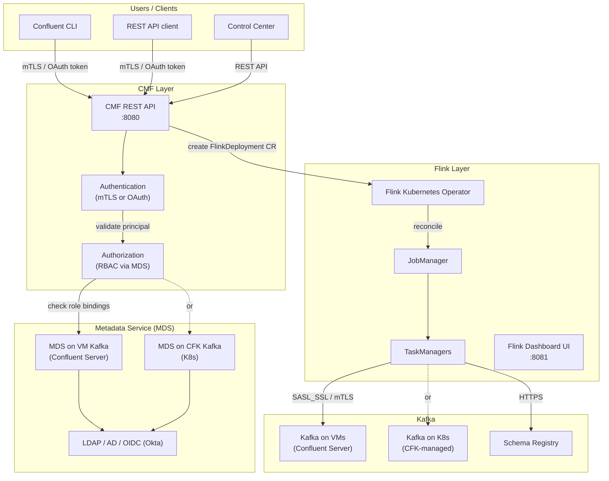
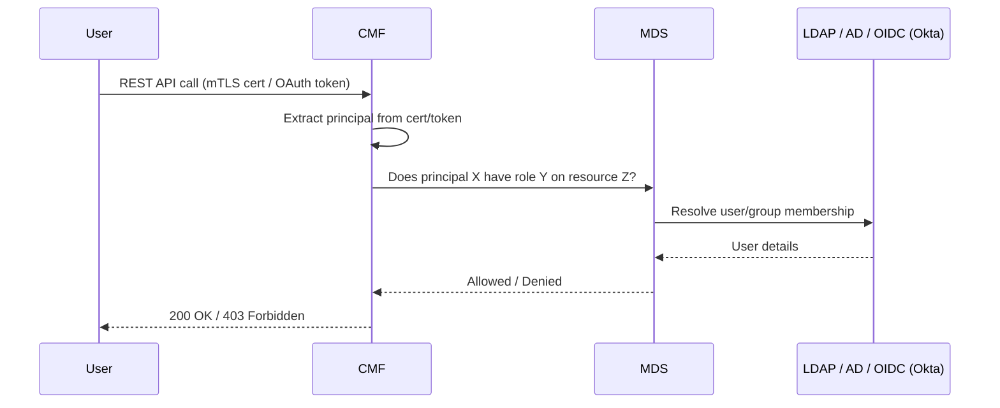
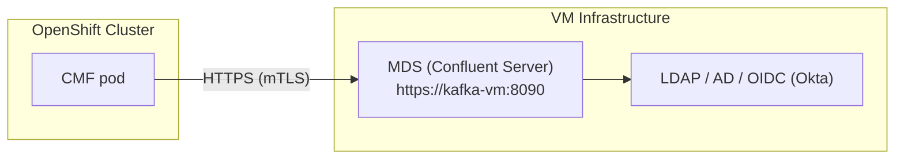
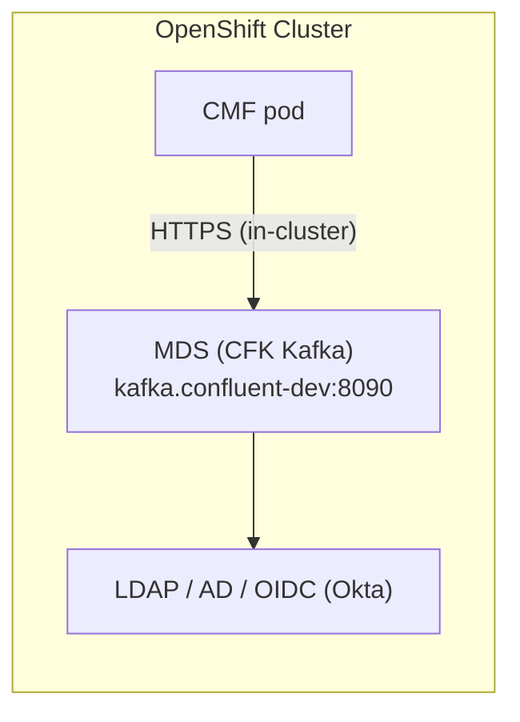
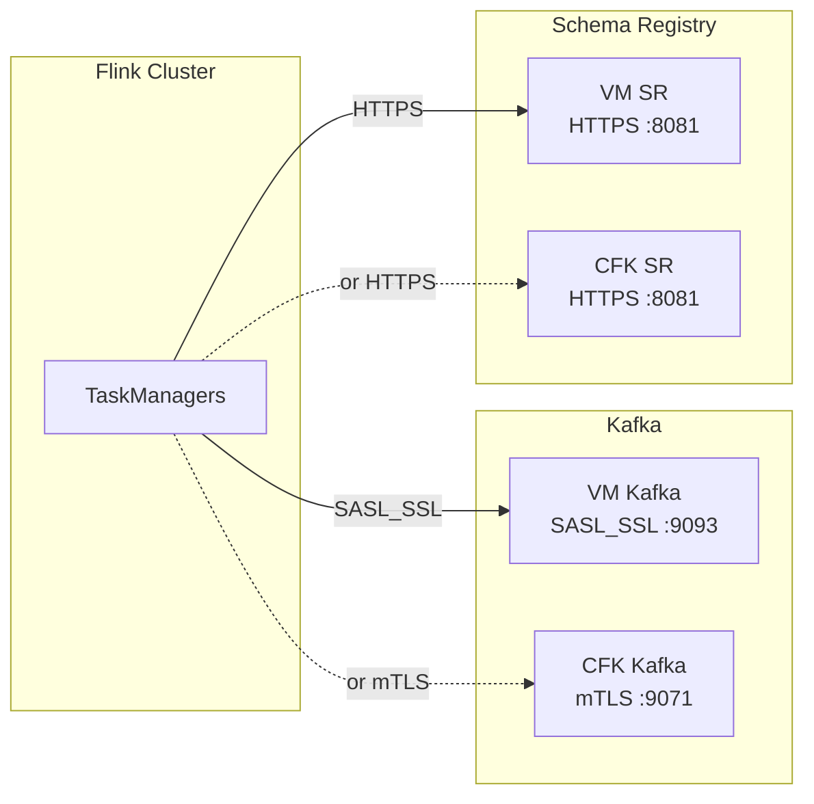
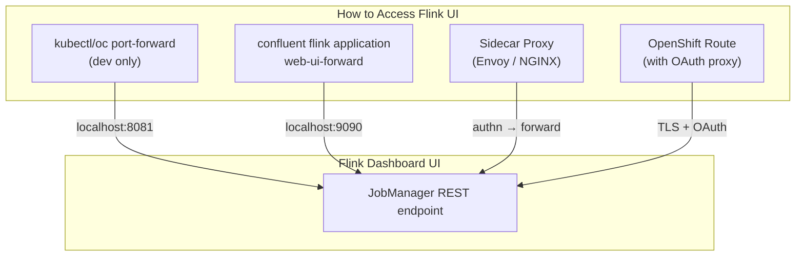

# Security Architecture — CMF, Flink, and Confluent Platform

Security layers for Confluent Manager for Apache Flink (CMF), Flink workloads, and their integration with Confluent Platform's Metadata Service (MDS) for RBAC.

**References:**
- [CMF Authentication](https://docs.confluent.io/platform/current/flink/installation/authentication.html)
- [CMF Authorization](https://docs.confluent.io/platform/current/flink/installation/authorization.html)
- [CMF Encryption](https://docs.confluent.io/platform/current/flink/installation/encryption.html)
- [Flink Job Security](https://docs.confluent.io/platform/current/flink/flink-jobs/security.html)
- [CMF Concepts](https://docs.confluent.io/platform/current/flink/concepts/cmf.html)

---

## Security Overview



---

## 1. CMF Authentication

CMF supports OAuth bearer token authentication for its REST API. **By default, authentication is disabled** — it must be explicitly enabled for production.

### OAuth (Bearer Token)

Clients authenticate with OAuth bearer tokens validated against a JWKS endpoint. Available since CP 7.9.

> **Limitation:** OAuth works only with the REST API — it is NOT available with the Confluent CLI or CFK operator.

```yaml
# CMF Helm values — OAuth authentication
cmf:
  authentication:
    type: oauth
    publicKeyUri: https://<idp>/.well-known/jwks.json
    expectedIssuer: https://<idp>
    expectedAudience: confluent
```

### Three SSL Contexts

CMF maintains independent SSL configurations:

| Context | Purpose | Config Prefix |
|---------|---------|---------------|
| **Server HTTPS** | Encrypt client → CMF traffic | `cmf.ssl.*` |
| **MDS connection** | CMF → MDS communication | `confluent.metadata.ssl.*` |
| **Client auth** | Extract client principal | `cmf.authentication.*` |

---

## 2. CMF Authorization (RBAC via MDS)

CMF enforces **Role-Based Access Control** by calling the Confluent **Metadata Service (MDS)** to validate whether the authenticated principal has permission to perform the requested action.



### CMF Service Principal

CMF itself needs a service principal with one of these roles:
- **SystemAdmin** — full access (broadest)
- **UserAdmin** — manage users and role bindings
- **SecurityAdmin** — manage security configurations (least privilege)

### Role Bindings

Create role bindings per environment using the Confluent CLI:

```bash
# Grant a user access to a Flink environment
confluent iam rbac role-binding create \
  --principal User:alice \
  --role FlinkDeveloper \
  --cmf <cmf-id> \
  --flink-environment <environment-name>
```

### CMF Authorization Helm Values

```yaml
# CMF Helm values — RBAC authorization
cmf:
  authorization:
    enabled: true
confluent:
  metadata:
    bootstrapServerUrls: https://<mds-kafka>:8090
    ssl:
      trustStorePath: /certs/mds-truststore.jks
      trustStorePassword: ${MDS_TRUSTSTORE_PASSWORD}
```

---

## 3. MDS Integration — VM Kafka vs CFK Kafka

CMF connects to MDS for authorization. MDS runs as part of Confluent Server (the Kafka broker with RBAC enabled). The integration differs depending on where Kafka runs.

### Scenario A: MDS on VM-based Confluent Platform (Phase-I / Phase-III)



**Configuration:**

```yaml
# CMF Helm values — MDS on VMs
confluent:
  metadata:
    bootstrapServerUrls: https://kafka-vm-1.example.com:8090
    ssl:
      trustStorePath: /certs/vm-kafka-truststore.jks
      trustStorePassword: ${MDS_TRUSTSTORE_PASSWORD}
    # For mTLS auth to MDS:
    authentication:
      type: mtls
      keyStorePath: /certs/cmf-mds-keystore.jks
      keyStorePassword: ${CMF_MDS_KEYSTORE_PASSWORD}
```

**Requirements:**
- CMF pods must have network connectivity to VM Kafka's MDS port (8090)
- TLS certificates: CMF needs the VM Kafka CA in its truststore
- If using mTLS: VM Kafka needs CMF's CA in its truststore
- MDS must be enabled on VM Kafka brokers (`confluent.metadata.server.listeners`)

### Scenario B: MDS on CFK-managed Kafka (Phase-II PoC / Phase-III)



**Configuration:**

```yaml
# CMF Helm values — MDS on CFK Kafka (in-cluster)
confluent:
  metadata:
    bootstrapServerUrls: https://kafka.confluent-dev.svc.cluster.local:8090
    ssl:
      trustStorePath: /certs/kafka-truststore.jks
      trustStorePassword: ${MDS_TRUSTSTORE_PASSWORD}
```

**Requirements:**
- CFK Kafka must have MDS enabled (`spec.authorization.type: rbac` in Kafka CR)
- LDAP/AD and/or OIDC (Okta) must be reachable from the cluster for user resolution
- CFK auto-generates TLS certs via cert-manager — mount the CA into CMF's truststore

### Comparison

| | VM Kafka MDS | CFK Kafka MDS |
|---|---|---|
| **MDS endpoint** | `https://kafka-vm:8090` | `https://kafka.confluent-dev.svc:8090` |
| **Network** | Cross-network (K8s → VM) | In-cluster (same namespace) |
| **TLS certs** | Manual — import VM CA into CMF truststore | Auto — cert-manager generates, CFK mounts |
| **IAM (LDAP / OIDC)** | Kafka VMs connect to LDAP/OIDC directly | K8s pods need LDAP/OIDC network access |
| **Our Phase-I/II** | Planned (CP on VMs) | PoC only (local Kafka, no RBAC yet) |

---

## 4. Flink Job Security — Connecting to Kafka

Flink TaskManagers connect to Kafka to consume/produce data. These connections must be secured independently of CMF.



**Kafka credentials** are stored as CMF **Secrets** (encrypted with AES-256-GCM) and injected into Flink jobs at submission time. Users do not pass credentials directly — CMF manages them.

> **Important:** Users who can deploy Flink jobs can execute arbitrary code. Never expose unsecured Flink clusters to untrusted networks.

### Kubernetes RBAC for Flink Operator

The Flink Kubernetes Operator creates two K8s roles:

| Role | Service Account | Permissions |
|------|----------------|-------------|
| `flink-operator` | `flink-operator` | Manages FlinkDeployment CRs, creates JM/TM pods |
| `flink` | `flink` | Used by JobManager to manage TaskManagers |

Access to Flink resources should flow through CMF, not directly via `kubectl`/`oc`.

---

## 5. Flink Dashboard UI Access

The Flink Dashboard UI exposes job status, metrics, and logs. **It has no built-in authentication** — securing it is the operator's responsibility.

### Access Methods



### Option 1: Port-Forward (Dev/Debug Only)

```bash
# Direct port-forward
oc port-forward svc/flink-session-rest 8081:8081 -n confluent-dev

# Via Confluent CLI (supports client cert auth)
confluent flink application web-ui-forward my-app \
  --environment flink-env1 \
  --port 9090 \
  --url https://cmf-service.confluent-dev:80
```

**Not for production** — no authentication, no audit trail.

### Option 2: Sidecar Proxy (Recommended for Production)

Confluent recommends binding the Flink REST endpoint to the loopback interface and deploying a **sidecar proxy** (Envoy or NGINX) that:
1. Terminates TLS
2. Authenticates the user (OAuth, mTLS, or basic auth)
3. Forwards authenticated requests to `localhost:8081`

```yaml
# FlinkDeployment — bind REST to loopback + sidecar
spec:
  flinkConfiguration:
    rest.bind-address: 127.0.0.1
  podTemplate:
    spec:
      containers:
        - name: envoy-proxy
          image: envoyproxy/envoy:v1.28
          ports:
            - containerPort: 8443
          # Envoy config: TLS termination + auth → forward to 127.0.0.1:8081
```

### Option 3: OpenShift Route with OAuth Proxy

For OpenShift, use an `oauth-proxy` sidecar that integrates with OpenShift's built-in OAuth server:

```bash
# Create a passthrough route to the auth proxy
oc create route passthrough flink-ui \
  --service=flink-session-rest --port=8443 -n confluent-dev
```

Users authenticate via OpenShift login before accessing the Flink UI.

### Summary

| Method | Auth | TLS | Audit | Use Case |
|--------|------|-----|-------|----------|
| Port-forward | None | No | No | Dev/debug |
| Confluent CLI `web-ui-forward` | Client cert (optional) | Optional | No | Dev with auth |
| Sidecar proxy (Envoy/NGINX) | OAuth / mTLS / Basic | Yes | Yes | Production |
| OpenShift Route + OAuth proxy | OpenShift OAuth | Yes | Yes | Production on OpenShift |

---

## 6. Data-at-Rest Encryption

CMF encrypts sensitive data (Kafka credentials, SR credentials) stored in its internal database using **AES-256-GCM**.

```bash
# Generate encryption key
openssl rand -out cmf.key 32

# Create K8s secret
oc create secret generic cmf-encryption-key \
  --from-file=encryption-key=cmf.key -n confluent-dev
```

```yaml
# CMF Helm values — encryption
encryption:
  key:
    kubernetesSecretName: cmf-encryption-key
    kubernetesSecretProperty: encryption-key
cmf:
  sql:
    production: true   # Required for encryption — cannot switch modes later
```

> **Warning:** The encryption key cannot be rotated once set. The same key must be used for the entire lifetime of the CMF database.

---

## 7. Current State and Next Steps

### What's deployed now (Phase-II PoC)

| Layer | Status |
|-------|--------|
| CMF authentication | **Disabled** (dev mode) |
| CMF authorization (RBAC) | **Disabled** (no MDS configured) |
| CMF encryption | **Disabled** (`cmf.sql.production: false`) |
| Flink UI | **Port-forward only** (no ingress, no auth) |
| Kafka auth | **Plaintext** (local PoC Kafka, no SASL/TLS) |
| OpenShift SCC | **Enabled** (custom `confluent-scc`) |
| K8s RBAC | **Enabled** (operator service accounts) |

### Production hardening checklist

- [ ] Enable CMF authentication (mTLS or OAuth)
- [ ] Configure MDS connection (VM Kafka or CFK Kafka)
- [ ] Enable CMF authorization (RBAC role bindings)
- [ ] Enable CMF encryption (`cmf.sql.production: true` + AES key)
- [ ] Secure Flink UI (sidecar proxy or OpenShift Route + OAuth)
- [ ] Configure Kafka SASL_SSL or mTLS for Flink job connections
- [ ] Configure Schema Registry HTTPS for Flink jobs
- [ ] Create CMF Secrets for Kafka/SR credentials
- [ ] Restrict `oc`/`kubectl` access — route all Flink operations through CMF
- [ ] Set up LDAP/AD and/or OIDC (Okta) integration for MDS user resolution
