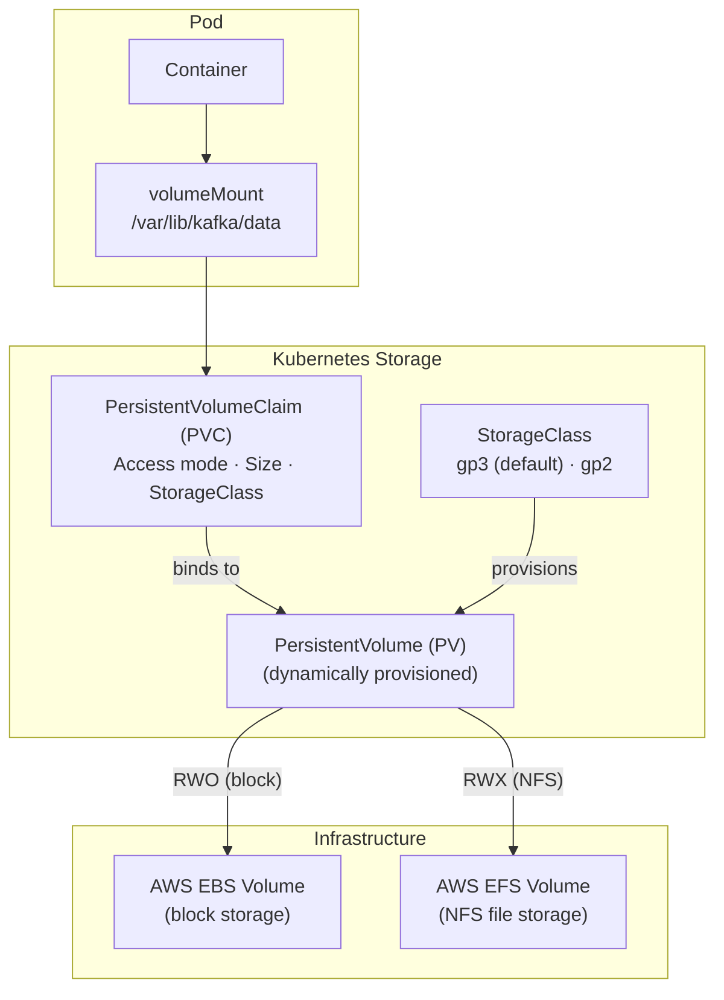
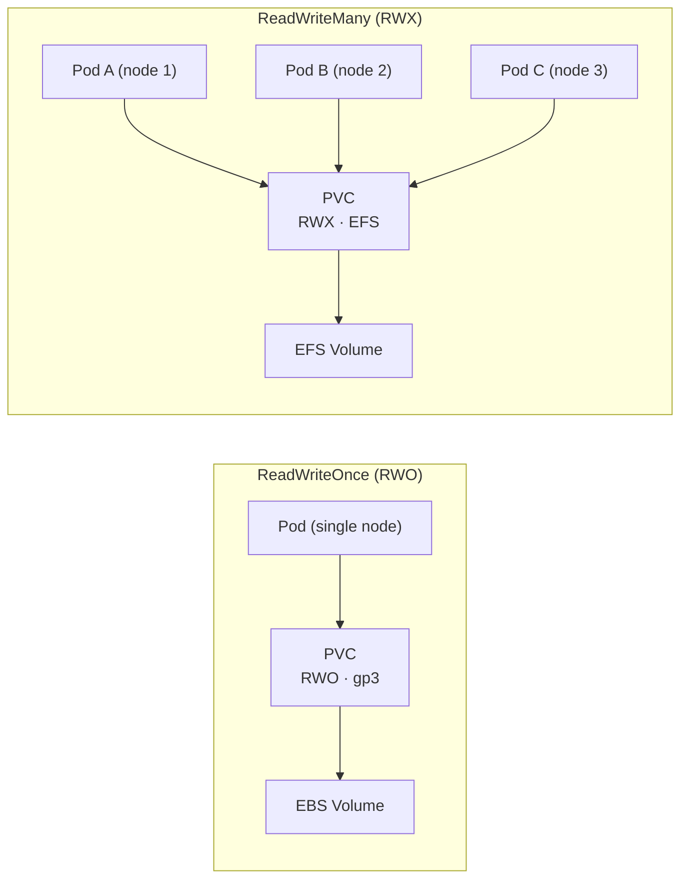
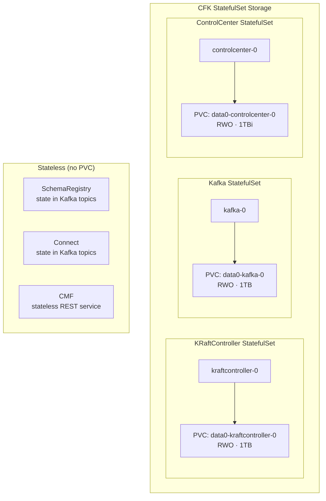
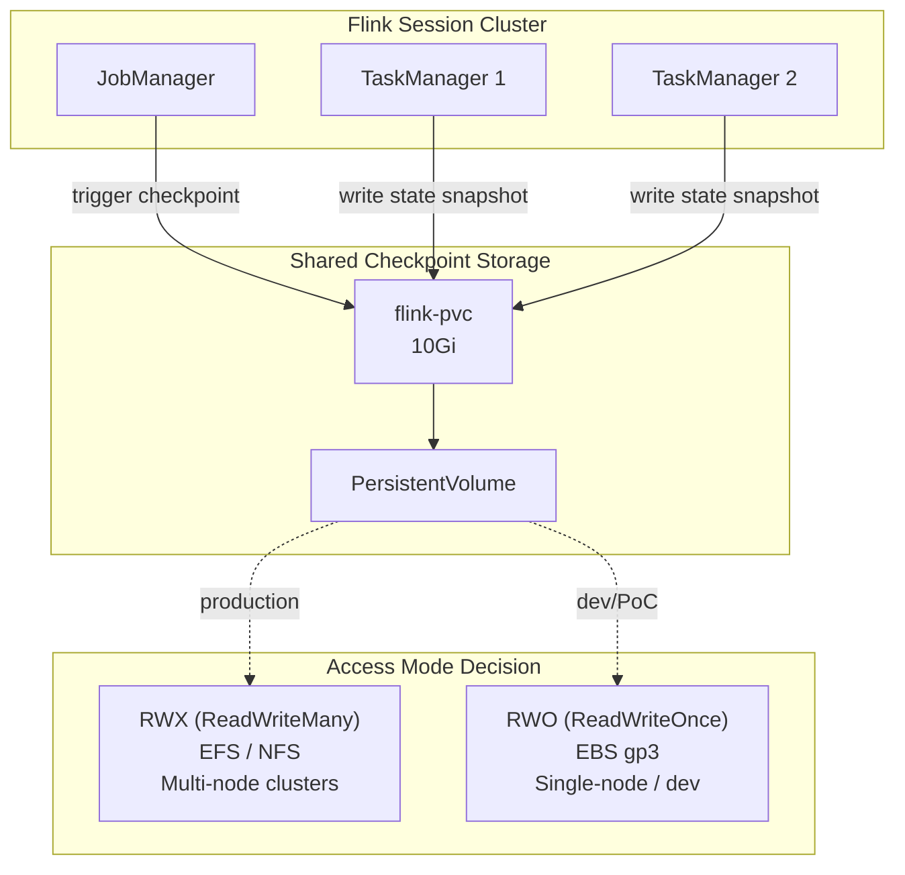

# Storage Architecture — CFK and Flink on OpenShift

How persistent storage works for Confluent Platform (CFK-managed) and Flink workloads, including the Kubernetes storage stack, access modes, and per-component requirements.

---

## Kubernetes Storage Stack



**How it works:**

1. A **Pod** declares a `volumeMount` pointing to a path inside the container
2. The volume references a **PVC** that requests storage with a specific access mode and size
3. The **StorageClass** dynamically provisions a **PV** backed by cloud storage
4. The PV binds to the PVC, and the pod mounts it

---

## Access Modes: RWO vs RWX



| Access Mode | Abbreviation | Backed By | Use Case |
|-------------|-------------|-----------|----------|
| **ReadWriteOnce** | RWO | AWS EBS (gp3/gp2) | Single pod reads/writes — block storage attached to one node |
| **ReadWriteMany** | RWX | AWS EFS (NFS) | Multiple pods on different nodes read/write simultaneously |

**Key rule:** EBS volumes (gp3/gp2) only support RWO — they physically attach to a single EC2 instance. For multi-pod shared storage, you need EFS (NFS-based), which supports RWX.

---

## Who Needs What

### CFK-Managed Components (Confluent Platform)

CFK uses **StatefulSets** for stateful components. Each pod gets its own dedicated PVC via `volumeClaimTemplates`. These are always **RWO** because each pod (broker, controller) has its own exclusive data.



| Component | Storage | Access Mode | Size | Why |
|-----------|---------|-------------|------|-----|
| **KRaftController** | PVC per pod | RWO | 1TB | KRaft consensus log, quorum state — exclusive to each controller |
| **Kafka** | PVC per pod | RWO | 1TB | Message logs, commit offsets — exclusive to each broker |
| **ControlCenter** | PVC per pod | RWO | 10Gi | Monitoring metrics, internal topics — single pod |
| **SchemaRegistry** | None | — | — | Stateless — schemas stored in Kafka `_schemas` topic |
| **Connect** | None | — | — | Stateless — configs/offsets/status stored in Kafka topics |
| **CMF** | None | — | — | Stateless REST service — state in Flink/Kafka/PostgreSQL |

**Why RWO for CFK?** Each Kafka broker and KRaft controller owns its data exclusively. No two pods ever need to read/write the same volume. CFK creates one PVC per pod replica via StatefulSet `volumeClaimTemplates`. This maps naturally to EBS block storage.

---

### Flink Components

Flink uses a **shared PVC** for checkpoints and savepoints — state snapshots that enable job recovery and exactly-once processing.



| Scenario | Access Mode | Storage | Why |
|----------|-------------|---------|-----|
| **Production** (multi-node) | **RWX** | AWS EFS | JM and TMs run on different nodes — all must read/write checkpoints |
| **Dev/PoC** (single-node) | **RWO** | AWS EBS (gp3) | Single replica, everything on one node — EBS is simpler and cheaper |

**Why Flink needs shared storage:**

1. **Checkpointing:** TaskManagers periodically snapshot their state to a shared location. The JobManager coordinates these snapshots. If a TaskManager fails, the replacement reads the checkpoint to resume processing.
2. **Savepoints:** Manual snapshots for job upgrades, scaling, or migration. Both JM and TMs need access.
3. **Multi-pod access:** In production, JM and TMs run on different nodes. All pods must read/write the same checkpoint directory — this requires RWX (EFS/NFS).

---

## Current Configuration

### Base manifests

| File | Access Mode | Size |
|------|-------------|------|
| `apps/confluent-flink/base/flink-pvc.yaml` | ReadWriteMany | 10Gi |

### Per-environment overlays

All environments currently patch to **RWO** for single-replica dev/PoC:

| Environment | Overlay | Access Mode | Why |
|-------------|---------|-------------|-----|
| dev | `apps/confluent-flink/dev/kustomization.yaml` | ReadWriteOnce | Single replica, one node |
| qa | `apps/confluent-flink/qa/kustomization.yaml` | ReadWriteOnce | Single replica |
| stg | `apps/confluent-flink/stg/kustomization.yaml` | ReadWriteOnce | Single replica |
| prd | `apps/confluent-flink/prd/kustomization.yaml` | ReadWriteOnce | Single replica |

> **Production note:** When scaling to multi-node Flink clusters, change the prd overlay back to `ReadWriteMany` and provision an EFS StorageClass. The base manifest already defaults to RWX.

---

## Storage Classes on OpenShift (ROSA)

| StorageClass | Provisioner | Binding Mode | Access Modes | Use Case |
|-------------|------------|-------------|-------------|----------|
| **gp3** (default) | `ebs.csi.aws.com` | WaitForFirstConsumer | RWO | Kafka, KRaft, C3, Flink (dev) |
| **gp2** | `kubernetes.io/aws-ebs` | WaitForFirstConsumer | RWO | Legacy EBS |
| **efs** (if provisioned) | `efs.csi.aws.com` | Immediate | RWO, RWX | Flink checkpoints (production) |

> **WaitForFirstConsumer:** PVC stays `Pending` until a pod actually mounts it. This ensures the EBS volume is created in the same availability zone as the pod's node.

---

## OpenShift SCC Volume Constraints

The custom `confluent-scc` allows these volume types:

```yaml
volumes:
  - configMap
  - downwardAPI
  - emptyDir
  - persistentVolumeClaim    # PVCs allowed
  - projected
  - secret
```

`hostPath` volumes are **not allowed** — all persistent data must go through PVCs.
