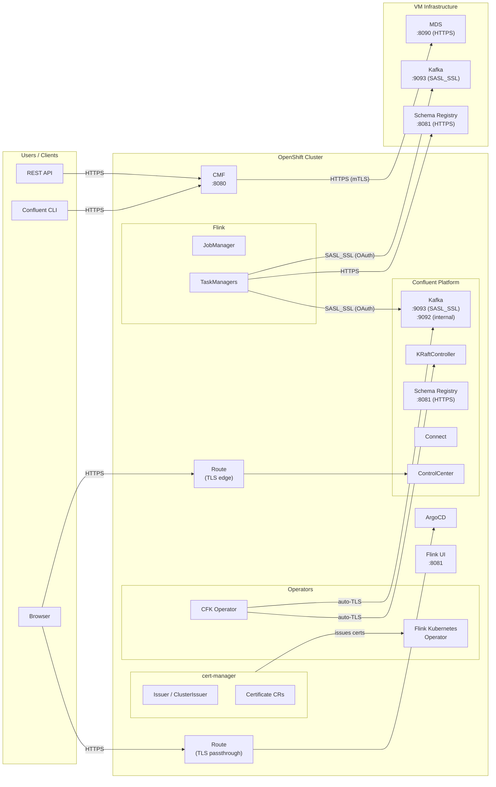
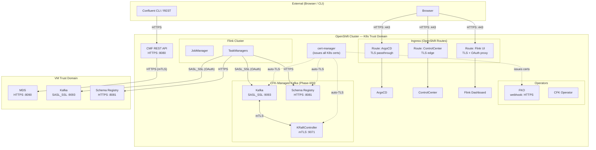
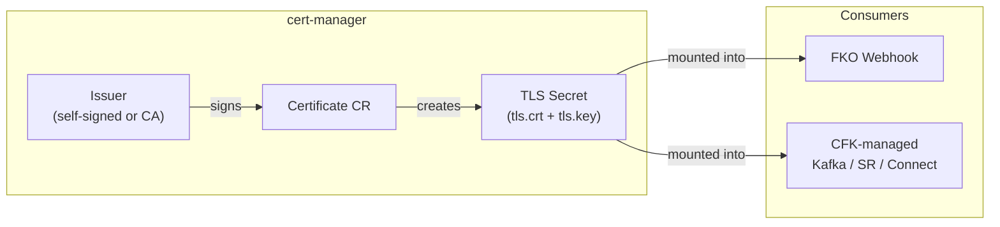
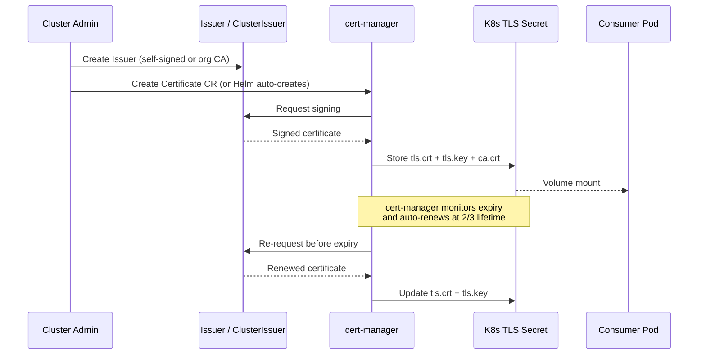
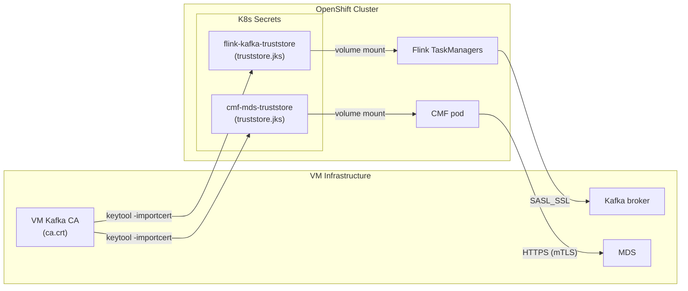
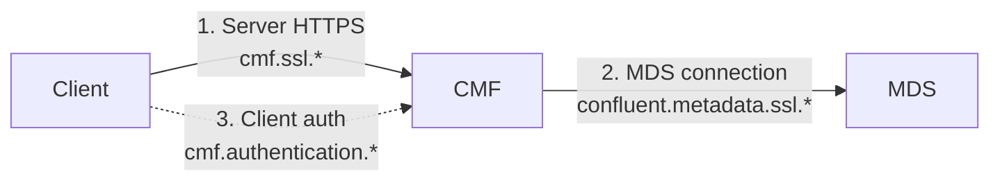
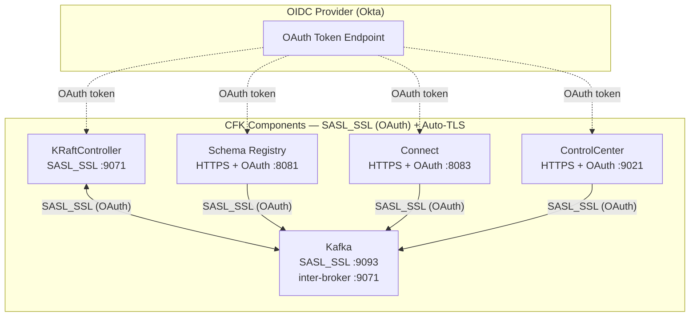
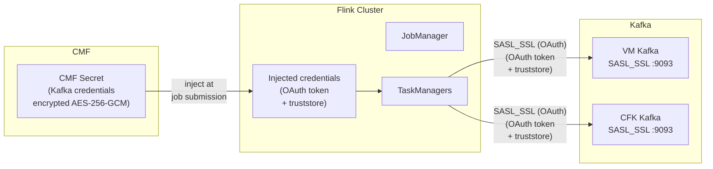
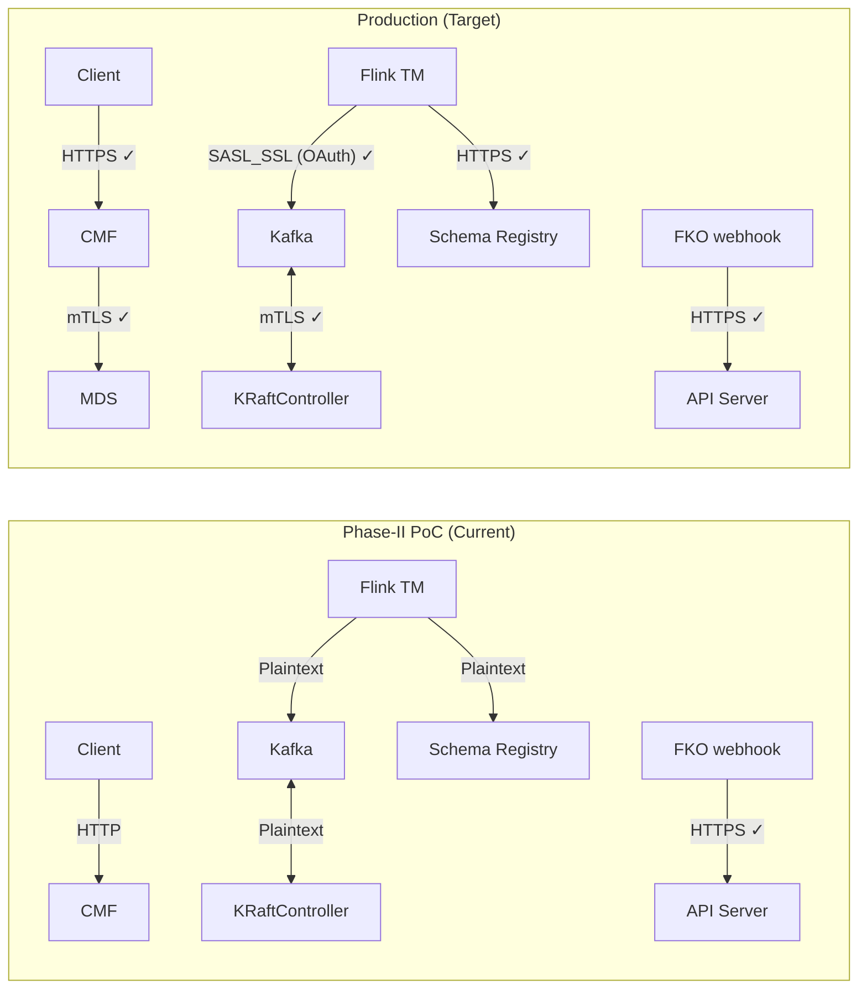

# TLS Architecture — Transport Layer Security

How TLS secures communication between all components in the Confluent + Flink deployment on OpenShift.

**References:**
- [CMF Encryption](https://docs.confluent.io/platform/current/flink/installation/encryption.html)
- [CMF Authentication](https://docs.confluent.io/platform/current/flink/installation/authentication.html)
- [CFK TLS Configuration](https://docs.confluent.io/operator/current/co-network-encryption.html)
- [Flink Job Security](https://docs.confluent.io/platform/current/flink/flink-jobs/security.html)

---

## TLS Overview



---

## TLS Connections — All Communication Paths

Every connection between components should be encrypted with TLS in production. The diagram below shows the three trust domains and the TLS protocol used on each path.



### Connection Inventory

| # | Source | Destination | Protocol | Port | Certificate Provider | Phase |
|---|--------|-------------|----------|------|---------------------|-------|
| 1 | **Client** | **CMF REST API** | HTTPS | 8080 | Manual (JKS keystore) or cert-manager | Phase-II |
| 2 | **CMF** | **MDS (VM Kafka)** | HTTPS (mTLS) | 8090 | Manual — import VM Kafka CA into CMF truststore | Phase-I / III |
| 3 | **CMF** | **MDS (CFK Kafka)** | HTTPS | 8090 | CFK auto-generates via cert-manager | Phase-II / III |
| 4 | **Flink TM** | **Kafka (VMs)** | SASL_SSL (OAuth) | 9093 | Manual — Kafka broker CA in Flink truststore + OAuth token | Phase-I |
| 5 | **Flink TM** | **Kafka (CFK)** | SASL_SSL (OAuth) | 9093 | CFK auto-TLS + OAuth token from OIDC (Okta) | Phase-II / III |
| 6 | **Flink TM** | **Schema Registry** | HTTPS | 8081 | CFK auto-generates or manual | Phase-I / II |
| 7 | **Browser** | **ArgoCD UI** | HTTPS | 443 | OpenShift Route (TLS passthrough) | Phase-I |
| 8 | **Browser** | **Control Center** | HTTPS | 443 | OpenShift Route (TLS edge) | Phase-II |
| 9 | **Browser** | **Flink Dashboard** | HTTPS | 8443 | Sidecar proxy (Envoy/NGINX) or OAuth proxy | Phase-II |
| 10 | **FKO webhooks** | **API Server** | HTTPS | 443 | cert-manager (auto-provisioned) | Phase-I |
| 11 | **Kafka** | **KRaftController** | mTLS | 9071 | CFK auto-generates via cert-manager | Phase-II / III |
| 12 | **Kafka** | **Schema Registry** | mTLS | 8081 | CFK auto-generates via cert-manager | Phase-II / III |

---

## Certificate Provisioning

### cert-manager (Automated)

cert-manager handles certificate lifecycle for operator webhooks and can be used for CFK-managed components.



### Certificate Lifecycle



**What cert-manager provisions today:**
- Flink Kubernetes Operator admission webhook certificates (automatic via Helm chart)

**What cert-manager can provision (when TLS is enabled):**
- CFK-managed component certificates (Kafka inter-broker, SR, Connect)
- CMF server certificate
- Custom Issuer/ClusterIssuer for organization CA integration

### CFK Auto-TLS (Automated)

When TLS is enabled on CFK-managed CRs, CFK automatically generates certificates using cert-manager:

```yaml
# Kafka CR — enable auto-TLS
apiVersion: platform.confluent.io/v1beta1
kind: Kafka
metadata:
  name: kafka
spec:
  tls:
    autoGeneratedCerts: true    # CFK creates Certificate CRs via cert-manager
  listeners:
    internal:
      tls:
        enabled: true
    external:
      tls:
        enabled: true
```

This creates:
- Server certificates for each broker
- Inter-broker mTLS certificates
- CA certificate stored in a Kubernetes Secret
- Automatic rotation before expiry

### Manual Certificates (VM Integration)

For connections to VM-based Confluent Platform (Phase-I), certificates are managed manually. The VM CA must be imported into truststores on the K8s side.



```bash
# Import VM Kafka CA into a truststore for CMF
keytool -importcert -alias kafka-vm-ca \
  -file /path/to/vm-kafka-ca.crt \
  -keystore cmf-truststore.jks \
  -storepass "${TRUSTSTORE_PASSWORD}" -noprompt

# Create K8s Secret from truststore
oc create secret generic cmf-mds-truststore \
  --from-file=truststore.jks=cmf-truststore.jks \
  -n confluent-dev
```

For Flink jobs connecting to VM Kafka:

```bash
# Import VM Kafka CA for Flink TaskManagers
oc create secret generic flink-kafka-truststore \
  --from-file=truststore.jks=flink-truststore.jks \
  -n confluent-dev
```

These secrets are referenced in CMF Helm values and Flink job configurations respectively.

---

## CMF SSL Contexts

CMF maintains three independent SSL configurations, each serving a different communication path:



| # | Context | Purpose | Helm Config Prefix | Certificates Needed |
|---|---------|---------|-------------------|-------------------|
| 1 | **Server HTTPS** | Encrypt client → CMF traffic | `cmf.ssl.*` | CMF server cert + key |
| 2 | **MDS connection** | CMF → MDS communication | `confluent.metadata.ssl.*` | MDS CA in truststore |
| 3 | **Client auth** | Extract client principal from cert | `cmf.authentication.*` | Client CA in truststore |

### CMF Server HTTPS Configuration

```yaml
# CMF Helm values — enable HTTPS on CMF REST API
cmf:
  ssl:
    keyStorePath: /certs/cmf-keystore.jks
    keyStorePassword: ${CMF_KEYSTORE_PASSWORD}
    trustStorePath: /certs/cmf-truststore.jks
    trustStorePassword: ${CMF_TRUSTSTORE_PASSWORD}
```

### CMF → MDS TLS Configuration

```yaml
# CMF Helm values — TLS to MDS (VM Kafka)
confluent:
  metadata:
    bootstrapServerUrls: https://kafka-vm.example.com:8090
    ssl:
      trustStorePath: /certs/mds-truststore.jks
      trustStorePassword: ${MDS_TRUSTSTORE_PASSWORD}
```

---

## CFK-Managed Component TLS + OAuth

CFK components use **SASL_SSL with OAuth (OAUTHBEARER)** for authentication and **TLS** for encryption. Each component authenticates to Kafka using an OAuth token obtained from the OIDC provider (Okta).



### Enable TLS + OAuth on All CFK Components

```yaml
# Kafka — SASL_SSL listener with OAUTHBEARER
spec:
  tls:
    autoGeneratedCerts: true
  listeners:
    internal:
      tls:
        enabled: true
      authentication:
        type: oauthbearer
        oauthbearer:
          jwksEndpointUri: https://<okta-domain>/oauth2/default/v1/keys
          expectedIssuer: https://<okta-domain>/oauth2/default
          expectedAudience: confluent

# SchemaRegistry — OAuth to Kafka
spec:
  tls:
    autoGeneratedCerts: true
  dependencies:
    kafka:
      authentication:
        type: oauthbearer
        oauthbearer:
          tokenEndpointUri: https://<okta-domain>/oauth2/default/v1/token
          clientId: ${SR_OAUTH_CLIENT_ID}
          clientSecret: ${SR_OAUTH_CLIENT_SECRET}

# Connect — OAuth to Kafka
spec:
  tls:
    autoGeneratedCerts: true
  dependencies:
    kafka:
      authentication:
        type: oauthbearer
        oauthbearer:
          tokenEndpointUri: https://<okta-domain>/oauth2/default/v1/token
          clientId: ${CONNECT_OAUTH_CLIENT_ID}
          clientSecret: ${CONNECT_OAUTH_CLIENT_SECRET}

# ControlCenter — OAuth to Kafka
spec:
  tls:
    autoGeneratedCerts: true
  dependencies:
    kafka:
      authentication:
        type: oauthbearer
        oauthbearer:
          tokenEndpointUri: https://<okta-domain>/oauth2/default/v1/token
          clientId: ${C3_OAUTH_CLIENT_ID}
          clientSecret: ${C3_OAUTH_CLIENT_SECRET}
```

---

## Flink Job TLS — Connecting to Kafka

Flink TaskManagers need TLS credentials to connect to Kafka. These credentials are stored as **CMF Secrets** and injected into Flink jobs at submission time.



### Connecting to Kafka (SASL_SSL with OAuth)

Both VM Kafka and CFK Kafka use **SASL_SSL with OAuth (OAUTHBEARER)** for Flink job authentication. Flink TaskManagers obtain an OAuth token from the OIDC provider (Okta) and present it to Kafka.

```properties
# Flink job properties — SASL_SSL with OAuth
security.protocol=SASL_SSL
sasl.mechanism=OAUTHBEARER
sasl.jaas.config=org.apache.kafka.common.security.oauthbearer.OAuthBearerLoginModule required \
  clientId="${OAUTH_CLIENT_ID}" \
  clientSecret="${OAUTH_CLIENT_SECRET}" \
  scope="kafka" ;
sasl.login.callback.handler.class=org.apache.kafka.common.security.oauthbearer.secured.OAuthBearerLoginCallbackHandler
sasl.oauthbearer.token.endpoint.url=https://<okta-domain>/oauth2/default/v1/token
ssl.truststore.location=/certs/truststore.jks
ssl.truststore.password=${TRUSTSTORE_PASSWORD}
```

### Connecting to Schema Registry (HTTPS with OAuth)

```properties
# Flink job properties — Schema Registry with OAuth
schema.registry.url=https://<schema-registry>:8081
schema.registry.ssl.truststore.location=/certs/truststore.jks
schema.registry.ssl.truststore.password=${TRUSTSTORE_PASSWORD}
basic.auth.credentials.source=OAUTHBEARER
bearer.auth.token=${OAUTH_TOKEN}
```

---

## Current State and TLS Hardening Checklist

### PoC vs Production TLS



### What's deployed now (Phase-II PoC)

| Connection | TLS Status |
|------------|-----------|
| Client → CMF | **Plaintext HTTP** (auth disabled) |
| CMF → MDS | **Not configured** (no MDS) |
| Flink → Kafka | **Plaintext** (local PoC Kafka) |
| Flink → Schema Registry | **Plaintext** |
| ArgoCD UI | **HTTPS** (OpenShift Route, TLS passthrough) |
| FKO webhooks | **HTTPS** (cert-manager auto-provisioned) |
| Kafka inter-broker | **Plaintext** (PoC) |
| Flink Dashboard UI | **No TLS** (port-forward only) |

### Production TLS checklist

- [ ] Enable CMF server HTTPS (`cmf.ssl.*` keystore/truststore)
- [ ] Configure CMF → MDS TLS (`confluent.metadata.ssl.*` truststore with VM Kafka CA)
- [ ] Enable CFK auto-TLS on Kafka (`spec.tls.autoGeneratedCerts: true`)
- [ ] Enable CFK auto-TLS on SchemaRegistry, Connect, ControlCenter
- [ ] Create CMF Secrets with OAuth credentials (client ID/secret) for Flink jobs
- [ ] Configure OAUTHBEARER SASL mechanism on Kafka listeners
- [ ] Import VM Kafka CA into Flink truststore Secret
- [ ] Configure Okta OIDC application for Flink service accounts
- [ ] Secure Flink Dashboard UI with sidecar proxy (TLS termination)
- [ ] Create OpenShift Route for Control Center with TLS edge termination
- [ ] Verify cert-manager Issuer/ClusterIssuer is configured for organization CA (not self-signed)
- [ ] Set certificate rotation policy (cert-manager default: renew at 2/3 of lifetime)
- [ ] Disable plaintext listeners on Kafka once all clients are migrated to TLS
