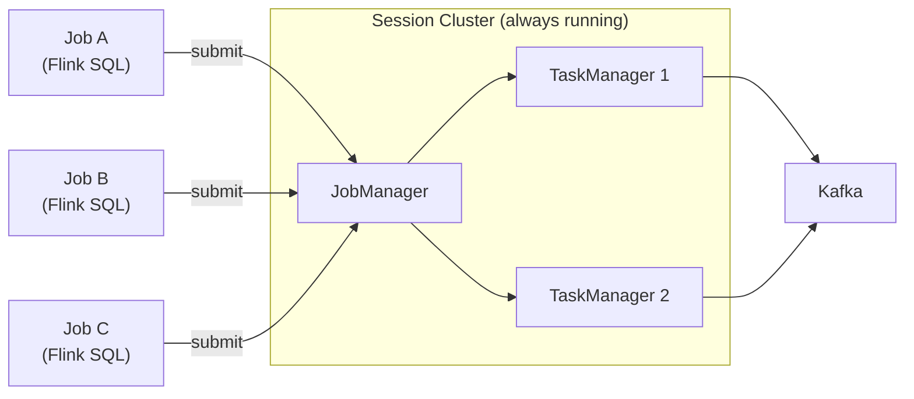
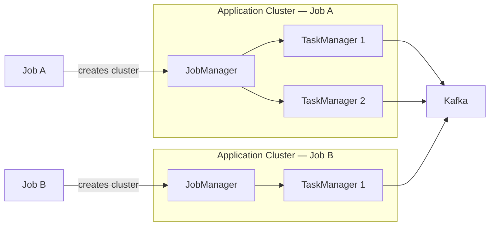

# Flink Cluster Modes — Session vs Application

## Session Cluster

A long-running Flink cluster that sits idle and waits for jobs to be submitted. Multiple jobs share the same JobManager and TaskManagers.

- One `FlinkDeployment` CR with `mode: session`
- CMF submits jobs to the shared cluster via REST API
- Jobs share TaskManager slots — risk of noisy neighbor
- Cluster stays running even when no jobs are active

---

## Application Cluster

A dedicated Flink cluster spun up for a single job. The cluster is created when the job starts and torn down when it finishes.

- One `FlinkDeployment` CR per job with `mode: application`
- Each job gets its own isolated JM + TMs
- Cluster is provisioned on submit and destroyed on completion
- No resource contention between jobs

---

## Comparison

| | Session Cluster | Application Cluster |
|---|---|---|
| **Lifecycle** | Always running, shared by many jobs | Spun up per job, dies when job finishes |
| **Use case** | Interactive SQL, short-lived jobs, dev/PoC | Production long-running jobs |
| **Resource sharing** | Jobs share JM/TM — risk of noisy neighbor | Isolated resources per job |
| **Startup time** | Instant (cluster already running) | Slower (provisions JM/TM per job) |
| **Fault isolation** | One bad job can affect others | Full isolation per job |
| **Cost** | Lower — shared infrastructure | Higher — dedicated resources per job |

---

## What we use

- **Dev/PoC (Phase-II):** Session cluster (`apps/confluent-flink/base/flink-session-cluster.yaml`) — fast iteration, low overhead
- **Production (Phase-III):** Application mode recommended — job isolation, independent scaling, fault containment
