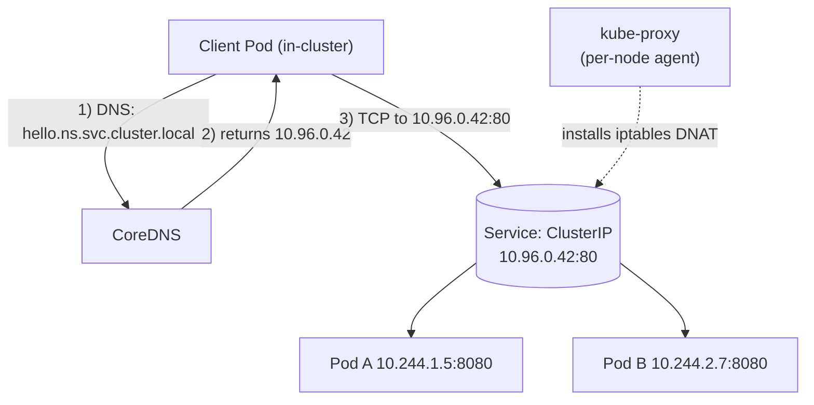
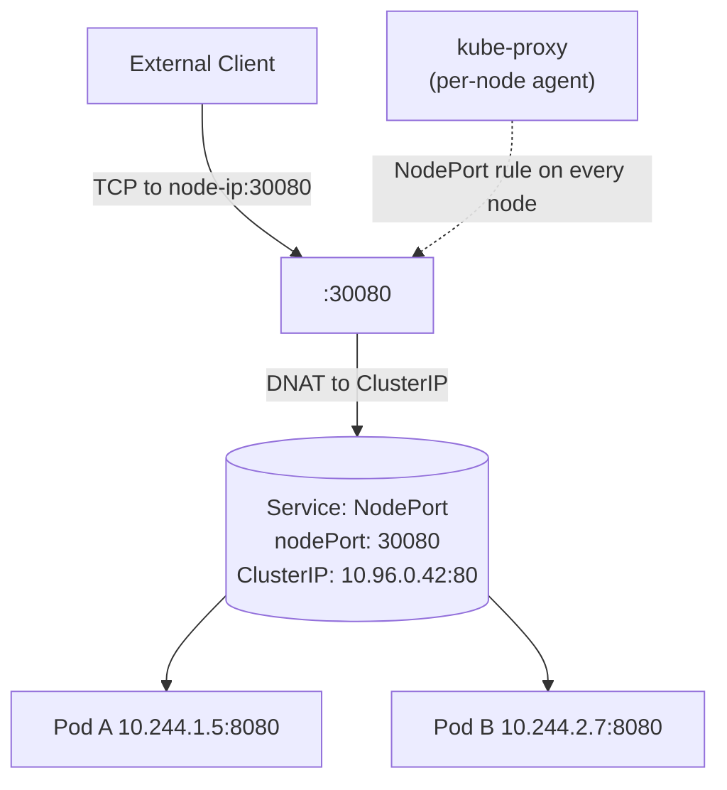
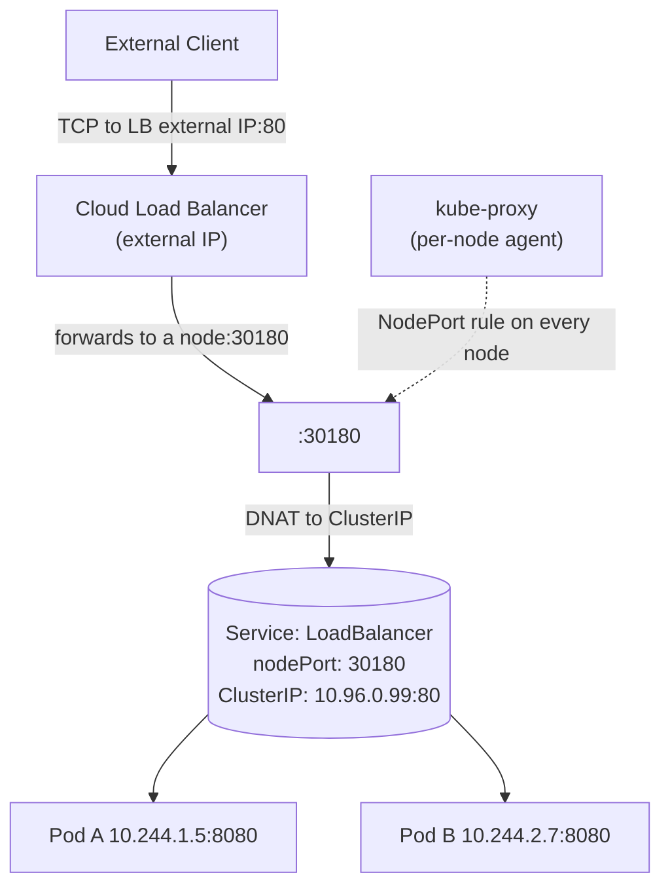

# Wednesday — Services + Routes (Traffic Flow)

**Time**: ~90 min
**Diagram**: [`10-services-routes-traffic-flow.drawio`](10-services-routes-traffic-flow.drawio) — client → HAProxy ingress → Route → Service → Endpoint → Pod

## Learning objective

> **Trace a single HTTP request from an external user's browser to the Pod that answers it.** Name every K8s object the packet passes through, and what happens at each.

## Architecture Discussion (~40 min)

Services and Routes are the two K8s networking objects engineers misuse most often. Cover, in order:

- **Pod IP** — every Pod gets one, from the CNI overlay. **Useless to clients**: ephemeral, changes on every restart, not externally reachable.

- **Service (ClusterIP)** — a stable virtual IP + DNS name (`my-svc.namespace.svc.cluster.local`) that load-balances to all Pods matching its `selector`. The matching happens via an **EndpointSlice** object that the EndpointSlice controller keeps in sync with the Pods. `kube-proxy` watches EndpointSlices and writes iptables rules so traffic to the ClusterIP gets DNAT'd to a backing Pod IP.

- **Service (NodePort / LoadBalancer)** — same backing model as ClusterIP, just adds external exposure:
  - NodePort opens a port on every node — **PROHIBITED in production by admission control**
  - LoadBalancer asks the cloud provider for an external LB — not whin production uses for OpenShift apps

- **OpenShift Route** — the standard OpenShift way to expose a Service externally. Routes carry a hostname (`my-app.apps.dv-p.ocp.example.com`) and live on HAProxy ingress routers. Three TLS modes:
  - `edge` — HAProxy terminates TLS; backend is plain HTTP (Service must be ClusterIP, port matches a HTTP backend)
  - `passthrough` — HAProxy doesn't terminate; backend must speak TLS itself; SNI-based routing
  - `reencrypt` — HAProxy terminates TLS, then re-encrypts to the backend with a different cert. **This is whin production uses for everything** (Pod-side TLS via cert-manager + Keyfactor; HAProxy-side TLS via the Ingress Certificate).

- **Kubernetes Ingress (`networking.k8s.io/v1`)** — the cloud-portable version of Route. OpenShift translates Ingress objects into Routes under the hood. You can declare Ingress YAML and OpenShift creates the matching Route automatically (this is what the platform's apps do — `apps/confluent-platform/<env>/ingress/*.yaml` is Ingress YAML, becomes Routes inside the cluster).

## Service Types — Side-by-Side

The bullets above gave you the conceptual difference. Concrete artifacts to anchor the mental model:

### Sample manifests

```yaml
# ClusterIP — the default. Cluster-internal only.
# Reachable as: hello.<namespace>.svc.cluster.local
apiVersion: v1
kind: Service
metadata:
  name: hello
spec:
  type: ClusterIP            # default; can be omitted
  selector:
    app: hello
  ports:
  - port: 80                 # the ClusterIP port
    targetPort: 8080         # the Pod's containerPort
---
# NodePort — opens a fixed port (30000-32767) on EVERY node.
# Reachable as: <any-node-ip>:30080
# PROHIBITED in FCB production by admission control.
apiVersion: v1
kind: Service
metadata:
  name: hello-nodeport
spec:
  type: NodePort
  selector:
    app: hello
  ports:
  - port: 80                 # cluster-internal ClusterIP still exists
    targetPort: 8080
    nodePort: 30080          # if omitted, the API server picks one
---
# LoadBalancer — provisions an external LB via the cloud provider.
# Allocates a NodePort under the hood (visible in .spec.ports[].nodePort).
# Reachable as: <external-lb-ip>:80
apiVersion: v1
kind: Service
metadata:
  name: hello-lb
spec:
  type: LoadBalancer
  selector:
    app: hello
  ports:
  - port: 80
    targetPort: 8080
```

### Traffic flow (Mermaid)

**ClusterIP** — in-cluster traffic only. CoreDNS resolves the Service DNS name; kube-proxy installs the iptables DNAT rules on every node so packets to the ClusterIP land on a backing Pod.



**NodePort** — external client hits any node's IP on the chosen port; kube-proxy's NodePort iptables rule on that node DNATs the packet onto the underlying ClusterIP.



**LoadBalancer** — adds a cloud-provisioned external LB in front of NodePort. The LB picks a node and forwards to its NodePort; from there it's the NodePort flow.



### CFK mapping — abridged Kafka + KRaftController

The CFK operator translates two domain-specific CRs into the **StatefulSet + Service + ConfigMap + Secret** primitives from this week's lessons. Abridged snippet, with `# generates:` comments showing the K8s objects the operator creates from each CR:

```yaml
# CFK Kafka CR (abridged)
apiVersion: platform.confluent.io/v1beta1
kind: Kafka
metadata:
  name: kafka
  namespace: dah-flink-dev
spec:
  replicas: 3
  image:
    application: confluentinc/cp-server:7.7.0
  dataVolumeCapacity: 100Gi
  dependencies:
    kRaftController:
      clusterRef:
        name: kraftcontroller
  listeners:
    internal:
      authentication: { type: mtls }
      tls: { enabled: true }
# CFK generates:
#   StatefulSet  kafka                              3 broker Pods (kafka-0, kafka-1, kafka-2)
#   Service      kafka                              headless (ClusterIP: None) — per-Pod DNS
#   Service      kafka-0-internal, -1-, -2-internal one ClusterIP per broker (stable per-broker addr)
#   Service      kafka-bootstrap                    ClusterIP fronting the cluster for bootstrap
#   ConfigMap    kafka                              rendered server.properties
#   Secret       kafka-*-tls                        broker certs (issued by cert-manager)

---
# CFK KRaftController CR (abridged)
apiVersion: platform.confluent.io/v1beta1
kind: KRaftController
metadata:
  name: kraftcontroller
  namespace: dah-flink-dev
spec:
  replicas: 3
  image:
    application: confluentinc/cp-server:7.7.0
  dataVolumeCapacity: 10Gi
  listeners:
    controller:
      authentication: { type: mtls }
      tls: { enabled: true }
# CFK generates:
#   StatefulSet  kraftcontroller                            3 controller Pods (KRaft quorum)
#   Service      kraftcontroller                            headless — per-Pod DNS for quorum
#   Service      kraftcontroller-0-internal, -1-, -2-       one ClusterIP per controller
#   ConfigMap    kraftcontroller                            rendered controller.properties
#   Secret       kraftcontroller-*-tls                      controller certs
```

At FCB, every Service the CFK operator generates is **ClusterIP** (headless is a ClusterIP variant with `ClusterIP: None`). Brokers and controllers are never exposed via NodePort or LoadBalancer directly — external client access is layered on top via Route + HAProxy ingress, with TLS edge/reencrypt termination at the router. That's tomorrow's (Thursday) story; today the Service-side is the focus.

## Diagram Walkthrough (~30 min) — trace one HTTPS request from user's browser to Pod

Walk through the diagram, one arrow at a time:

```
User browser
  │ HTTPS GET https://my-app.apps.dv-p.ocp.example.com/
  │
  ▼
enterprise perimeter firewall (TCP/443 allow → OCP cluster LB IP)
  │
  ▼
OCP cluster Load Balancer IP (10.7.72.209 for DEV)
  │
  ▼
HAProxy Ingress router pod (on a router node — Core Zone or Secure Zone)
  │  matches the Route by Host: header
  │  decrypts TLS with the Ingress Certificate
  │  re-encrypts with the backend-cert (reencrypt mode)
  ▼
Service ClusterIP (10.x.x.x)
  │  kube-proxy iptables rule: DNAT ClusterIP:443 → one of the Pod IPs:8080
  ▼
Pod IP (10.y.y.y) — the actual Pod that answers
```

Stop at each layer and ask: *"if THIS layer broke, what would the user see?"*

## Failure Scenarios — preview troubleshooting

| Symptom | Likely cause | Where to check |
|---|---|---|
| `connection refused` from the user's browser | Firewall not allowing 443 to the LB IP | Security team / tracker 2.10 firewall |
| `404 not found` from HAProxy | Route doesn't match the Host: header | `oc get routes` — check `.spec.host` |
| `503 Service Unavailable` | Route exists but Service has no Ready endpoints | `oc get endpoints <svc-name>` — empty? |
| `connection refused` from inside the cluster (Pod → Service) | Service `selector` doesn't match Pod labels | `oc get pod -l <selector>` returns empty |
| TLS handshake failure | Cert mismatch between HAProxy and the backend | Compare cert in HAProxy edge with backend Service's TLS Secret |

## Q&A

1. What's the difference between a Service's `selector` and its `targetPort`?
2. If two Routes claim the same hostname, what does HAProxy do?
3. Can a Service have no Pods backing it? What's that state called?
4. When you delete a Pod, why does the Service automatically stop routing to it?
5. In production, why is `NodePort` not an option for exposing CFK components externally?

## Common misconceptions

- **"Services proxy traffic"** — kube-proxy writes iptables rules; the kernel routes traffic. There is no userspace proxy in the data path.
- **"Route IS Ingress"** — Route is the OpenShift-native object; Ingress is the K8s-standard. OpenShift maps Ingress → Route.
- **"ClusterIP Services are reachable from outside the cluster"** — no, ClusterIP is cluster-internal only. External reach needs a Route or Ingress.


## Added Enhancement — DNS & Name Resolution (CFK Readiness)

Why this matters:
- Most Kafka, Connect, Schema Registry, and Flink connectivity issues ultimately become DNS troubleshooting exercises.
- Engineers should understand Route -> DNS -> Service -> Pod resolution.

Mini Lab:
```bash
oc exec <pod> -- nslookup kubernetes.default.svc
oc exec <pod> -- nslookup <service-name>
oc exec <pod> -- getent hosts <service-name>
```
