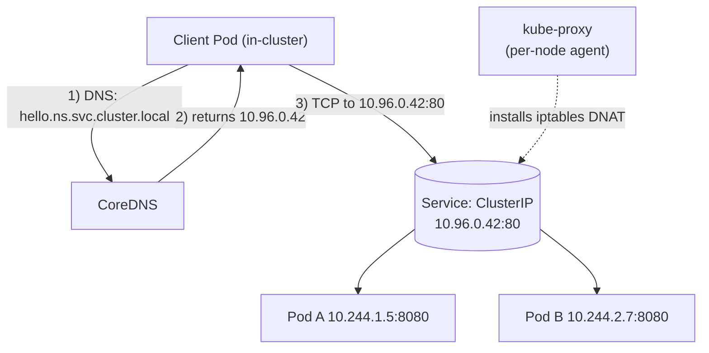
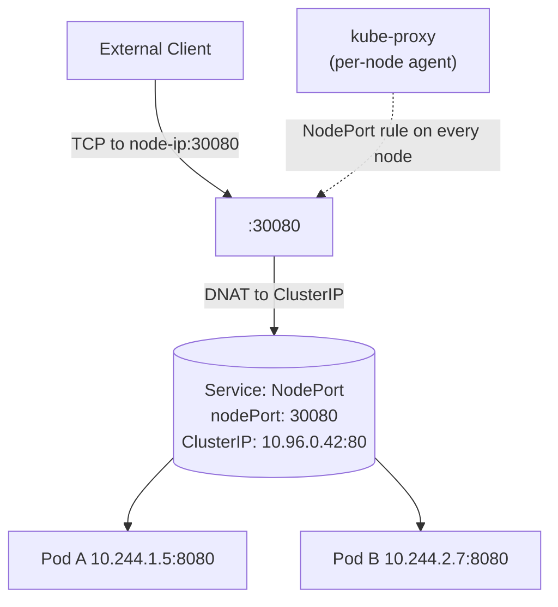
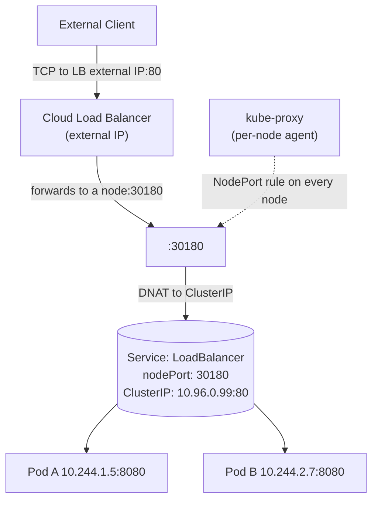

# Wednesday — K8s Networking from the Ground Up → OpenShift Services + Routes

**Time**: ~90 min discussion + ~30 min lab tie-in
**Diagram**: [`10-services-routes-traffic-flow.drawio`](10-services-routes-traffic-flow.drawio) — client → HAProxy ingress → Route → Service → Endpoint → Pod

## Learning objective

> **Trace a single HTTP request from an external user's browser to the Pod that answers it.** Name every K8s object the packet passes through, why each one exists, and what happens at each.

## Why this matters

Almost every Kafka, Connect, Schema Registry, and Flink connectivity issue you'll hit in production ultimately becomes a networking-layer troubleshooting exercise. Today is the foundation — by the end of it you should be able to look at a failing producer/consumer and predict which layer is at fault before opening a single log file.

The discussion below builds from the smallest networking primitive (a Pod's IP) up to the full production path (browser → HAProxy ingress router → Route → Service → EndpointSlice → Pod). Each new part adds **one** capability the previous part couldn't provide. Resist the temptation to skip ahead.

---

## Part 1 — The Problem: Why Services Exist (~10 min)

### Every Pod gets an IP — for free

When K8s schedules a Pod, the CNI (Container Network Interface — the cluster's overlay-network plugin) assigns it an IP. You can see it:

```bash
kubectl get pods -o wide
```

The `IP` column is the Pod's address inside the cluster.

### But Pod IPs are useless to clients

Three reasons:

1. **Ephemeral.** Restart the Pod (crash, redeploy, eviction) and it comes back with a different IP. A client that hard-coded the old IP now talks to nothing.
2. **Internal.** Pod IPs live on the cluster's overlay network. Your laptop, the perimeter firewall, and most external clients can't route to them.
3. **No load balancing.** Scale a Deployment from 1 to 5 Pods and you now have 5 IPs. A naive client can't pick one, retry the others, or rebalance.

### What we actually need

A networking layer that gives clients:

- A **stable address** that doesn't change when Pods restart.
- A **single entry point** that load-balances across all healthy Pods.
- A **name** to reach it (so config doesn't hard-code IPs).
- Automatic membership: as Pods come and go, the address keeps working.

That layer is the **Service**.

---

## Part 2 — Service (ClusterIP): The K8s Answer (~15 min)

### What a Service is

A Service is a K8s object that gives a group of Pods (selected by label) a stable virtual IP and a stable DNS name. Think of it as a phonebook entry that always points to whichever Pods currently match the description — no matter how often the Pods underneath change.

### Sample manifest

First, the Pod the Service will route to. In production you'd run several of these via a Deployment or StatefulSet — a bare Pod is shown here just to make the label → selector mapping unambiguous:

```yaml
# A Pod with label app=hello. The Service below (and the NodePort and
# LoadBalancer Services in Parts 3 and 4) all select THIS Pod.
apiVersion: v1
kind: Pod
metadata:
  name: hello-1
  labels:
    app: hello                       # <-- Services match on this label
spec:
  containers:
  - name: hello
    image: nginx:1.27
    ports:
    - containerPort: 8080            # <-- Services' targetPort points here
```

Now the Service:

```yaml
# ClusterIP — the default Service type. Cluster-internal only.
# Reachable as: hello.<namespace>.svc.cluster.local
apiVersion: v1               # core K8s API group/version (Service is a core object)
kind: Service                # the object kind we're declaring
metadata:                    # object-level metadata (name, namespace, labels, annotations)
  name: hello                # Service name; also the DNS prefix → hello.<namespace>.svc.cluster.local
spec:                        # desired state of the Service
  type: ClusterIP            # Service type. Possible values:
                             #   ClusterIP    — default; cluster-internal virtual IP only
                             #   NodePort     — also opens a static port (30000-32767) on every node
                             #   LoadBalancer — also asks the cloud for an external LB (uses NodePort underneath)
                             #   ExternalName — CNAME alias to an external DNS name (no proxying)
                             # Headless variant: keep type: ClusterIP and set clusterIP: None
                             # (returns per-Pod DNS records instead of a single virtual IP — used by StatefulSets)
  selector:                  # label query — picks which Pods back this Service
    app: hello               # <-- MATCHES the Pod's metadata.labels.app
  ports:                     # list of ports this Service exposes
  - port: 80                 # the port clients connect to on the Service's ClusterIP
    targetPort: 8080         # <-- MATCHES the Pod's containerPort (where traffic actually lands)
    protocol: TCP            # TCP | UDP | SCTP (TCP is the default if omitted)
```

**The selector ↔ label link.** The Service's `selector: app: hello` is what wires it to the Pod's `metadata.labels.app: hello`. Change either one and the connection silently breaks: the Service ends up with zero Endpoints (the most common "Service quietly doesn't work" failure mode). The Service's `targetPort: 8080` is the **Pod's containerPort**, not its own port — mismatch them and traffic reaches the Pod on the wrong port.

What the cluster does with this manifest, in order:

1. Allocates a `ClusterIP` from the Service network (e.g., `10.96.0.42`).
2. Creates an **EndpointSlice** object listing every Pod IP+port whose labels match `app=hello`.
3. **CoreDNS** publishes the record: `hello.<namespace>.svc.cluster.local → 10.96.0.42`.
4. **kube-proxy** (running on every node) installs iptables (or IPVS) rules that DNAT traffic from `10.96.0.42:80` to one of the backing Pod IPs.

### Three supporting objects you must know

**EndpointSlice** — the glue between Service and Pods. The EndpointSlice controller updates it whenever a Pod is added, removed, or fails its readinessProbe. Inspect it:

```bash
kubectl get endpointslice -l kubernetes.io/service-name=hello
```

This is the **actual source of truth** for "which Pods is this Service routing to right now." When troubleshooting "the Service isn't working," check the EndpointSlice first.

**CoreDNS** — the cluster DNS resolver, deployed as Pods (usually in `kube-system`). Any Pod doing `nslookup hello.ns.svc.cluster.local` is asking CoreDNS. CoreDNS reads K8s API objects (Services, EndpointSlices) and answers with the right IP. If a Service has no Endpoints, the DNS lookup may still resolve to the ClusterIP — but the actual traffic will fail at the Service layer.

**kube-proxy** — runs on every node as a DaemonSet. Despite the name, **it does not proxy traffic itself**. It watches the API server for Service and EndpointSlice changes and writes iptables (or IPVS) rules so the kernel routes ClusterIP packets directly to a backing Pod. Once kube-proxy has installed the rules, there is no userspace proxy in the data path.

### Diagram — ClusterIP traffic flow



### Mental model

A ClusterIP Service is **three coordinated objects pretending to be one**: the Service (the abstraction), the EndpointSlice (the live membership), and the iptables rules (the actual data path). When a Service "isn't working," the question is always: which of those three is out of sync?

### Mini-exercise — name resolution before data path

```bash
oc exec <pod> -- nslookup kubernetes.default.svc
oc exec <pod> -- nslookup <service-name>
oc exec <pod> -- getent hosts <service-name>
```

Most Kafka / Connect / Schema Registry / Flink connectivity problems are ultimately a CoreDNS resolution failure. **Always test name resolution before debugging the data path.**

---

## Part 3 — External Access, Take 1: NodePort (~5 min)

### The gap ClusterIP doesn't close

ClusterIP is cluster-internal only. An external client (your laptop, an upstream system, a monitoring scrape) can't route to `10.96.0.42`.

### The NodePort answer

`type: NodePort` says: "in addition to the ClusterIP, open a high port (range `30000-32767`) on every node, and DNAT it back to the same ClusterIP." External clients reach the Service by hitting **any** node's IP on that port.

```yaml
# NodePort — opens a fixed port on EVERY node.
# Reachable as: <any-node-ip>:30080
apiVersion: v1
kind: Service
metadata:
  name: hello-nodeport
spec:
  type: NodePort
  selector:
    app: hello                # <-- same label as the Pod in Part 2; same backend
  ports:
  - port: 80
    targetPort: 8080          # <-- same containerPort as the Pod in Part 2
    nodePort: 30080           # if omitted, K8s assigns one from 30000-32767
```

### Diagram — NodePort



### Why production blocks NodePort

Every node ends up listening on a high port that isn't governed by Routes, HAProxy TLS, hostname-based admission, or the firewall rules guarding the Route layer. Production admission control (Gatekeeper / OPA) rejects `type: NodePort` for that reason. NodePort survives in lab clusters precisely because they don't enforce that constraint.

---

## Part 4 — External Access, Take 2: LoadBalancer (~5 min)

### The gap NodePort doesn't close

NodePort exposes a port on every node, but which node's IP do external clients use? Hardcoding one is fragile (that node could go down). Round-robin DNS helps but doesn't handle node failures cleanly. We want a single external IP, served by a Load Balancer outside the cluster, that picks a healthy node automatically.

### The LoadBalancer answer

`type: LoadBalancer` is **NodePort + a cloud-provisioned external LB in front**. K8s asks the cloud provider's API: "give me an external LB IP, point it at port `30xxx` on every node." The LB does the health-checking and node-selection.

```yaml
# LoadBalancer — cloud-provisioned external LB.
# Reachable as: <external-lb-ip>:80
apiVersion: v1
kind: Service
metadata:
  name: hello-lb
spec:
  type: LoadBalancer
  selector:
    app: hello                # <-- same label as the Pod in Part 2; same backend
  ports:
  - port: 80
    targetPort: 8080          # <-- same containerPort as the Pod in Part 2
# K8s ALSO allocates a nodePort under the hood — visible in `.spec.ports[0].nodePort`.
```

### Diagram — LoadBalancer



### What happens on-prem (no cloud LB controller)

On an on-prem OpenShift cluster there is no cloud LB controller to satisfy the request — so `kubectl get svc hello-lb` shows `EXTERNAL-IP: <pending>` forever. The underlying NodePort is still allocated, but no external LB exists. On cloud OpenShift (ROSA, ARO) the same Service would resolve to a provisioned LB IP within ~60 seconds.

### The key insight

`LoadBalancer = NodePort + external LB`. Same admission concern as NodePort applies — on-prem production clusters don't use LoadBalancer either. So how do we expose Kafka, REST Proxy, or anything else externally on an on-prem cluster? That's the next two layers.

---

## Part 5 — Vanilla K8s External Access: Ingress (~10 min)

### Why we need yet another layer

NodePort and LoadBalancer consume resources **per Service** — a NodePort per Service, a cloud LB per Service. That doesn't scale. A cluster with 50 web apps doesn't want 50 LB IPs.

What we actually want is **one** external entry point that routes by **hostname** (or **path**) to many backend Services. That's Ingress.

### The Ingress object

```yaml
# Ingress — hostname-based routing to a Service.
apiVersion: networking.k8s.io/v1
kind: Ingress
metadata:
  name: hello
spec:
  rules:
  - host: hello.example.com           # incoming Host: header
    http:
      paths:
      - path: /
        pathType: Prefix
        backend:
          service:
            name: hello                # which Service to route to
            port:
              number: 80
  tls:
  - hosts: [hello.example.com]
    secretName: hello-tls              # cert/key for the listener
```

### An Ingress object needs an Ingress Controller

The Ingress object is a **declarative description** of what should happen. Something actually has to listen on `:80/:443`, terminate TLS, read the `Host:` header, and route to the backend Service. That something is the **Ingress Controller** — a Pod (or several) running a reverse proxy. Common implementations:

- `ingress-nginx` — NGINX-based, very common on vanilla K8s and kind.
- `haproxy-ingress` — what OpenShift uses (covered in Part 6).
- Traefik, Contour, AWS ALB Controller, etc.

Without a controller, an Ingress object is inert. With a controller, the controller watches the API for Ingress objects and reconfigures its proxy on every change.

### Ingress vs LoadBalancer — when to use which

| Need | Use |
|---|---|
| Expose a non-HTTP TCP/UDP Service externally | LoadBalancer (or NodePort on lab) |
| Expose many HTTP Services through one hostname tier | Ingress |
| One external IP per app | LoadBalancer (where cluster supports it) |
| Hostname-based routing, TLS termination, path rules | Ingress |

For HTTP traffic on a real cluster, Ingress is almost always the right answer.

---

## Part 6 — OpenShift's Addition: Route (~10 min)

### What OpenShift adds

OpenShift's Route object predates K8s Ingress (Routes appeared in OpenShift v3, Ingress in K8s v1.1). Routes solve the same problem Ingress does, but with extra TLS modes and tight integration with OpenShift's HAProxy-based ingress router.

### The Route object

```yaml
# Route — OpenShift's external-access object.
apiVersion: route.openshift.io/v1
kind: Route
metadata:
  name: hello
spec:
  host: hello.apps.dev.ocp.example.com
  to:
    kind: Service
    name: hello                        # which ClusterIP Service to expose
  port:
    targetPort: 80
  tls:
    termination: reencrypt             # see TLS modes below
    insecureEdgeTerminationPolicy: Redirect
```

### Routes live on HAProxy ingress routers

The OpenShift "ingress router" is a small set of HAProxy Pods running on dedicated router nodes (in regulated customer environments these typically sit on a DMZ or secure-zone network). When you create a Route, the OpenShift Ingress Operator picks it up and pushes the hostname into HAProxy's config. HAProxy reloads with the new mapping.

So at the bottom layer, a Route is just: "this hostname goes to that ClusterIP Service, via HAProxy."

### Three TLS modes — pick the one that matches the trust model

| Mode | HAProxy terminates TLS? | Backend speaks | When to use |
|---|---|---|---|
| `edge` | Yes | plain HTTP | Backend Pod has no cert; cluster-internal trust is fine |
| `passthrough` | No (passes bytes through) | TLS | Backend MUST own its own cert; HAProxy only sees SNI |
| `reencrypt` | Yes (then re-encrypts) | TLS | Both hops want TLS but with different certs (common in regulated environments) |

**A common preferred mode in regulated environments is `reencrypt`.** Why:

- Pod-side TLS is issued per-Service by cert-manager + the customer's PKI (narrow trust).
- HAProxy-side TLS uses the wildcard Ingress Certificate (`*.apps.<env>.ocp.example.com`).
- HAProxy decrypts → re-encrypts, so the wire is encrypted end-to-end, but with the right cert at each hop.

### Route vs Ingress — OpenShift's POV

OpenShift translates Ingress objects into Routes under the hood. You can declare K8s-standard Ingress YAML and OpenShift will create a matching Route automatically. Tradeoffs:

- **Write Route directly** — full access to OpenShift-specific TLS modes (especially `reencrypt`), tighter integration.
- **Write Ingress (translates to Route)** — portable across vanilla K8s and OpenShift; some advanced TLS settings can't be expressed.

In practice, customer GitOps repos often use **Ingress YAML** (cloud-portable) and let OpenShift translate to Routes — files like `<gitops-root>/confluent-platform/<env>/ingress/*.yaml` become Routes inside the cluster.

---

## Part 7 — Putting It All Together: The Full Production Path (~15 min)

The full path a real user HTTPS request takes to reach a Pod on a production OpenShift cluster:

```
User browser
  │ HTTPS GET https://my-app.apps.dev.ocp.example.com/
  │
  ▼
enterprise perimeter firewall (TCP/443 allow → OCP cluster LB IP)
  │
  ▼
OCP cluster Load Balancer IP
  │
  ▼
HAProxy Ingress router pod (on a dedicated router node)
  │  matches the Route by Host: header
  │  decrypts TLS with the Ingress Certificate
  │  re-encrypts with the backend cert (reencrypt mode)
  ▼
Service ClusterIP (10.x.x.x)
  │  kube-proxy iptables rule: DNAT ClusterIP:443 → one of the Pod IPs:8080
  ▼
Pod IP (10.y.y.y) — the actual Pod that answers
```

Six hops, six layers, six things that can break. Walk through it one arrow at a time and ask: *"if THIS layer broke, what would the user see?"*

### Failure scenarios — predicting symptoms by layer

| Symptom | Likely cause | Where to check |
|---|---|---|
| `connection refused` from the user's browser | Firewall not allowing 443 to the LB IP | Network / firewall team |
| `404 not found` from HAProxy | Route doesn't match the Host: header | `oc get routes` — check `.spec.host` |
| `503 Service Unavailable` | Route exists but Service has no Ready endpoints | `oc get endpoints <svc-name>` — empty? |
| `connection refused` from inside the cluster (Pod → Service) | Service `selector` doesn't match Pod labels | `oc get pod -l <selector>` returns empty |
| TLS handshake failure | Cert mismatch between HAProxy and the backend | Compare cert in HAProxy edge with backend Service's TLS Secret |

Spend the rest of this section running through the [`10-services-routes-traffic-flow.drawio`](10-services-routes-traffic-flow.drawio) diagram, stopping at each hop. If a diagram is the wrong abstraction for someone in the room, walk the table column-by-column instead.

---

## Part 8 — CFK Mapping: How All This Comes Together for Kafka (~10 min)

The CFK (Confluent for Kubernetes) operator translates two Kafka-specific CRs into the K8s primitives we just covered — Services, EndpointSlices, the lot — plus StatefulSets, ConfigMaps, and Secrets from this week's earlier lessons. You'll see these next week in Week 04:

```yaml
# CFK Kafka CR (abridged)
apiVersion: platform.confluent.io/v1beta1
kind: Kafka
metadata:
  name: kafka
  namespace: kafka-dev
spec:
  replicas: 3
  image:
    application: confluentinc/cp-server:7.7.0
  dataVolumeCapacity: 100Gi
  dependencies:
    kRaftController:
      clusterRef:
        name: kraftcontroller
  listeners:
    internal:
      authentication: { type: mtls }
      tls: { enabled: true }
# CFK generates:
#   StatefulSet  kafka                              3 broker Pods (kafka-0, kafka-1, kafka-2)
#   Service      kafka                              headless (ClusterIP: None) — per-Pod DNS
#   Service      kafka-0-internal, -1-, -2-internal one ClusterIP per broker (stable per-broker addr)
#   Service      kafka-bootstrap                    ClusterIP fronting the cluster for bootstrap
#   ConfigMap    kafka                              rendered server.properties
#   Secret       kafka-*-tls                        broker certs (issued by cert-manager)

---
# CFK KRaftController CR (abridged)
apiVersion: platform.confluent.io/v1beta1
kind: KRaftController
metadata:
  name: kraftcontroller
  namespace: kafka-dev
spec:
  replicas: 3
  image:
    application: confluentinc/cp-server:7.7.0
  dataVolumeCapacity: 10Gi
  listeners:
    controller:
      authentication: { type: mtls }
      tls: { enabled: true }
# CFK generates:
#   StatefulSet  kraftcontroller                            3 controller Pods (KRaft quorum)
#   Service      kraftcontroller                            headless — per-Pod DNS for quorum
#   Service      kraftcontroller-0-internal, -1-, -2-       one ClusterIP per controller
#   ConfigMap    kraftcontroller                            rendered controller.properties
#   Secret       kraftcontroller-*-tls                      controller certs
```

In practice, **every Service the CFK operator generates is ClusterIP** (or headless — a ClusterIP variant with `ClusterIP: None`). Brokers and controllers are never exposed via NodePort or LoadBalancer directly. External client access is layered on top via Route + HAProxy ingress with reencrypt TLS termination. That's tomorrow's (Thursday) story; today's job was getting the Service side covered.

---

## Q&A

1. What's the difference between a Service's `selector` and its `targetPort`?
2. If two Routes claim the same hostname, what does HAProxy do?
3. Can a Service have no Pods backing it? What's that state called?
4. When you delete a Pod, why does the Service automatically stop routing to it?
5. In production, why is `NodePort` not an option for exposing CFK components externally?
6. CoreDNS returns an IP for your Service, but `curl` to that IP hangs. What three things would you check first?
7. What happens if a Pod's `readinessProbe` starts failing mid-request to the Service?
8. Why does `LoadBalancer` show `EXTERNAL-IP: <pending>` on an on-prem OpenShift cluster but resolve quickly on ROSA?
9. What's the difference between a headless Service (`ClusterIP: None`) and a regular ClusterIP, and why does CFK generate one for the Kafka StatefulSet?

---

## Common misconceptions

- **"Services proxy traffic."** kube-proxy installs iptables (or IPVS) rules; the kernel routes the traffic. There is no userspace proxy in the data path.
- **"Route IS Ingress."** Route is the OpenShift-native object; Ingress is the K8s standard. OpenShift maps Ingress → Route, but they aren't the same K8s kind.
- **"ClusterIP Services are reachable from outside the cluster."** No — ClusterIP is cluster-internal only. External reach needs a Route, an Ingress, or one of the external Service types.
- **"NodePort and LoadBalancer use a different data plane from ClusterIP."** No — they're built on top of ClusterIP. Same kube-proxy, same iptables rules, same EndpointSlice. They just add external exposure.
- **"DNS for Services is automatic, so I never have to think about it."** When CoreDNS breaks, every Service breaks. Always test name resolution (`nslookup`) before debugging the data path.
