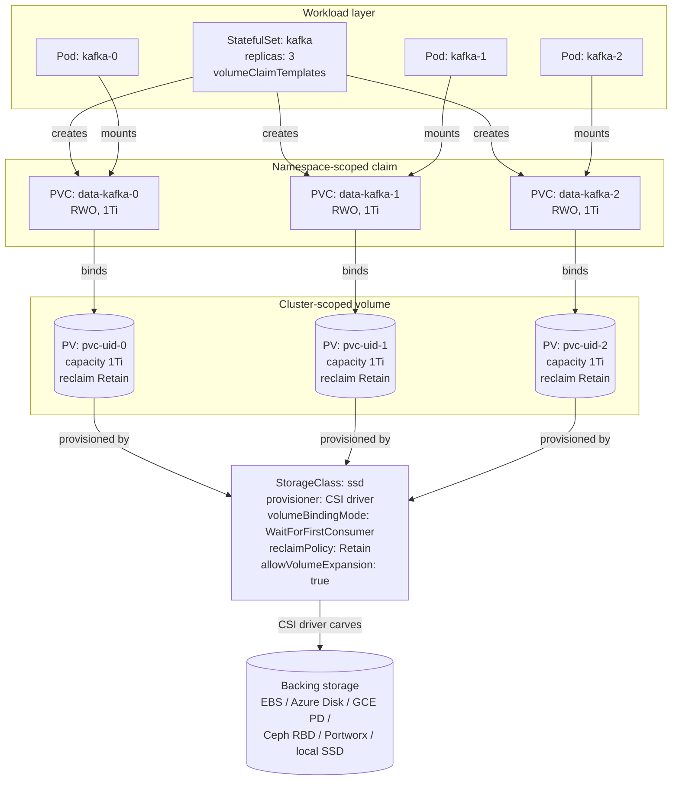

# Thursday — Storage (PVC + PV + StorageClass)

**Diagram**: [`11-storage-chain.drawio`](11-storage-chain.drawio) — Pod → PVC → PV → StorageClass → backing storage

## Learning objective

> **Why does Kafka depend on PVCs?** And what happens, step by step, when a Pod requests storage?

By the end of the day an engineer should be able to:

- Trace a Pod's data path from `volumeMount` all the way down to the backing disk
- Explain why CFK refuses to run Kafka on NFS or object storage
- Pick a sensible StorageClass (`volumeBindingMode`, `reclaimPolicy`, `allowVolumeExpansion`) for a CFK install on EKS / AKS / GKE / ROSA
- Predict what happens to a PVC when its Pod is deleted, its StatefulSet is deleted, or the cluster reboots

## Architecture Discussion

K8s storage has four layers. Engineers who don't understand the difference between PVC and PV will not be able to triage CFK PVC-stuck-Pending issues.

- **StorageClass** — describes a *type* of storage available on the cluster (e.g. `ceph-rbd-fast-ssd`, `gp3-encrypted`). Cluster admin defines them. Each has a `provisioner` (the CSI driver that creates volumes) and parameters (replication factor, encryption, IOPS tier).

- **PersistentVolume (PV)** — a *specific* volume that exists somewhere — a Ceph RBD image, an EBS volume, an NFS share. Has capacity, access modes, a storage class label, and a reclaim policy (`Retain` vs `Delete`). Cluster-scoped resource — Pods don't reference PVs directly.

- **PersistentVolumeClaim (PVC)** — a Pod's *request* for storage. "I need 100Gi, ReadWriteOnce, of storage class `ceph-rbd-fast-ssd`." Namespace-scoped. K8s + the storage provisioner find or create a matching PV and **bind** them.

- **Pod `volumes` + `volumeMounts`** — the Pod references the PVC by name; kubelet mounts the bound PV into the container at the requested path.

The **binding** between PVC and PV is the most-misunderstood step. Two flavors:

- **Static provisioning** — admin manually creates a PV; PVC matches it by storage class + capacity + access mode. Old-school; rarely used.
- **Dynamic provisioning** — PVC is created with a `storageClassName`; the CSI driver creates a fresh PV on demand. This is the default everywhere modern. **OpenShift uses dynamic provisioning by default with Ceph CSI** (rook / ODF).

For Kafka specifically:

- Every broker Pod needs its OWN persistent disk (its log directory). If broker.id=0's disk gets mounted into broker.id=1, the data is corrupted.
- A StatefulSet's `volumeClaimTemplates` block creates ONE PVC per Pod automatically — `data-kafka-0`, `data-kafka-1`, `data-kafka-2`. Each PVC binds to its own PV. Each Pod always mounts its own PVC across restarts. (Tied back to Tuesday's StatefulSet identity-preservation discussion.)
- If the PVC's PV is lost (storage corruption, accidental delete), the broker pod can never restart with the same identity — the broker is gone from Kafka's perspective. This is the disaster-recovery scenario covered in Week 5.

### Access modes — who can mount the volume, and how

A PVC is created with one of four access modes. The mode constrains how the cluster can attach the underlying PV.

| Mode | Short | Meaning |
|---|---|---|
| `ReadWriteOnce` | RWO | Mounted read-write by **one node** at a time. Many Pods on the same node can share it; Pods on different nodes cannot. The CFK default for Kafka, KRaft, ksqlDB, Control Center, REST Proxy. |
| `ReadWriteOncePod` | RWOP | Mounted read-write by **one Pod** at a time (K8s 1.22+). Tighter than RWO. Useful when you absolutely must not have a stale Pod still attached. |
| `ReadOnlyMany` | ROX | Mounted read-only by many nodes simultaneously. Mostly used for shipping static content. |
| `ReadWriteMany` | RWX | Mounted read-write by many nodes simultaneously. Requires a shared filesystem (CephFS, NFS, Azure Files, EFS). |

**Why Kafka must be RWO (and never RWX)**: Kafka writes its log directory with the assumption that exactly one process owns it. Two brokers writing into the same directory corrupts segments and indexes within seconds. The RWO mode is K8s's way of enforcing single-mounter at the storage layer — belt-and-braces on top of the StatefulSet's per-Pod PVC pattern.

### Block storage vs. NFS — why Kafka rejects file storage

There are two physical shapes of "remote disk":

- **Block storage** (EBS, Azure Managed Disk, GCE PD, Ceph RBD, Portworx, vSphere VMDK) — the cluster sees a raw block device, mounts a filesystem on it, and the OS does normal direct I/O. Latency: low. Throughput: high. Mount semantics: **one node owns it.**
- **File storage / NFS / NAS** (EFS, Azure Files, CephFS, GlusterFS, plain NFS) — the cluster mounts a remote filesystem that already has a filesystem on it. Multiple nodes can mount simultaneously. Latency: higher. Throughput: lower. Mount semantics: **many nodes can share it.**

Confluent's CFK docs are explicit: **Kafka brokers MUST run on block storage.** NFS / object / file storage is unsupported. Reasons:

1. **fsync semantics** — Kafka calls `fsync` to flush committed writes. NFS clients have historically had quirky fsync behavior (caching layers can ack before the server actually durably writes). A lost fsync after an ack = lost data Kafka believes is committed.
2. **Locking** — Kafka brokers use file locks on the log directory to prevent two brokers ever sharing it. NFS file locking is unreliable across implementations.
3. **Latency tail** — NFS tail latency under network pressure breaks Kafka's tight write SLAs (request handlers stall, ISR shrinks, retries cascade).
4. **fsync amplification on RWX backends** — even when RWX works correctly, the cost of cross-node coherence makes it noticeably slower than RWO block storage.

The corollary: KRaft controllers, Schema Registry (if persistent), ksqlDB, Control Center, and Connect (workers with internal state) all follow the same rule. **Block storage, RWO, period.**

## Diagram Walkthrough

The drawio at [`11-storage-chain.drawio`](11-storage-chain.drawio) is the visual reference. Below is the same chain as a mermaid graph followed by the matching YAML manifests so engineers can see what each box becomes on the cluster.



### How the layers map to YAML

The five boxes correspond to five resources you can find on any CFK-managed cluster. Read top-down — each layer references the one below it.

**1. The StatefulSet — generated by CFK from the `Kafka` CR; you rarely write it by hand.**

```yaml
apiVersion: apps/v1
kind: StatefulSet
metadata:
  name: kafka
  namespace: kafka-dev
spec:
  serviceName: kafka
  replicas: 3
  selector:
    matchLabels: {app: kafka}
  template:
    metadata:
      labels: {app: kafka}
    spec:
      containers:
        - name: kafka
          image: confluentinc/cp-server:7.9.8
          volumeMounts:
            - name: data            # <-- references the claim template below
              mountPath: /var/lib/kafka/data
  volumeClaimTemplates:             # <-- one PVC per replica, auto-named data-kafka-N
    - metadata:
        name: data
      spec:
        accessModes: ["ReadWriteOnce"]
        storageClassName: ssd
        resources:
          requests:
            storage: 1Ti
```

**2. The PersistentVolumeClaim — created automatically by the StatefulSet controller.**

```yaml
apiVersion: v1
kind: PersistentVolumeClaim
metadata:
  name: data-kafka-0                # <-- {template-name}-{statefulset-name}-{ordinal}
  namespace: kafka-dev
spec:
  accessModes: ["ReadWriteOnce"]
  storageClassName: ssd
  resources:
    requests:
      storage: 1Ti
  volumeName: pvc-7f2a...            # <-- set by the binder after a PV is matched
```

**3. The PersistentVolume — created by the CSI driver in response to the PVC.**

```yaml
apiVersion: v1
kind: PersistentVolume
metadata:
  name: pvc-7f2a...                  # <-- name matches PVC.spec.volumeName
spec:
  capacity:
    storage: 1Ti
  accessModes: ["ReadWriteOnce"]
  storageClassName: ssd
  persistentVolumeReclaimPolicy: Retain
  csi:
    driver: ebs.csi.aws.com          # <-- which CSI driver owns it
    volumeHandle: vol-0a1b2c3d4e     # <-- the cloud-side disk ID
  claimRef:                          # <-- back-reference to the PVC that owns it
    namespace: kafka-dev
    name: data-kafka-0
```

**4. The StorageClass — declared once by a cluster admin; every PVC references it.**

```yaml
apiVersion: storage.k8s.io/v1
kind: StorageClass
metadata:
  name: ssd
provisioner: ebs.csi.aws.com         # <-- the CSI driver to call
parameters:
  type: gp3
  encrypted: "true"
  iops: "3000"
  throughput: "125"
volumeBindingMode: WaitForFirstConsumer   # <-- wait until a Pod schedules before creating the disk
reclaimPolicy: Retain                # <-- keep the PV (and data) when the PVC is deleted
allowVolumeExpansion: true           # <-- let PVCs be resized in place
```

**5. The backing storage — outside K8s; visible only through the cloud provider's console / API.**

For an AWS EKS cluster with the EBS CSI driver, the `volumeHandle` above is the EBS volume ID; it shows up in `aws ec2 describe-volumes`. For an Azure AKS cluster with the Disk CSI driver it's the Managed Disk resource ID. For a kind cluster with the rancher.io/local-path provisioner it's a directory on the worker node's host filesystem. Same chain, different bottom turtle.

## Three provisioning approaches CFK supports

The Confluent docs (`docs.confluent.io/operator/current/co-storage.html`) call out three ways a CFK CR can get its PVs created. Engineers need to recognize all three because cluster admins on EKS, AKS, GKE, and ROSA do not all configure storage the same way.

### Option 1 — Dynamic provisioning with a named StorageClass (preferred)

The component CR carries `spec.storageClass.name`. CFK puts that name into the StatefulSet's `volumeClaimTemplates.spec.storageClassName`. K8s asks the matching CSI driver to create a new PV on demand. Engineer chooses the storage class deliberately.

```yaml
apiVersion: platform.confluent.io/v1beta1
kind: Kafka
metadata:
  name: kafka
spec:
  replicas: 3
  dataVolumeCapacity: 1Ti
  storageClass:
    name: ssd                  # <-- explicit, audited, predictable
```

When to use: production. Every cluster admin can document exactly which CSI driver, which IOPS class, and which reclaim policy each CFK component sits on. This is the only mode that survives an audit.

### Option 2 — Dynamic provisioning with the cluster default StorageClass

The component CR omits `spec.storageClass.name`. CFK leaves `storageClassName` blank in the template, K8s applies the cluster's *default* StorageClass (the one annotated `storageclass.kubernetes.io/is-default-class: "true"`).

```yaml
apiVersion: platform.confluent.io/v1beta1
kind: Kafka
metadata:
  name: kafka
spec:
  replicas: 3
  dataVolumeCapacity: 1Ti
  # storageClass omitted intentionally → uses cluster default
```

When to use: PoCs, dev sandboxes, lab clusters, and `kind` setups where there is exactly one default class and re-binding is acceptable. On managed clouds the default class is usually a baseline tier (gp2 on older EKS, Standard SSD on AKS, standard-rwo on GKE) — fine for dev, almost never right for a production Kafka.

### Option 3 — Static provisioning (admin pre-creates PVs)

Used on clusters that have no CSI driver and no dynamic provisioner — typically bare-metal / on-prem / air-gapped environments. The admin:

1. Defines a StorageClass with `provisioner: kubernetes.io/no-provisioner` (so K8s does NOT try to create volumes for it).
2. Pre-creates one PV per future PVC, sized and labeled to match.
3. Creates the CFK CR pointing at that StorageClass. K8s binds each PVC the StatefulSet emits to one of the pre-created PVs.

```yaml
---
apiVersion: storage.k8s.io/v1
kind: StorageClass
metadata:
  name: local-block
provisioner: kubernetes.io/no-provisioner
volumeBindingMode: WaitForFirstConsumer
reclaimPolicy: Retain
---
apiVersion: v1
kind: PersistentVolume
metadata:
  name: kafka-data-0
spec:
  capacity: {storage: 1Ti}
  accessModes: ["ReadWriteOnce"]
  storageClassName: local-block
  persistentVolumeReclaimPolicy: Retain
  local:
    path: /mnt/disks/kafka-0
  nodeAffinity:                      # <-- pins this PV to one specific node
    required:
      nodeSelectorTerms:
        - matchExpressions:
            - {key: kubernetes.io/hostname, operator: In, values: [worker-1]}
```

When to use: on-prem ROSA / OCP-on-VMs where storage is local NVMe, or air-gapped sites with no dynamic CSI. The trade-off is that the admin manages capacity manually (forget to pre-create the next PV → next broker replica stays Pending).

### Storage flavor by cloud / platform (real-world map)

| Platform | Typical default StorageClass | Underlying CSI | Block or File | Safe for Kafka? |
|---|---|---|---|---|
| Amazon EKS | `gp2`, `gp3` | `ebs.csi.aws.com` | Block | Yes — use `gp3` with provisioned IOPS for prod |
| Amazon EKS (RWX) | `efs-sc` | `efs.csi.aws.com` | File (NFS) | **No** — never put Kafka on EFS |
| Azure AKS | `managed-csi`, `managed-csi-premium` | `disk.csi.azure.com` | Block | Yes — Premium SSD v2 for prod |
| Azure AKS (RWX) | `azurefile-csi` | `file.csi.azure.com` | File | **No** — never put Kafka on Azure Files |
| GCP GKE | `standard-rwo`, `premium-rwo` | `pd.csi.storage.gke.io` | Block | Yes — `premium-rwo` (SSD PD) for prod |
| Red Hat ROSA | `gp3-csi` (default), `gp2-csi` | `ebs.csi.aws.com` | Block | Yes — same EBS underneath EKS |
| OpenShift on-prem | `ocs-storagecluster-ceph-rbd` (ODF) | `openshift-storage.rbd.csi.ceph.com` | Block (Ceph RBD) | Yes — production-grade |
| OpenShift on-prem | `ocs-storagecluster-cephfs` (ODF) | `openshift-storage.cephfs.csi.ceph.com` | File (CephFS) | **No** for Kafka |
| Local lab — kind | `standard` (or custom `ssd`) | `rancher.io/local-path` | Local file (host dir) | Lab only — single-node, not durable |
| Local lab — OpenShift Local (CRC) | `crc-csi-hostpath-provisioner` | `kubevirt.io.hostpath-provisioner` | Local file (host dir) | Lab only |

### StorageClass settings every CFK install needs

Three knobs on the StorageClass shape what happens when things go wrong — these are the ones Confluent's docs explicitly call out for production:

- `volumeBindingMode: WaitForFirstConsumer` — delay PV creation until a Pod is scheduled. Lets the CSI driver place the PV in the same AZ/node as the Pod that will use it. The default `Immediate` will create PVs in random AZs and then Pods can't schedule because the cross-AZ attach fails.
- `reclaimPolicy: Retain` — when the PVC is deleted, the PV stays around with the data. Required for any production CFK deployment — `Delete` means a `kubectl delete kafka` silently destroys the broker logs.
- `allowVolumeExpansion: true` — lets you grow a PVC in place by editing `spec.resources.requests.storage`. Without this you cannot expand storage without a full broker rebuild.

CFK does not support changing the storage class on an existing deployment. Pick correctly the first time.

## What happens on Pod restart — PVC reattachment

This is the question engineers most often get wrong. Walk through it slowly:

1. **Pod `kafka-1` crashes** (OOM, node reboot, broker bug — doesn't matter).
2. **StatefulSet controller notices** the desired count is 3 but only 2 Ready Pods exist.
3. It re-creates a Pod with the *exact same name* `kafka-1`. **StatefulSets give Pods stable names. Deployments do not.**
4. The new Pod's spec includes `volumes: [{name: data, persistentVolumeClaim: {claimName: data-kafka-1}}]` — the PVC name comes from `{volumeClaimTemplate}-{statefulset}-{ordinal}` and the ordinal is sticky.
5. The PVC `data-kafka-1` was never deleted. It is still bound to PV `pvc-uid-1`, which still references the same EBS volume / Ceph image / hostPath directory.
6. The scheduler picks a node, the kubelet calls the CSI driver's `ControllerPublishVolume` + `NodePublishVolume` — the same backing disk is attached and mounted at `/var/lib/kafka/data`.
7. The broker starts, reads its `meta.properties`, sees its `broker.id` and `cluster.id` on disk, joins the cluster with the same identity.

The same logic applies when an *entire node* dies and `kafka-1` is rescheduled onto a different node. The disk is detached from the dead node (after the kubelet timeout — typically a few minutes), then attached to the new node. The PVC → PV binding never broke.

Exactly the same chain holds for the rest of the CFK components — they're all StatefulSets:

- **KRaft controllers** — `data-kraftcontroller-0`, `data-kraftcontroller-1`, `data-kraftcontroller-2` carry the cluster metadata log; reattached so the controller resumes from the same Raft offset
- **Control Center** — `data-controlcenter-0` carries the C3 RocksDB; reattached so the UI keeps its computed metrics state
- **ksqlDB** — `data-ksqldb-0` etc. carry the RocksDB state stores for stateful streaming queries; reattached so the queries don't have to rebuild state from earliest
- **Schema Registry / Connect** — no PVCs (state lives in Kafka topics); restarts just re-read those topics

### What breaks the reattachment chain

- **Deleting the PVC** — `kubectl delete pvc data-kafka-1`. The PV's `reclaimPolicy` decides what happens to the data: `Retain` keeps the PV but un-bound (an admin can manually re-bind), `Delete` actively destroys the backing disk. The StatefulSet will create a fresh empty PVC and bind it to a *new* empty PV. The broker comes up with the same `broker.id` but no data → registers as the same broker but with empty logs → the rest of the cluster sees it as a broker that lost its log; partition replicas it was holding go under-replicated and resync from the leader. **Survivable, but slow and risky if you do it to >1 broker at once.**
- **Deleting the StatefulSet without the PVCs** — `kubectl delete sts kafka`. PVCs are NOT garbage-collected. Reapplying the StatefulSet re-attaches everything. This is the routine pattern when you regenerate manifests.
- **Deleting the StatefulSet AND the PVCs** — destroys data unless `reclaimPolicy: Retain` (and even then you must manually rebind, which is fiddly). Almost always a mistake.
- **Pod scheduled on a different AZ than its PV** — only happens if your StorageClass uses `volumeBindingMode: Immediate` and the EBS/PD volume was provisioned before the Pod scheduled. Pod stays Pending. Fix: switch to `WaitForFirstConsumer`.

## Failure Scenarios — preview troubleshooting

| Symptom | Likely cause |
|---|---|
| PVC stuck `Pending` | StorageClass doesn't exist; provisioner not running; cluster out of capacity; admission webhook rejecting the PVC |
| PVC bound but Pod can't start | PV's access mode wrong (`RWX` requested, `RWO` available); CSI node plugin down on that node; volume attach hung |
| StatefulSet stuck creating pod-1 | pod-0's PVC didn't bind; ordered lifecycle blocks pod-1 |
| Pod ran fine, then disk full | PVC's storage size is a soft limit on most CSI drivers; the filesystem fills up; Kafka's `log.cleanup.policy` doesn't kick in fast enough |
| Restored a Kafka cluster from snapshot, brokers don't form quorum | PV reclaim policy was `Delete`; old PVs were garbage-collected; new PVs have no broker data |
| Pod stuck `ContainerCreating` after node reboot | Volume still attached to the old node from K8s's view; cluster-side detach timeout (typically 6 min on AWS); resolves itself |
| Kafka broker started with wrong `broker.id` | Pod treated as fungible — Deployment used instead of StatefulSet, or PVC was deleted and recreated |

## Q&A

1. If you delete a StatefulSet, what happens to its PVCs? (Trick: nothing — PVCs are not garbage-collected. You have to delete them yourself or set `persistentVolumeClaimRetentionPolicy`.)
2. If a node holding a PV's mount dies, can the Pod be rescheduled to a different node?
3. What's `accessMode: ReadWriteOnce`? Why is it the default for Kafka? What's the difference between RWO and RWOP?
4. Why does StatefulSet `volumeClaimTemplates` create separate PVCs instead of one shared PVC for all Pods?
5. In production, what's the storage backend behind the StorageClass that CFK uses? (Trick: depends per env — ask the platform team)
6. Why does Confluent block NFS for Kafka? Name two of the four reasons (fsync, locking, latency tail, RWX cost).
7. You're deploying CFK on EKS. Cluster admin offers you `gp2`, `gp3`, and `efs-sc`. Which do you pick and why?
8. The cluster admin set `reclaimPolicy: Delete` on every StorageClass "for tidiness." What do you push back on?
9. Walk through Option 3 (static provisioning) — when would you choose it over Option 1?
10. PV reclaim policy is `Retain`. PVC `data-kafka-1` gets deleted. What state is the PV in? How would an admin re-attach it?

## Common misconceptions

- **"PVCs and PVs are the same"** — no, PVC = request, PV = the actual volume
- **"All Pods of a StatefulSet share storage"** — NO. Each Pod has its OWN PVC and PV. Critical for Kafka.
- **"Deleting a PVC deletes the data"** — depends on reclaim policy. `Retain` keeps it; `Delete` reclaims it. Read the StorageClass.
- **"Cluster storage is unlimited"** — no, `ResourceQuota.storage` caps how much PVC space a project can claim.
- **"NFS works fine for Kafka, I tested it"** — works *most of the time* on a quiet network. Falls apart under load or partial network failure. Confluent explicitly does not support it.
- **"`ReadWriteMany` is just RWO but better"** — no, RWX requires a fundamentally different backend (shared filesystem). For Kafka, RWX is actively wrong.
- **"`reclaimPolicy: Delete` is fine because we have backups"** — backups are not the same as not losing the underlying disk on every `kubectl delete`. Use `Retain` and delete PVs deliberately.
- **"Resizing a PVC just works"** — only if the StorageClass has `allowVolumeExpansion: true` AND the CSI driver supports online resize AND the filesystem supports online grow (ext4 / xfs do; some older ones don't).

## Reference

- Confluent docs — Storage for CFK: <https://docs.confluent.io/operator/current/co-storage.html>
- Kubernetes docs — Persistent Volumes: <https://kubernetes.io/docs/concepts/storage/persistent-volumes/>
- Kubernetes docs — Storage Classes: <https://kubernetes.io/docs/concepts/storage/storage-classes/>
