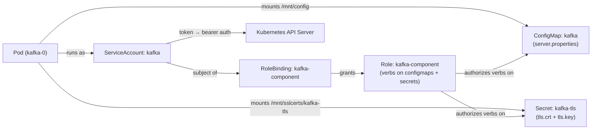
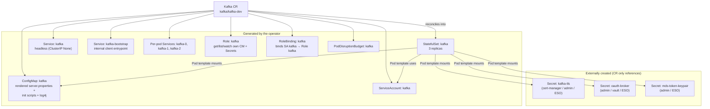
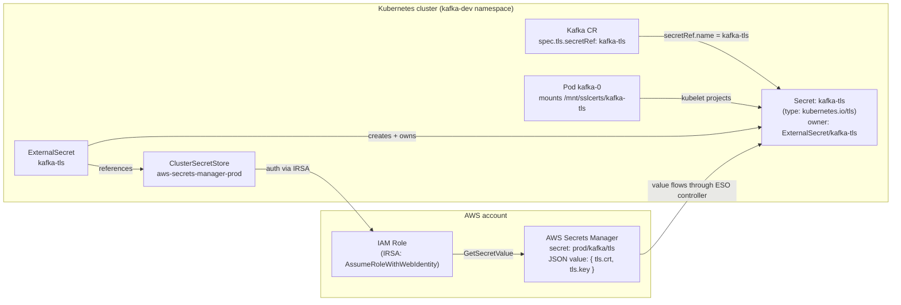
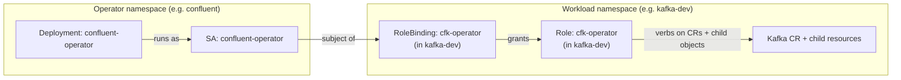

# Friday — ConfigMaps, Secrets, ServiceAccounts, Roles, RoleBindings

## Learning objective

> **How does a single CFK Custom Resource end up creating ConfigMaps, Secrets, a ServiceAccount, a Role, and a RoleBinding — and which ones does the operator generate vs. which ones must already exist before the apply?**

By the end of the day an engineer should be able to:

- Explain the difference between a ConfigMap and a Secret in one sentence — and why the difference matters operationally even though both live in etcd
- Trace which K8s objects a `Kafka` CR emits when applied, and which ones it expects to already exist
- Read a CR's `secretRef:` blocks and locate the actual Secrets they point at on the cluster
- Walk through the SA → RoleBinding → Role chain for a CFK component and explain what each link grants
- Predict what breaks (and how) when any one of these five primitives is missing, mis-labeled, or wrongly bound

---

## Part 1 — The five primitives, in plain K8s

These are the K8s objects every CFK install touches. Read this section once for the generic shape, then Part 2 shows the CFK-specific instances.

### 1.1 ConfigMap — non-sensitive configuration

A ConfigMap is a namespace-scoped key→value store for *non-sensitive* configuration. The keys are filenames; the values are file contents. Pods consume them either as **env vars** or as **mounted files**.

```yaml
apiVersion: v1
kind: ConfigMap
metadata:
  name: my-app-config
  namespace: kafka-dev
data:
  app.properties: |
    log.level=INFO
    metrics.enabled=true
  threshold: "100"
```

- Stored in etcd in plain text.
- Limited to ~1 MiB per object.
- Mutable — a Pod that mounts a ConfigMap as a file will (eventually) see the updated content; env vars are baked in at Pod start, so an env-var consumer needs a Pod restart.

### 1.2 Secret — sensitive configuration

A Secret has the same shape as a ConfigMap (key→value, namespace-scoped) but with two real differences and one cultural one:

```yaml
apiVersion: v1
kind: Secret
metadata:
  name: my-app-credentials
  namespace: kafka-dev
type: Opaque                           # default; other types: kubernetes.io/tls, kubernetes.io/dockerconfigjson, …
data:
  password: cGFzc3dvcmQxMjM=           # base64-encoded
  token:    ZXlKaGJHY2lPaUpJVXpJ…      # base64-encoded
```

- `data:` values are **base64-encoded** in the wire/etcd representation. That is *not* encryption — it's transport encoding. Anyone with `get secret` permission sees the cleartext after one decode step.
- Encryption-at-rest in etcd is a *cluster-level* feature (an EncryptionConfiguration on the apiserver). Not on by default in every distribution.
- Typed variants impose schema: `kubernetes.io/tls` requires `tls.crt` and `tls.key` keys; `kubernetes.io/dockerconfigjson` requires `.dockerconfigjson`. Operators and webhooks consume the typed shape.

The cultural difference: RBAC is usually configured so that `get secrets` is more tightly held than `get configmaps`. Treat Secrets like passwords; treat ConfigMaps like config files.

### 1.3 ServiceAccount — Pod identity in the cluster

Every Pod runs as some ServiceAccount. If `spec.serviceAccountName` is unset, the Pod runs as the namespace's `default` SA.

```yaml
apiVersion: v1
kind: ServiceAccount
metadata:
  name: kafka
  namespace: kafka-dev
```

What an SA gives the Pod:

- A bearer token automatically mounted at `/var/run/secrets/kubernetes.io/serviceaccount/token`
- An identity the K8s API server recognizes for authorization (`system:serviceaccount:<ns>:<name>`)
- Optionally, image-pull credentials via `imagePullSecrets:`

By itself, an SA has **no permissions**. What it can do at the K8s API is determined by the (Cluster)RoleBindings that name it.

### 1.4 Role — a namespace-scoped permission set

A Role lists verbs the subject may perform on resources, in **one namespace**.

```yaml
apiVersion: rbac.authorization.k8s.io/v1
kind: Role
metadata:
  name: kafka-component
  namespace: kafka-dev
rules:
  - apiGroups: [""]
    resources: ["configmaps", "secrets"]
    verbs: ["get", "list", "watch"]
  - apiGroups: [""]
    resources: ["pods"]
    verbs: ["get", "list"]
```

The cluster-scoped sibling is **ClusterRole**, which lists the same kind of rules but is not bound to a single namespace (it can grant permissions cluster-wide *or* be reused inside multiple Roles via aggregation).

### 1.5 RoleBinding — who gets the Role

A RoleBinding ties a Role to one or more subjects (ServiceAccounts, users, groups). Without it, the Role grants nothing.

```yaml
apiVersion: rbac.authorization.k8s.io/v1
kind: RoleBinding
metadata:
  name: kafka-component
  namespace: kafka-dev
subjects:
  - kind: ServiceAccount
    name: kafka                # the SA from 1.3
    namespace: kafka-dev
roleRef:
  apiGroup: rbac.authorization.k8s.io
  kind: Role
  name: kafka-component        # the Role from 1.4
```

The cluster-scoped sibling is **ClusterRoleBinding**, which can subject-bind a ClusterRole across all namespaces (cluster-wide grant) or in a specific namespace via the namespaced RoleBinding pointing at a ClusterRole.

### How the five lock together



The Pod gets its identity from the SA. The SA's effective permissions come from the RoleBinding linking it to the Role. The Role enumerates what verbs the SA may perform on which resources. The Pod still reads ConfigMaps/Secrets via the *kubelet's* projection (which doesn't go through SA RBAC — the kubelet uses its own permissions), but any in-process API call the application makes (the operator reading CRs, an init container listing pods) goes through the SA's grants.

---

## Part 2 — How CFK CRs produce and consume each primitive

A CFK install does two things with these primitives: the operator **generates** some (ConfigMap, ServiceAccount, Role, RoleBinding) as side-effects of reconciling a CR; and it **consumes** others (Secrets, plus user-provided ConfigMaps for `configOverrides`) that must already exist.

### 2.1 What the operator generates from a single `Kafka` CR

Apply this minimal Kafka CR:

```yaml
apiVersion: platform.confluent.io/v1beta1
kind: Kafka
metadata:
  name: kafka
  namespace: kafka-dev
spec:
  replicas: 3
  image:
    application: confluentinc/cp-server:7.9.8
    init: confluentinc/confluent-init-container:2.10.1
  dataVolumeCapacity: 100Gi
  storageClass:
    name: ssd
  configOverrides:                       # optional — injected into the rendered ConfigMap
    server:
      - "auto.create.topics.enable=false"
      - "num.partitions=3"
```

The CFK operator reconciles this CR and creates the following — every name is derived from the CR's `metadata.name` (`kafka` here):



What ends up on the cluster after `oc apply -f kafka.yaml` (or `kubectl apply -f kafka.yaml`):

```text
NAMESPACE   KIND              NAME              SOURCE
kafka-dev   Kafka             kafka             you applied this
kafka-dev   StatefulSet       kafka             operator (from CR)
kafka-dev   Service           kafka             operator — headless, for StatefulSet DNS
kafka-dev   Service           kafka-bootstrap   operator — internal client entrypoint
kafka-dev   Service           kafka-0           operator — per-pod (one per replica)
kafka-dev   Service           kafka-1           operator
kafka-dev   Service           kafka-2           operator
kafka-dev   ConfigMap         kafka             operator — rendered config
kafka-dev   ServiceAccount    kafka             operator
kafka-dev   Role              kafka             operator
kafka-dev   RoleBinding       kafka             operator
kafka-dev   PodDisruptionBudget kafka           operator
kafka-dev   Secret            kafka-tls         externally created (referenced by CR)
kafka-dev   Secret            oauth-broker      externally created (referenced by CR)
kafka-dev   Secret            mds-token-keypair externally created (referenced by CR)
```

The operator never creates Secrets — that's an intentional design choice so credentials never live in the operator's reconcile loop.

### 2.2 ConfigMap deep-dive — `<cr-name>` carries the rendered config

When the operator reconciles a `Kafka`, `KRaftController`, `SchemaRegistry`, `Connect`, `KafkaRestProxy`, or `ControlCenter` CR, it generates a ConfigMap whose name matches the CR's `metadata.name`. That ConfigMap holds:

- `server.properties` (or `schema-registry.properties`, etc.) — the fully rendered properties file for the component
- `log4j.properties` — the logging configuration
- One or more **init scripts** — the operator's init container reads these to merge Secrets into the final on-disk config before the main container starts

```bash
# What's in the kafka ConfigMap (kubectl works the same — equivalent below)
oc -n kafka-dev get cm kafka -o jsonpath='{.data}' | python3 -m json.tool | head -30
# Equivalent: kubectl -n kafka-dev get cm kafka ...

# Just see which files are in there
oc -n kafka-dev get cm kafka -o jsonpath='{.data}' | python3 -c "import json,sys; print(sorted(json.load(sys.stdin).keys()))"
```

You influence the rendered ConfigMap via the CR's `configOverrides:` block:

```yaml
spec:
  configOverrides:
    server:                                    # → injected into server.properties
      - "auto.create.topics.enable=false"
      - "num.partitions=3"
    log4j:                                     # → injected into log4j.properties
      - "log4j.logger.kafka.controller=DEBUG"
    jvm:                                       # → JVM args
      - "-XX:MaxRAMPercentage=70.0"
```

The operator re-renders the ConfigMap on every reconcile. **Do not edit the ConfigMap directly** — the operator will overwrite it. Edit the CR.

### 2.3 Secret deep-dive — what CFK CRs reference

CFK never creates Secrets. Every Secret a CFK component consumes is created by something else (admin `oc create secret`, cert-manager rendering a Certificate, External Secrets Operator pulling from a vault, etc.) and *referenced* from the CR.

The shape of the reference is consistent across CFK CRs — a `secretRef:` block with a `name:` pointing at a Secret in the same namespace.

```yaml
spec:
  tls:                                      # transport TLS for the listener
    secretRef: kafka-tls

  listeners:
    external:
      tls:
        secretRef: kafka-tls
      authentication:
        type: oauth
        oauth:
          secretRef: oauth-broker          # OAuth client credentials
          configuration:
            issuer: https://idp.example.com/oauth2/default
            jwks: https://idp.example.com/oauth2/default/v1/keys

  services:
    mds:                                    # Metadata Service token keys
      tokenKeyPair:
        secretRef: mds-token-keypair

  license:
    secretRef: confluent-license
```

The Secrets these references resolve to follow a per-component naming convention (used here as the *convention*, not the *requirement* — you can call them anything as long as the `secretRef.name` matches):

| Secret name | Type | Purpose | Typical creator |
|---|---|---|---|
| `confluent-license` | Opaque | CFK license JWT (used by every CFK component) | manually applied, or sourced from a vault via ESO |
| `<cr>-tls` | `kubernetes.io/tls` | Transport TLS for that component's listener — `kafka-tls`, `kraftcontroller-tls`, `schemaregistry-tls`, `connect-tls`, etc. | cert-manager `Certificate` |
| `<cr>-ingress-tls` | `kubernetes.io/tls` | Edge TLS for the Ingress/Route fronting that component | cert-manager `Certificate` |
| `oauth-<role>` | Opaque | OAuth client_id + client_secret per CFK role (`oauth-broker`, `oauth-schemaregistry`, `oauth-mds-rest`, …) | created from your IdP's client app credentials, often via ESO |
| `mds-token-keypair` | Opaque | MDS token-signing keypair (`mdsTokenKeyPair.pem` + `mdsPublicKey.pem`) | generated once with `openssl genrsa` + `openssl rsa -pubout`, then applied as a Secret |
| `sasl-plain-internal` | Opaque | SASL/PLAIN credentials file for inter-broker authn | generated by an init script in the install pipeline |

CFK validates the Secret's *content* before mounting (e.g., `kubernetes.io/tls` Secrets must carry `tls.crt` + `tls.key`; OAuth Secrets must carry the expected key names). A Secret that exists with the right name but wrong keys causes the Pod to crashloop with messages from the init container's config-rendering script — not from CFK itself.

### 2.3.1 External Secrets Operator — sourcing Secrets from a vault

In production you don't want OAuth client secrets, license JWTs, or DB passwords sitting in a repo or in `kubectl create secret --from-literal=…` history. The mainstream answer is **External Secrets Operator (ESO)** — a separate K8s operator that watches `ExternalSecret` CRs, fetches values from an external secret store, and synthesizes plain `Secret` objects in the namespace. CFK consumes those Secrets exactly the same way it would consume any other — via the `secretRef:` blocks shown above. CFK is unaware ESO is involved.

ESO supports many providers — AWS Secrets Manager, Azure Key Vault, HashiCorp Vault, GCP Secret Manager, CyberArk CCP, 1Password Connect, and others — all behind the same two CRDs:

- **`SecretStore`** (namespaced) or **`ClusterSecretStore`** (cluster-scoped) — declares "how to reach the provider": endpoint, auth method, region/tenant. One per provider configuration.
- **`ExternalSecret`** — declares "pull THIS value(s) from the provider, write THAT K8s Secret." One per K8s Secret you want synthesized.

The worked example below uses **AWS Secrets Manager** because it's the most common cloud-native pairing — and because the same shape (swap the provider block) gives you Azure Key Vault or any other backend.

#### The full chain



Five concrete handoffs:

1. **AWS Secrets Manager** holds the canonical value (e.g. a TLS keypair as a JSON document `{"tls.crt":"<PEM>","tls.key":"<PEM>"}` under the secret name `prod/kafka/tls`).
2. **ClusterSecretStore** in K8s declares the endpoint + auth — here, AWS Secrets Manager in region `us-west-2`, authenticating via an IAM Role attached to a K8s ServiceAccount (IRSA).
3. **ExternalSecret** in `kafka-dev` says "from that store, fetch `prod/kafka/tls` and project it into a K8s Secret named `kafka-tls` whose `data.tls.crt` and `data.tls.key` come from the matching JSON keys."
4. **K8s Secret** `kafka-tls` is created (and re-created on the configured refresh interval). It carries an `ownerReference` back to the `ExternalSecret` — delete the `ExternalSecret` and the Secret follows.
5. **CFK Kafka CR** references `kafka-tls` from `spec.tls.secretRef` — unchanged from the manually-created case. The kubelet projects the Secret into the broker Pod at startup.

#### Manifests in dependency order

**ClusterSecretStore** — declared once per cluster + provider configuration:

```yaml
apiVersion: external-secrets.io/v1beta1
kind: ClusterSecretStore
metadata:
  name: aws-secrets-manager-prod
spec:
  provider:
    aws:
      service: SecretsManager
      region: us-west-2
      auth:
        jwt:
          serviceAccountRef:
            name: external-secrets-irsa     # SA in the ESO namespace that
            namespace: external-secrets     # carries the IRSA annotation
                                            # eks.amazonaws.com/role-arn=…
```

The `ServiceAccount` referenced above is annotated with the IAM role ARN that has `secretsmanager:GetSecretValue` on the relevant resource paths. That's how the cluster authenticates to AWS without static credentials.

**ExternalSecret** — one per K8s Secret you want synthesized (this would land in the `kafka-dev` namespace alongside the CFK CRs):

```yaml
apiVersion: external-secrets.io/v1beta1
kind: ExternalSecret
metadata:
  name: kafka-tls
  namespace: kafka-dev
spec:
  refreshInterval: 1h                         # re-fetch from AWS every hour
  secretStoreRef:
    kind: ClusterSecretStore
    name: aws-secrets-manager-prod
  target:
    name: kafka-tls                           # K8s Secret to create
    creationPolicy: Owner                     # ESO owns + GCs the Secret
    template:
      type: kubernetes.io/tls                 # forces the typed shape CFK expects
      data:
        tls.crt: "{{ .crt }}"
        tls.key: "{{ .key }}"
  data:
    - secretKey: crt                          # local key name (used in template above)
      remoteRef:
        key: prod/kafka/tls                   # AWS Secrets Manager secret name
        property: tls.crt                     # JSON key inside the secret value
    - secretKey: key
      remoteRef:
        key: prod/kafka/tls
        property: tls.key
```

**The K8s Secret that ESO produces** — you don't author this; ESO writes it. Useful to recognize it on a cluster:

```yaml
apiVersion: v1
kind: Secret
metadata:
  name: kafka-tls
  namespace: kafka-dev
  ownerReferences:                            # <— tells you ESO owns this
    - apiVersion: external-secrets.io/v1beta1
      kind: ExternalSecret
      name: kafka-tls
      controller: true
      blockOwnerDeletion: true
  labels:
    reconcile.external-secrets.io/created-by: external-secrets-controller
type: kubernetes.io/tls                       # matches the ExternalSecret target.template.type
data:
  tls.crt: <base64 of PEM>
  tls.key: <base64 of PEM>
```

**The CFK Kafka CR** — exactly the same as before; no change because ESO is transparent to CFK:

```yaml
apiVersion: platform.confluent.io/v1beta1
kind: Kafka
metadata:
  name: kafka
  namespace: kafka-dev
spec:
  replicas: 3
  tls:
    secretRef: kafka-tls            # ← the ESO-synthesized Secret, by name
```

#### Other providers — same two CRDs, swap the provider block

The `SecretStore`/`ClusterSecretStore` provider block is the only thing that changes per backend. A few common examples:

```yaml
# Azure Key Vault
spec:
  provider:
    azurekv:
      tenantId: <tenant-uuid>
      vaultUrl: https://<vault-name>.vault.azure.net
      authType: WorkloadIdentity       # or ServicePrincipal / ManagedIdentity
      serviceAccountRef: { name: external-secrets-wi, namespace: external-secrets }
```

```yaml
# HashiCorp Vault
spec:
  provider:
    vault:
      server: https://vault.example.internal:8200
      path: secret                     # KV v2 mount
      version: v2
      auth:
        kubernetes:
          mountPath: kubernetes
          role: external-secrets
          serviceAccountRef: { name: external-secrets }
```

```yaml
# CyberArk CCP (via webhook provider — used by enterprises that standardize on CyberArk)
spec:
  provider:
    webhook:
      url: 'https://ccp.example.internal/AIMWebService/api/Accounts?AppID=CFK&Safe=Confluent&Object={{ .remoteRef.key }}'
      headers:
        Content-Type: application/json
      result:
        jsonPath: '$.Content'
      caBundle: <base64 internal CA>
```

The corresponding `ExternalSecret` against any of these looks identical to the AWS example above — only the `secretStoreRef.name` and the `remoteRef.key` path differ.

#### Why this matters for CFK installs

- **No Secret values in git.** Every CFK install in this bootcamp (and in any production posture) treats Secrets the same way: the *reference* lives in code (CFK CR's `secretRef`), the *value* lives in a vault. ESO is the bridge.
- **Rotations are decoupled from deploys.** When the upstream secret rotates in AWS Secrets Manager, ESO updates the K8s Secret on its next `refreshInterval`. The CFK Pod doesn't pick up the new value until it restarts (env-var consumer) or re-reads the file (mounted-file consumer) — same property as the ConfigMap reload story from Part 1.
- **One operational pattern across components.** TLS Secrets (from cert-manager) and credential Secrets (from a vault via ESO) coexist — every CFK CR points at named Secrets, doesn't care which operator wrote them.
- **Audit trail.** Every Secret on the cluster either has a `cert-manager.io/certificate-name` annotation (cert-manager) or an `ownerReferences` block pointing at an `ExternalSecret` (ESO) — or it's hand-applied (treat as a smell in any non-trivial environment).

#### Common ESO failure modes

| Symptom | Likely cause |
|---|---|
| `ExternalSecret` shows `SecretSyncedError`, `status: False` | Provider auth failure (IRSA misconfigured, IAM permissions missing, Vault role not bound to the SA) |
| ExternalSecret Ready=True but the resulting Secret has wrong keys | `target.template` keys don't match what the consumer expects, OR `remoteRef.property` doesn't match a JSON key in the source secret |
| CFK pod crashloops despite the ExternalSecret syncing fine | Source secret value was rotated but the consumer Pod hasn't restarted — Pod env vars are stale (mounted files would have updated) |
| ESO controller events show `connection refused` to the provider | Network policy / egress firewall blocking the provider endpoint from the ESO controller's namespace |
| The K8s Secret was deleted manually | ESO recreates it on the next refresh — but until then, dependent Pods may crashloop |

### 2.4 ServiceAccount deep-dive — one per CFK component

For each CFK CR you apply, the operator generates a ServiceAccount whose name matches the CR. That SA is the identity the component's Pods run as. By default it has:

- A token mounted at `/var/run/secrets/kubernetes.io/serviceaccount/token`
- No image-pull credentials (CFK assumes the cluster's default image-pull mechanism applies, or you attach an imagePullSecret via `spec.podTemplate.imagePullSecrets`)

Override via the CR:

```yaml
spec:
  podTemplate:
    serviceAccountName: my-prebuilt-sa         # use this SA instead of the operator-generated one
    imagePullSecrets:
      - name: registry-pull-secret
```

Why you'd override: a pre-existing SA already has the imagePullSecrets, image scanning labels, or pod-security-context annotations your platform team wants on every workload. Letting the operator create a fresh SA per CR can mean those custom attributes are missing.

### 2.5 Role / RoleBinding deep-dive — what CFK pods actually need at runtime

Run a real-world CFK install and you'll find that the per-component Role is *minimal* — CFK Pods do very little K8s-API work at runtime. The Role typically grants:

```yaml
apiVersion: rbac.authorization.k8s.io/v1
kind: Role
metadata:
  name: kafka                              # operator-generated; matches CR name
  namespace: kafka-dev
rules:
  - apiGroups: [""]
    resources: ["configmaps"]
    verbs: ["get", "list", "watch"]
    resourceNames: ["kafka"]               # tight: only its OWN ConfigMap
  - apiGroups: [""]
    resources: ["secrets"]
    verbs: ["get", "list", "watch"]        # to read its tls / oauth / mds Secrets
  - apiGroups: [""]
    resources: ["pods"]
    verbs: ["get", "list"]                 # for peer-discovery (broker.id ↔ pod ordinal)
```

The matching RoleBinding subjects the CR's own SA:

```yaml
apiVersion: rbac.authorization.k8s.io/v1
kind: RoleBinding
metadata:
  name: kafka
  namespace: kafka-dev
subjects:
  - kind: ServiceAccount
    name: kafka
    namespace: kafka-dev
roleRef:
  apiGroup: rbac.authorization.k8s.io
  kind: Role
  name: kafka
```

The **CFK operator itself** runs as a separate ServiceAccount in its own namespace (commonly `confluent`). That operator SA has a much larger permission set — it needs to `get/list/watch/create/update/patch/delete` on `configmaps`, `secrets`, `serviceaccounts`, `roles`, `rolebindings`, `statefulsets`, `services`, `poddisruptionbudgets`, and every CFK CR type — in each namespace the operator watches.

Two installation postures:

- **Cluster-scoped operator** — the operator chart emits a `ClusterRole` + `ClusterRoleBinding` and watches every namespace. Convenient, but the operator's SA holds broad permissions.
- **Namespace-scoped operator** — the chart is installed with `namespaced=true` and a `namespaceList` of watched namespaces. The chart emits a `Role` + `RoleBinding` *in each watched namespace* (the operator's SA lives in the operator's home namespace, but the binding lives in the workload namespace). Smaller blast radius; each workload namespace's RBAC enumerates exactly what the operator may touch there.



Operationally: if the operator can apply CRs in dev but not in qa, **always check the RoleBinding in the qa namespace first**. The most common namespace-scoped-install failure is a missing per-namespace RoleBinding.

---

## Part 3 — "Who creates what" matrix

| Object | Who creates it | When | What happens if missing |
|---|---|---|---|
| CR ConfigMap (`<cr-name>`) | CFK operator | On every CR reconcile | Pod can't start — init container has nothing to render |
| Component ServiceAccount | CFK operator | On every CR reconcile | Pod stuck Pending (`serviceaccount "kafka" not found`) |
| Component Role + RoleBinding | CFK operator | On every CR reconcile | Pod runs but can't read its own Secrets — crashlooped by init container |
| Component StatefulSet / Service / PDB | CFK operator | On every CR reconcile | Resources just don't appear; CR conditions report ApplyFailed |
| TLS Secret (`<cr>-tls`) | cert-manager (via a `Certificate` resource), or admin | Before applying the CR | CR conditions surface "Secret not found"; Pod stays in init |
| OAuth Secret (`oauth-<role>`) | Admin, often via External Secrets Operator pulling from a vault | Before applying the CR | OAuth init step fails; pod crashlooped at init |
| License Secret (`confluent-license`) | Admin (one-time) | Before any CFK CR | Every CFK component refuses to start; license-check failure in logs |
| MDS keypair (`mds-token-keypair`) | Admin (one-time via `openssl genrsa`) | Before applying the CR that enables MDS | MDS init step fails — Kafka boots but MDS endpoint doesn't come up |
| Operator SA + operator's Role/RoleBinding | Helm chart at operator install time | When the operator is installed | Operator can't reconcile CRs — `forbidden` errors in operator log |

The split is deliberate: **anything that holds credentials is created outside the operator's reconcile loop**, so even an operator compromise doesn't expose vault material. **Everything else** is operator-generated so the apply experience is one CR per component.

---

## Part 4 — Common misconceptions

- **"ConfigMaps and Secrets are the same; Secrets are just encrypted"** — no. Secret values are *base64-encoded* on the wire (not encrypted). At-rest encryption is a separate, cluster-level feature. The real differences are RBAC posture and the typed schemas (`kubernetes.io/tls`, `kubernetes.io/dockerconfigjson`).
- **"I'll edit the operator-generated ConfigMap to tweak `server.properties`"** — wasted minutes. The operator will overwrite it on the next reconcile. Edit the CR's `configOverrides:` block instead.
- **"`default` SA is fine for everything"** — for a pod that never calls the K8s API, sure. But every CFK component has a generated SA for a reason: the pod *does* call the API (read its own ConfigMap, discover peers). Don't drop the per-component SA unless you're swapping it for a pre-built one with the same grants.
- **"A Role grants permissions to the namespace"** — no, a Role grants permissions to whatever's listed in the matching RoleBinding's `subjects:`. A Role on its own is dormant.
- **"Pods read Secrets through their ServiceAccount"** — no. The kubelet projects Secret content into the Pod's filesystem (or env vars) at scheduling time; that bypasses the SA's RBAC. The SA only matters for in-process API calls the application code makes.
- **"OAuth and TLS Secrets are the same kind of thing"** — different `type:` values. `kubernetes.io/tls` is schema-validated (must have `tls.crt` + `tls.key`); OAuth Secrets are usually `Opaque` with conventional but un-enforced key names.
- **"Cluster-scoped operator is always wrong"** — not always. For a small platform with a single team owning every namespace it's fine and simpler. The namespace-scoped posture matters when *multiple* teams need permission boundaries between their CFK installs.

---

## Part 5 — Q&A

1. You apply a `Kafka` CR and the Pod stays `Pending` with the event `serviceaccount "kafka" not found`. What's broken — is this an operator problem or a user problem?
2. The operator reconciles a CR, the StatefulSet exists, but the Pod immediately crashloops with "Secret kafka-tls not found". Whose job was it to create that Secret? Where do you look first?
3. You edit `oc edit cm kafka` to bump `num.partitions` to 6. Five minutes later it's back to 3. Why? What's the right way to make the change persistent?
4. Why does the operator never create Secrets but does create ConfigMaps, ServiceAccounts, Roles, and RoleBindings?
5. The CFK operator is installed cluster-scoped. Engineering wants to also deploy a CFK install in the `team-b` namespace that only the `team-b` group can manage. How do you reconcile those two postures?
6. A junior engineer added a custom `serviceAccountName: pinned-sa` to the Kafka CR. The Pod starts but immediately throws "forbidden: cannot list pods". What's the most likely cause, and what's the fix?
7. Walk through what the Role's `resourceNames: ["kafka"]` constraint actually does for security. Why isn't a broader `get configmaps` rule the default?
8. The operator runs in namespace `confluent`. It needs to reconcile CRs in `kafka-dev`. Where does each of these live: the operator's SA, the Role that lists what it can do, the RoleBinding that ties them together?
9. You're auditing a CFK install and want a one-shot view of every operator-generated artifact for a single CR. Sketch the `oc get` command (and the `kubectl` equivalent).
10. A teammate says "let's put the OAuth client_secret in a ConfigMap because Secret RBAC is too restrictive in this cluster." Walk them through why that's the wrong fix.

---

## Part 6 — Try it (quick command sketches)

These are pointers, not a full lab — Friday's lab.md drives the actual end-to-end exercise.

```bash
# Snapshot everything the operator created for the kafka CR (kubectl equivalent: kubectl ... )
oc -n kafka-dev get configmap,sa,role,rolebinding,svc,sts,pdb -l app=kafka

# Confirm a Secret has the keys the CR references (e.g. an Opaque OAuth secret)
oc -n kafka-dev get secret oauth-broker -o jsonpath='{.data}' \
  | python3 -c "import json,sys; print(sorted(json.load(sys.stdin).keys()))"

# What's actually in the rendered ConfigMap
oc -n kafka-dev get cm kafka -o jsonpath='{.data.server\.properties}' | head -40

# What's in the RoleBinding — confirm which SA is subjected to which Role
oc -n kafka-dev get rolebinding kafka -o yaml \
  | grep -A3 -E 'subjects|roleRef'

# Verify a generated SA actually has a token mounted (1.24+ uses TokenRequest, not a static Secret)
oc -n kafka-dev get sa kafka -o yaml
```

All the above work identically with `kubectl` — substitute the binary, drop the `oc`-specific niceties.

---

## Reference

- Kubernetes ConfigMaps: <https://kubernetes.io/docs/concepts/configuration/configmap/>
- Kubernetes Secrets: <https://kubernetes.io/docs/concepts/configuration/secret/>
- Kubernetes RBAC: <https://kubernetes.io/docs/reference/access-authn-authz/rbac/>
- Confluent for Kubernetes — operator overview: <https://docs.confluent.io/operator/current/overview.html>
- Confluent for Kubernetes — configuration overrides: <https://docs.confluent.io/operator/current/co-configure-overrides.html>
- Confluent for Kubernetes — security (TLS, SASL, OAuth, MDS): <https://docs.confluent.io/operator/current/co-network-encryption.html>
