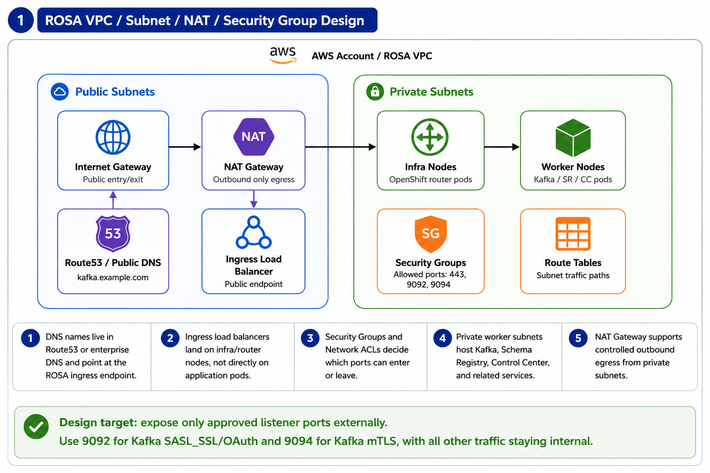
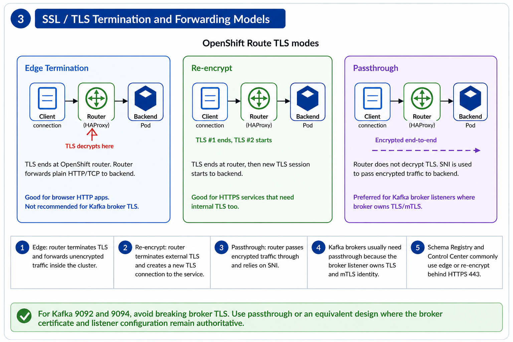

# Wednesday — OpenShift Network Architecture

## Learning objective

> **How does customer traffic actually enter an OpenShift cluster running on ROSA, where is TLS terminated along the way, and why does Kafka need a fundamentally different pattern (TCP passthrough on 9092/9094) from every other HTTP-shaped workload?**

By the end of the day an engineer should be able to:

- Trace a packet from an external client all the way to a Pod, naming every hop and the object that owns each hop.
- Pick the correct OpenShift Route TLS termination mode (edge / re-encrypt / passthrough) for a given workload — and explain why Kafka brokers can use *only* passthrough.
- Map each hop in the path to the observability tool that exposes it (CloudWatch, VPC Flow Logs, Dynatrace, Splunk, OpenShift Console).
- Explain why Kafka's bootstrap → metadata → direct-broker handshake breaks naïve "one hostname in front of three brokers" Ingress patterns.

## Diagrams referenced

The discussion is anchored on seven images under [`images/`](./images/). The first three are recaps of last Wednesday's Kubernetes-networking material; the last four are the new OpenShift-network-architecture material introduced today.

| # | File | Purpose |
|---|---|---|
| R1 | `Pod to Service in-cluster traffic path.png` | Wk1 recap — Pod → CoreDNS → Service → EndpointSlice → Ready Pod; kube-proxy programs the rules but is not in the data path |
| R2 | `Kubernetes Service Type Compared.png` | Wk1 recap — ClusterIP vs NodePort vs LoadBalancer side-by-side, what each exposes and where it sits |
| R3 | `Ingress vs OpenShift Route.png` | Wk1 recap — Ingress (controller-based) vs OpenShift Route (HAProxy router), with a preview inset of the three TLS modes |
| 1 | `ROSA-Networking-01.png` | ROSA VPC / Subnet / NAT / Security Group design — where the cluster actually lives in AWS |
| 2 | `Monitoring and Observability.png` | The same traffic path with telemetry sources at each hop (CloudWatch, VPC Flow Logs, Dynatrace, Splunk, OCP Console) |
| 3 | `TLS-Encryption.png` | OpenShift Route TLS termination modes — edge / re-encrypt / passthrough |
| 4 | `Broker Ingress Traffic.png` | Kafka-specific ingress + egress — why brokers need 9092 OAuth + 9094 mTLS and TCP passthrough |

Walk the diagrams in order. Each one extends the previous one — by the time you reach image 4, the broker-traffic story should feel inevitable.

---

## Part 0 — Recap of Wk1 Wednesday (10–15 min)

We spent Wednesday of Week 1 building up Kubernetes networking from first principles. Re-anchor that material in three short passes before introducing the OpenShift-specific layers.

### R1 — Pod to Service path


- **Pod IPs are ephemeral and internal**. Clients never depend on Pod IPs. The Service DNS name is the contract.
- **CoreDNS** resolves the Service DNS to a stable ClusterIP. Failure of DNS is a separate failure mode from failure of the data path.
- **EndpointSlice** is the source of truth for "which Pods are currently behind this Service." Selector mismatch → no endpoints → 503/timeout, even with a working ClusterIP.
- **kube-proxy** is *not* a userspace proxy. It watches Services + EndpointSlices and programs node-level iptables/IPVS/eBPF rules. The kernel does the actual DNAT.
- **Readiness probes** gate EndpointSlice membership. A Pod can be Running but Not Ready, and silently drop out of rotation.

### R2 — Service types compared


- **ClusterIP** — the only type reachable in-cluster by default. Every other type layers on top.
- **NodePort** — exposes the same Service on a port (30000–32767) on every node. Often rejected by enterprise OpenShift admission policy because it bypasses Route/TLS governance.
- **LoadBalancer** — provisions a real external LB via a cloud or on-prem LB controller. `EXTERNAL-IP <pending>` on clusters with no controller — common gotcha on bare-metal/on-prem.

For internal callers: ClusterIP. For external HTTP/S: Route (next diagram). For Kafka external clients: a special pattern, covered later today.

### R3 — Ingress vs OpenShift Route + the TLS modes inset


- **Ingress (vanilla K8s)** — Ingress object = declarative rules; Ingress Controller = the actual proxy. Without a controller, an Ingress object is configuration with no data plane.
- **OpenShift Route** — Route object = rules; the OCP Router pod (HAProxy) is the proxy. Comes built into the cluster, knows about TLS, defaults to a wildcard `*.apps.<cluster>` hostname.

The bottom inset previews the three TLS termination modes. We come back to those in detail when we look at image 3.

**Key transition into the rest of the day**: every K8s primitive we discussed last week is still in play. We're now adding the **AWS layer underneath** (VPC, NAT, SG), the **OpenShift router behavior on top**, and the **Kafka-specific pattern** that doesn't fit any of the standard shapes.

---

## Part 1 — Where the cluster actually lives: ROSA VPC, subnets, NAT, security groups



- **Public subnets** hold only the *entry points* — Internet Gateway, NAT Gateway, public DNS (Route53), and the Ingress LoadBalancer that fronts the OCP Router. Nothing application-level lives here.
- **Private subnets** hold:
  - **Infra nodes** — OpenShift router pods (HAProxy) run here. They have private IPs only.
  - **Worker nodes** — Kafka, Schema Registry, Connect, REST Proxy, ControlCenter, CMF Pods all run here. Also private IPs only.
- **NAT Gateway** is the only outbound path. Pods that need to call Okta, CyberArk webhooks, Artifactory, or external APIs egress through the NAT. Egress is *controlled by approved listener ports only* — not a fully-open outbound.
- **Security Groups** restrict ingress to the Ingress LB to **443** (HTTPS for UIs / REST), **9092** (Kafka SASL_SSL OAuth), and **9094** (Kafka mTLS). Nothing else is reachable from the public internet.
- **Route Tables** in private subnets point to NAT for outbound, no direct internet route.

**Design target** (the green banner at the bottom of the diagram): expose only approved listener ports externally. Use **9092** for OAuth-authenticated Kafka clients and **9094** for mTLS clients. Everything else stays inside the private subnets.

This shape is what we mean when we say "ROSA-style cluster." Reproducing this with on-prem OpenShift differs at the AWS-specific pieces (replace IGW/NAT/Route53 with the on-prem equivalent: firewall + DNS + LB), but the public/private split and the SG-rule discipline carry over.

### Why this matters for CFK

CFK is going to render brokers, controllers, Schema Registry, Control Center, and Connect inside the private subnets on worker nodes. The brokers' Pod IPs are *not externally routable*. The only way an external producer / consumer reaches a broker is through:

1. **DNS resolution** → public Route53 record points at the Ingress LB.
2. **Ingress LB** terminates the TCP connection (or forwards it) into a private-subnet OCP Router pod.
3. **OCP Router** picks the right backend Service based on hostname (and, for Kafka, port).
4. **Service** routes to the broker Pod's port.

Every one of those hops is a place where the path can break. Image 4 (Broker Ingress Traffic) walks the entire chain end-to-end.

---

## Part 2 — Observability along the path


The diagram restates the traffic path (Client → Route53/DNS → Ingress LB → OCP Router → Service/Endpoint → Pod/Broker) but pairs every hop with the **observability tool** that gives you visibility into that hop. Building this mental map early is what separates a triage that takes 5 minutes from one that takes hours.

| Hop | What can break | Tool to inspect first |
|---|---|---|
| DNS / Route53 | NXDOMAIN, wrong A record, TTL not refreshed after migration | `dig`, Route53 console, **AWS CloudWatch** (LB health) |
| Ingress LB | Backend unhealthy, target group misconfigured, ACL denial | **AWS CloudWatch** (target health) + **VPC Flow Logs** (was the packet even accepted?) |
| Network (VPC, SG, NACL, NetworkPolicy) | Security Group rule missing, NetworkPolicy in the wrong namespace | **VPC Flow Logs** (ACCEPT vs REJECT per 5-tuple) |
| OCP Router (HAProxy) | Route admission failed, TLS cert expired, no matching host header | **Dynatrace** (router metrics) + **OpenShift Console** (Route status) |
| Service / Endpoint | Selector mismatch, EndpointSlice empty, readiness probe failing | **OpenShift Console** (Service + EndpointSlices view) |
| Pod / Broker | Application error, crashloop, OOM, JVM stuck | **Splunk** (logs) + **Dynatrace** (per-pod metrics) + `oc logs` |

**Note from the diagram** (grey line at the bottom): *Monitoring should prove where the packet stopped: DNS, load balancer, router, service, endpoint, pod, or Kafka listener.* In other words — don't go straight to `oc logs`. Walk the hops from the outside in; the tool that has visibility into the hop tells you where you are.

This is the operational counterpart to last week's troubleshooting decision tree.

---

## Part 3 — OpenShift Route TLS termination modes



### Edge termination

- Router decrypts TLS using a certificate stored on the Route object.
- Sends **HTTP** (or unencrypted TCP) to the backend.
- **Good for**: stateless HTTPS UIs where the backend doesn't need to know about TLS.
- **Not for Kafka**: brokers must terminate TLS themselves to authenticate the client (mTLS) and to use their own JKS/PEM material.

### Re-encrypt

- Router decrypts TLS session #1 (presenting the Route's external cert to the client).
- Opens a *new* TLS session #2 to the backend (presenting a different cert pair to the Service).
- **Good for**: HTTPS services that require end-to-end TLS but use a different cert at the edge than the backend.
- **Still not ideal for Kafka**: the broker would need to negotiate TLS with a router-presented client cert rather than the actual external client cert, breaking mTLS identity.

### Passthrough

- Router does **not** decrypt. The TLS session goes end-to-end from external client to backend Pod.
- Router uses **SNI** to pick the right backend based on the hostname the client requested.
- **Required for Kafka broker listeners** — brokers present their own cert, terminate TLS themselves, and validate client certs against their own truststore.
- **Required for Schema Registry / Connect / Control Center** when those services have a strong mTLS posture that the router shouldn't interpose in.

**Rule of thumb**: if the backend needs to see the *real client cert* or terminate TLS with *its own keystore*, you must use passthrough. Everything else can usually use edge or re-encrypt.

The bottom takeaway (green banner): *For Kafka 9092 and 9094, avoid breaking broker TLS. Use passthrough or an equivalent design where the broker certificate and listener configuration remain authoritative.*

---

## Part 4 — Kafka broker ingress: why it doesn't fit the HTTP shape

Show `images/Broker Ingress Traffic.png`. This is the diagram that ties the day together. Walk it slowly — most engineers expect Kafka to behave like an HTTP API and are surprised by what actually happens.

### The bootstrap → metadata → broker handshake

1. **Client connects to a bootstrap address** (one of the brokers, or a bootstrap-shaped DNS record). The connection lands on the Ingress LB, traverses the OCP Router using TCP/SNI passthrough, and reaches one broker Pod.
2. **The broker returns cluster metadata** — including the **per-broker advertised hostnames and ports** for every broker in the cluster.
3. **The client then opens direct connections to each individual broker** at the advertised hostname, *not* through the same bootstrap path. If `advertised.listeners` returns a hostname the client can't resolve or reach, every produce/consume hangs or fails immediately, even though the bootstrap worked.

This is why Kafka cannot be hidden behind a single hostname that proxies HTTP-style to "the brokers." The client *has* to be able to reach each broker independently at its advertised address.

### 9092 vs 9094

Two listeners are exposed to external traffic; both carry real Kafka protocol traffic, but they differ in how the client authenticates:

- **9092 — SASL_SSL with OAuth (OAUTHBEARER)**. Clients authenticate using a JWT issued by Okta (`myapps.firstcitizens.com:443` is the egress dependency from broker Pods to the IdP). TLS protects the transport; OAuth establishes the user/principal.
- **9094 — mTLS (SSL with client-cert required)**. Clients authenticate using a certificate from the cluster's trust store. No SASL; the cert IS the identity. Used by service-to-service callers and any client that can't get an Okta token.

Both listeners are configured on every broker. Per-broker advertised listeners look like:

```
INTERNAL://broker0.kafka-dev-namespace.svc.cluster.local:9092
CERTONLY://broker0.kafka.example.com:9094
```

The OCP Router's Route objects forward the public hostname `broker0.kafka.example.com:9094` straight through (TCP passthrough, SNI-based) to the broker Pod that owns that name. Repeat for broker1, broker2, etc.

### Broker outbound (the right side of the diagram)

The brokers also reach outbound through the NAT to call:

- **MDS** — the embedded Metadata Service inside the brokers themselves (often via internal Service DNS, sometimes externalized).
- **IdP** — Okta, to validate OAuthbearer tokens presented on the 9092 listener.
- **CyberArk / vault** — when ESO refreshes Secret values that the brokers consume on rotation.

Egress is constrained by the same VPC + NAT + SG model from Part 1 — outbound to approved hostnames/ports only.

### Why this matters for the catalog/database JSON

This is the same surface as last week's UAT flink-environments issue. The `kafka-database.json` says `:9094` + `PLAINTEXT`. The 9094 listener is actually mTLS-required. The CMF catalog creation succeeds because CMF stores the JSON without connecting. The first Flink SQL statement against the catalog will fail at the TLS handshake. (See `runbook/LESSONS_LEARNED.md` H5.)

---

## Failure scenarios — by diagram

| Symptom | Most likely hop | Diagram to look at |
|---|---|---|
| External client can't resolve broker hostname | Route53 / public DNS | 1 (VPC) + 2 (observability) |
| `Connection timed out` from outside the VPC | Security Group rule missing for 9092 or 9094 | 1 (VPC) |
| Bootstrap succeeds but produce/consume hangs | Advertised broker hostnames not reachable | 4 (broker ingress) |
| TLS handshake fails on 9094 | Wrong TLS mode on the Route (edge instead of passthrough) | 3 (TLS modes) + 4 (broker ingress) |
| OAuth handshake fails on 9092 | Broker can't reach Okta (NAT or SG egress rule missing) | 1 (VPC egress) + 4 (broker egress) |
| Pod scheduled, Ready, but Route returns 503 | Service selector mismatch, no Endpoints | R1 (Pod → Service) + 2 (observability) |
| Browser hits OCP UI, gets cert error | Route TLS edge mode using expired or wrong-host cert | 3 (TLS modes) |
| Random consumers fail intermittently | One broker's advertised hostname unreachable | 4 (broker ingress) |

---

## Q&A

1. Why is `9094` advertised as `broker0.kafka.example.com:9094` and not `kafka.example.com:9094` for all brokers?
2. What's the difference between Edge, Re-encrypt, and Passthrough — and which one would you pick for Schema Registry's REST endpoint?
3. The bootstrap connection works, but the producer logs say `Connection to broker1 (broker1.kafka.example.com:9094) failed`. What's the most likely cause, and which diagram do you walk first?
4. A team requests `type: NodePort` for a new internal Kafka client because "it's easier than configuring DNS." What's wrong with that on a regulated OpenShift cluster?
5. Why does CFK never put broker Pods in a public subnet?
6. Where does the `myapps.firstcitizens.com:443` egress dependency from broker Pods live in the picture — and which AWS object enforces that the dependency is reachable?
7. The OpenShift Route has `tls.termination: edge`. Why would a Kafka broker behind that Route fail?
8. Reading image 2: which tool would you check FIRST if a producer says "TLS handshake reset" on connection to a broker? Which one second?
9. The 9092 listener carries SASL_SSL + OAuth. Where is the JWT verified — at the OCP Router, at the broker, or both?
10. A new requirement comes in: expose Control Center UI externally over HTTPS. Walk through which OpenShift Route TLS mode you'd use and why.
11. Describe the difference between the "advertised hostname" Kafka returns to the client and the in-cluster Service DNS name. Why does Kafka need both?
12. If VPC Flow Logs show `ACCEPT` for the bootstrap packet but the Route status says no backend, where did the packet stop — and which next tool would isolate it?

---

## Common misconceptions

- **"Kafka brokers can sit behind a single hostname like an HTTP API"** — no. The bootstrap returns broker-specific advertised hostnames, and the client connects directly to each. A single front hostname only works if you make per-broker SNI-based passthrough Routes (one Route per broker hostname).
- **"OpenShift Routes always terminate TLS at the router"** — only for edge and re-encrypt modes. Passthrough specifically does not.
- **"NodePort is just an easier way to expose a Service"** — on enterprise OpenShift it usually fails admission. It also bypasses Route/TLS governance. Don't reach for it without checking policy.
- **"If the LB is green, the cluster is fine"** — the LB only sees the *first hop* of the path. A green LB plus a failing OCP Router or empty EndpointSlice produces a healthy-LB / dead-app combination. Image 2 exists precisely to teach this.
- **"The OCP Router can authenticate clients"** — by default it forwards traffic. Client authentication for Kafka happens at the broker (OAuth on 9092, mTLS on 9094), not at the router.
- **"VPC Flow Logs are too low-level to be useful"** — they're the single best tool for *was the packet even accepted by the network?* If Flow Logs say REJECT, no further app-layer triage will help.

---

## Reference

- OpenShift Routes: <https://docs.openshift.com/container-platform/latest/networking/routes/route-configuration.html>
- OpenShift Ingress Controller: <https://docs.openshift.com/container-platform/latest/networking/ingress-operator.html>
- ROSA AWS networking: <https://docs.aws.amazon.com/ROSA/latest/userguide/rosa-sts-aws-prereqs.html>
- VPC Flow Logs: <https://docs.aws.amazon.com/vpc/latest/userguide/flow-logs.html>
- Kafka listeners and advertised listeners: <https://docs.confluent.io/platform/current/installation/configuration/broker-configs.html#listeners>
