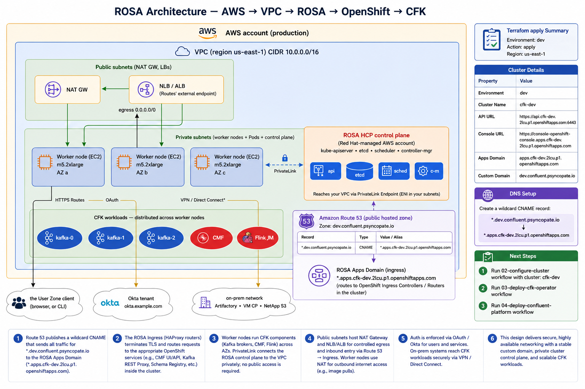

# Monday — ROSA Architecture

**Time**: ~90 min
**Diagram (source)**: [`30-rosa-architecture.drawio`](30-rosa-architecture.drawio) — `AWS → VPC → ROSA → OpenShift → CFK`, walked through using the `cfk-dev` cluster as the concrete example



## Learning objective

> **What is ROSA actually?** It's not a fork of OpenShift; it's not "OpenShift on EC2." It's a Red Hat–managed OpenShift cluster running inside an AWS account, jointly supported by RH + AWS, with a specific control-plane / worker split and a fixed integration surface with AWS (Route 53, OIDC, STS/IRSA, VPC + security groups) that differs from self-managed OCP.

The whole week is built around a single concrete cluster — `cfk-dev`, provisioned by the `01-Provision ROSA` Terraform workflow. Every walkthrough, every lab command, every Q&A example refers back to that cluster.

## Architecture Discussion (~40 min)

Walk the diagram top-down, in the order the layers compose:

### 1) AWS account + region (outermost rectangle)

The `cfk-dev` cluster lives in a single AWS account (the `production` account in the org) and a single region: **`us-east-1`**. ROSA does not span regions — multi-region needs a second cluster + replication (covered in Week 6). The cluster owner is identifiable from the `rosa_creator_arn` tag stamped on every resource.

### 2) VPC — your private network

`cfk-dev` is anchored to a VPC with **machine CIDR `10.0.0.0/16`**. Two named secondary CIDRs that the OpenShift install pins separately:
- **Pod CIDR `10.128.0.0/14`** — every Pod gets an IP from here (SDN/OVN-managed, not from the VPC)
- **Service CIDR `172.30.0.0/16`** — every `Service` ClusterIP comes from here

The VPC has **public subnets** (which host the NAT Gateway and the cluster's external load balancers / Routers) and **private subnets** (which host worker nodes, pods, and — on ROSA Classic — the control-plane EC2 instances). Multiple AZs across `us-east-1` give the cluster's control plane and worker pool fault tolerance inside the region.

### 3) ROSA control plane

ROSA has two architecture flavors. The diagram shows the hosted-control-plane shape because that's the direction most new deployments will go, but it's important to know which one *this* cluster is:

- **ROSA Classic** — control plane (kube-apiserver, etcd, scheduler, controller-manager) runs on dedicated EC2 instances in **your** VPC's private subnets; you pay for those instances. The Terraform module name `rosa-classic` and the presence of a `cfk-dev-ControlPlane-Role` IAM role are the giveaways. **`cfk-dev` is currently provisioned as ROSA Classic.**
- **ROSA HCP (Hosted Control Plane)** — control plane runs in Red Hat's own AWS account and reaches your VPC over a **PrivateLink** ENI. You pay only for worker nodes. There is no `ControlPlane-Role` because the control plane is not in your account.

Either way, from an engineer's perspective the OpenShift API + UI feel identical. The shape matters when:
- **Troubleshooting the control plane** — on HCP you can't reach the masters at all; tickets go to Red Hat support. On Classic you can still inspect master nodes, but you don't reconfigure them — Red Hat does.
- **Networking** — HCP requires that the PrivateLink endpoint inside your VPC stay healthy or the API is unreachable. Classic doesn't have that hop.
- **Cost model** — HCP separates the control-plane subscription from worker EC2 spend; Classic bundles control-plane EC2 cost into your AWS bill.

### 4) Worker nodes (EC2 in the private subnets)

For `cfk-dev`: `m5.xlarge` instances spread across multiple AZs in `us-east-1`, behind the cluster autoscaler. Each worker runs kubelet + CRI-O + kube-proxy + your Pods. Workers reach internet egress (image pulls, OpenShift telemetry, etc.) through the **NAT Gateway** in the public subnets — never directly.

### 5) OpenShift on top of Kubernetes

Routes, Projects, SCC, the OperatorHub framework, the integrated registry, the OpenShift Ingress Controller. Friday Week 1's diagram laid this out — Week 3 just observes that all of it runs in this specific ROSA cluster.

### 6) DNS and the two domains

This is the part that confuses every engineer the first time. ROSA gives you a Red Hat–managed wildcard domain — for `cfk-dev` that's **`apps.cfk-dev.2lcu.p1.openshiftapps.com`**. Every `Route` created in the cluster lives under it by default. The API URL is at **`https://api.cfk-dev.2lcu.p1.openshiftapps.com:6443`** and the console at **`https://console-openshift-console.apps.cfk-dev.2lcu.p1.openshiftapps.com`**.

To present friendlier hostnames, the Terraform workflow also publishes a public Route 53 hosted zone — **`dev.confluent.psyncopate.io`** — with a wildcard CNAME pointing at the ROSA apps domain:

```
*.dev.confluent.psyncopate.io.   CNAME   *.apps.cfk-dev.2lcu.p1.openshiftapps.com.
```

So any Route the cluster exposes — `controlcenter.dev.confluent.psyncopate.io`, `schemaregistry.dev.confluent.psyncopate.io`, `connect.dev.confluent.psyncopate.io`, `ksqldb.dev.confluent.psyncopate.io`, `kafkarestproxy.dev.confluent.psyncopate.io` — resolves through the public DNS zone, lands at the OpenShift Ingress Controller, and gets routed to the right `Service` inside the cluster.

### 7) Your workloads

For this engagement: **CFK** (Confluent for Kubernetes) deploying Kafka brokers, CMF, and Flink JobManagers as Pods scheduled onto the worker nodes. The Kafka brokers are not in the public Internet path — clients reach them only through Routes (HTTPS), or via VPN / Direct Connect from on-prem networks (Artifactory, the existing VM Confluent Platform, NetApp S3 for checkpoint storage).

### The three AWS-specific integration points engineers must understand

These are what makes ROSA "ROSA" vs vanilla OCP, and they're the topics of Tue/Wed/Thu:

- **OIDC** (Tuesday) — how users sign in. ROSA federates with an external identity provider (Okta in production). The cluster trusts tokens issued by that IdP.
- **STS / IRSA** (Wednesday) — how Pods authenticate to AWS APIs. The Pod's ServiceAccount is annotated with an IAM Role ARN; AWS STS exchanges the SA token for short-lived AWS credentials. No long-lived secrets stored anywhere.
- **VPC + security groups** (Thursday) — what the cluster can reach + what can reach it. NAT gateways, security groups, route tables.

### Read-only ROSA inventory commands (run these in the lab)

```bash
# Cluster version, operator health, node inventory
oc get clusterversion
oc get nodes -o wide
oc get machineconfigpools
oc get clusteroperators          # 30+ operators; this *is* the cluster itself
oc adm top nodes                 # what's running where
```

`kubectl` equivalent for the parts that aren't OpenShift-only:

```bash
kubectl get nodes -o wide
kubectl top nodes
```

`oc get clusterversion`, `oc get machineconfigpools`, and `oc get clusteroperators` have no portable `kubectl` form — they read CRDs that only OpenShift defines.

## Diagram Walkthrough (~30 min)

Walk the layered diagram top-down. At each layer, ask the team:

- *"If this layer fails, what does the engineer see?"*
- *"Who owns this layer — engineer, platform team, RH support, or AWS?"*

Example responses to walk through, using `cfk-dev` as the concrete cluster:

- VPC subnets full → new worker nodes can't get IPs → cluster scale-up fails — **platform team**
- Red Hat upgrades the control plane to next minor → some Kubernetes APIs are deprecated → workloads break — **RH-initiated, platform-orchestrated, engineer-impacted**
- `kube-apiserver` returns 5xx → all of `https://api.cfk-dev.2lcu.p1.openshiftapps.com:6443` is unreachable → cluster-wide outage → all ops paused — **RH support**
- A worker EC2 fails its health check → kubelet stops reporting → Pods on that node go `NotReady` → reschedule onto a healthy worker — **platform team / autoscaler**
- Route 53 record for `*.dev.confluent.psyncopate.io` accidentally deleted → all custom-domain Routes go NXDOMAIN even though OpenShift Routes are healthy — **engineer / platform team**

## Failure Scenarios

| Symptom | Likely cause | Who fixes |
|---|---|---|
| `oc login https://api.cfk-dev.2lcu.p1.openshiftapps.com:6443` returns `connection refused` | VPC routing broken (Classic) or PrivateLink endpoint unhealthy (HCP) | Platform team |
| New Pods stuck `Pending`: `0/X nodes available: Insufficient cpu` | Workers full; needs scale-up | Platform / autoscaler |
| Worker node disappears from `oc get nodes` | EC2 instance terminated; autoscaler replacing | Platform |
| Cluster operator shows `Degraded` in `oc get co` | Internal RH-managed component issue | RH support ticket |
| `controlcenter.dev.confluent.psyncopate.io` returns NXDOMAIN but the OpenShift Route is healthy | Route 53 wildcard CNAME missing or wrong target | Engineer / platform team |
| Pod can't pull from ECR | IRSA misconfigured (Wednesday's topic) | Engineer |

## Q&A

1. What's the difference between ROSA Classic and ROSA HCP, and which one is `cfk-dev`? How would you confirm it from `oc` alone?
2. Where does the etcd cluster live on `cfk-dev` today? If it were HCP, where would it live instead? Can you `ssh` to it in either case?
3. If Red Hat does a control-plane upgrade on `cfk-dev`, who orchestrates the worker upgrade?
4. Why does `cfk-dev`'s VPC need a NAT gateway in the public subnets? What stops working without it?
5. A user reports that `https://schemaregistry.dev.confluent.psyncopate.io` returns NXDOMAIN. Walk the layers of the diagram — at which layer is the failure, and what's the next command you run?
6. In production, who would you contact for: (a) a worker-side networking issue, (b) etcd disk pressure, (c) an SCC misconfiguration?

## Added Enhancement — ROSA vs Self-Managed OpenShift

Focus on operational differences:
- AWS-managed control plane (whether Classic or HCP) vs. customer-managed
- Shared responsibility model — who owns image pulls, network policy, IAM
- Cluster upgrades — initiated by Red Hat, orchestrated by platform, impacting workloads
- Support boundaries (Red Hat, AWS, customer)

Whiteboard: take the `cfk-dev` outage scenarios from the table above and re-classify each as **engineer**, **platform team**, **Red Hat**, or **AWS**.
