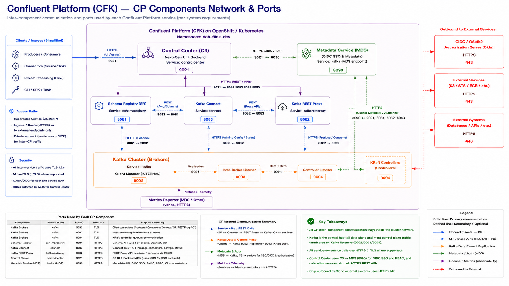

# Monday — CFK Architecture: CP Components, Network & Ports

**Time**: ~90 min



**Reference**: Confluent Platform [system requirements — ports](https://docs.confluent.io/platform/current/installation/system-requirements.html#ports). The diagram above is a CFK-on-OpenShift rendering of that table; every port shown maps to a row in the doc.

## Learning objective

> **When someone says "Connect can't reach Kafka," which port and which listener do you check first — and what does the diagram tell you about which certificate / OAuth token / RBAC role has to be in place for that connection to complete?** By the end of this session you should be able to point at the box, name the port, and name the auth flow from memory.

## Architecture Discussion (~45 min)

CFK = Confluent for Kubernetes. It's an Operator (Week 2 Tuesday pattern) that takes Custom Resources for each Confluent Platform component and reconciles them into StatefulSets / Deployments / Services / Ingresses. Engineers must know four layers: the components, the Kafka listener ports, the CP service ports, and the outbound-egress boundary.

### Layer 1 — The Confluent components

Walk the diagram top-to-bottom. Each component is a K8s Service inside the namespace; the port after each name is the primary Service port shown in the diagram and matches the Confluent Platform system-requirements defaults.

| Component | K8s Service | Port | Protocol | Purpose |
|---|---|---|---|---|
| Kafka Brokers — client | `kafka` | **9092** | TLS | Producer / Consumer / Connect / SR / REST Proxy / C3 traffic |
| Kafka Brokers — inter-broker | `kafka` | **9093** | TLS | Replication, ISR, partition data plane |
| Kafka Brokers — controller | `kafka` | **9094** | TLS | KRaft quorum (replaces ZooKeeper) |
| Schema Registry | `schemaregistry` | **8081** | HTTPS | Avro / Protobuf / JSON-Schema registration + compatibility |
| Kafka REST Proxy | `kafkarestproxy` | **8082** | HTTPS | HTTP produce / consume for non-Kafka-protocol clients |
| Kafka Connect | `connect` | **8083** | HTTPS | Connectors REST API (manage sources / sinks, configs, status) |
| Metadata Service (MDS) | `kafka` (MDS endpoint) | **8090** | HTTPS | OIDC SSO, AuthZ, RBAC, cluster metadata |
| Control Center (C3) | `controlcenter` | **9021** | HTTPS | Next-Gen UI + backend APIs |

These are defaults per the CP system-requirements doc; CFK preserves them unless overridden in the CR.

### Layer 2 — The Kafka broker listeners (9092 / 9093 / 9094)

The Kafka broker is not "one port on 9092." It runs **three separate listeners** on three ports, each with its own purpose, its own auth, and its own certificate. Engineers must know each:

- **9092 — Client listener (INTERNAL)**. Every Confluent Platform client component — Schema Registry, Connect, REST Proxy, Control Center, and end-user producers/consumers — connects here. In CFK on OpenShift this is TLS + OAUTHBEARER (Okta) in production.
- **9093 — Inter-broker listener**. Broker↔broker traffic: replication (ISR), leader elections, partition reassignment. Never touched by clients. TLS + broker-cert mTLS.
- **9094 — Controller listener (KRaft)**. Broker↔controller and controller↔controller quorum. Replaces the ZooKeeper `2181`/`3888` split. TLS.

If any of these three is misconfigured — wrong cert, wrong SASL mechanism, wrong advertised hostname — the cluster degrades in a specific and diagnosable way. Which port failed tells you which layer to look at.

### Layer 3 — CP service ports (8081 / 8082 / 8083 / 8090 / 9021)

All five CP service tiers are HTTPS-only inside the cluster. Every one of them calls Kafka on 9092 for its own operation; on top of that they call each other for specific reasons:

- **SR (8081)** — clients register/lookup schemas; Connect calls SR to serialize records; C3 calls SR to render schema browsing.
- **REST Proxy (8082)** — external HTTP clients produce/consume; internally translates HTTP to the Kafka wire protocol on 9092.
- **Connect (8083)** — REST API for connector CRUD; workers stream to/from Kafka on 9092; store connector offsets/configs/status in internal Kafka topics.
- **MDS (8090)** — the auth hub. Every component calls MDS for OIDC token validation and RBAC decisions. C3's browser SSO goes through here.
- **C3 (9021)** — the only browser-facing UI. Calls MDS (8090) for auth and calls every other CP service via its HTTPS REST API to render dashboards.

The **HTTPS (REST/APIs)** arrow band in the middle of the diagram (`9021 ↔ 8081, 8083, 8082, 8090`) is C3 fanning out to every service. When Control Center "can't see" a component, that specific arrow is broken.

### Layer 4 — Outbound to external services (443 only)

The right-hand column of the diagram is the only place CP traffic leaves the cluster. Engineers must know this list is short and every entry is HTTPS on 443:

- **Okta** (OIDC / OAuth2 Authorization Server) — token issuance, JWKS, OIDC SSO for C3
- **AWS Services** — S3 (Connect sinks), STS (IRSA), ECR (image pulls)
- **External Systems** — customer databases, third-party APIs consumed by Connect

Everything else — every one of the 8 rows in the ports table above — stays **inside the cluster network** and is not exposed by an Ingress or LoadBalancer unless someone deliberately adds one (that's the Firewall Request / Zscaler conversation from Week 3 Thursday). Kafka broker 9092/9093/9094 is not on this list because those are TCP-native Kafka wire protocol; they're covered by the tracker 2.10 policy exception, not by the 443-HTTPS pattern.

### What CFK adds on top of these ports

For each component the operator emits: a **StatefulSet** (Kafka + KRaftController) or **Deployment** (SR / Connect / REST Proxy / C3), a **Service** (ClusterIP) on the port from Layer 1, a **ConfigMap** with the component config, **Secrets** for TLS + OAuth, and **PVCs** where stateful. You don't apply any of that directly — you apply a `Kafka` CR + a `SchemaRegistry` CR + a `Connect` CR + a `KafkaRestProxy` CR + a `ControlCenter` CR, and the operator does the rest. Week 2 Tuesday pattern in action.

### CFK on production OpenShift — the specific constraints

Site-specific bits engineers must know (read `runbook/LESSONS_LEARNED.md`):

- **CFK 3.1.2 / preview-2 build** is the version the platform runs. Stock CFK 3.1.0 has site-incompatible defaults.
- **CRD limitations** (runbook A2, A3): no `startupProbe`, no `initContainers` override. Default init container has ~500m CPU floor that becomes the pod-effective minimum.
- **ResourceQuota** (tracker 2.5 / runbook A3): 6 CFK Pods × ~500m init CPU = ~3 CPU minimum. DEV's original 2-CPU quota fit only 4 pods.
- **OAuth integration** (tracker 2.9): the Kafka client listener on 9092 authenticates clients via Okta tokens (OAUTHBEARER). Operator OAuth flow vs end-user OAuth (Week 3 Tuesday) — different grant types, same trust chain.
- **External access exception** (tracker 2.10): broker 9094 (mTLS-only listener, distinct from the KRaft controller port also numbered 9094 — CR-configured) is exposed via LoadBalancer for cluster-link. Everything else stays cluster-internal.

### What's NOT CFK — the boundary

CFK does NOT manage: the K8s cluster (ROSA / OpenShift), storage provisioning (CSI + StorageClass), TLS certs (cert-manager + Keyfactor), Secrets (ESO + CyberArk), or metrics infrastructure (Prometheus / Grafana / Dynatrace — CFK does emit JMX, they scrape it). CFK is a thin layer that orchestrates Confluent components on top of K8s primitives.

## Diagram Walkthrough (~30 min)

Open the embedded image and trace, in this order:

1. **Kafka listener stack** — 9092 client, 9093 inter-broker, 9094 controller. For each one, name a symptom that would appear if it were broken (client can't connect / partition ISR shrinks / controller election fails).
2. **C3 fan-out** — the middle HTTPS band showing C3 (9021) reaching MDS (8090), SR (8081), Connect (8083), REST Proxy (8082). This is what "Control Center dashboard blank tile" almost always means: one arrow in this band is broken.
3. **The MDS diamond** — every component talks to MDS (8090) for auth. If MDS is down or misconfigured, every service-to-service call fails auth at the same time.
4. **Outbound HTTPS 443** — three destinations only (Okta / AWS Services / External Systems). Everything else stays inside.

For each trace, ask:
- *Which K8s Service is in play?*
- *Which certificate signs the TLS handshake?*
- *Which OAuth token / RBAC role authorizes the call?*
- *Which firewall or Ingress rule (if any) permits it?*

## Failure Scenarios — preview the week

| Symptom | Which port / arrow | Where to look |
|---|---|---|
| `kafka` CR applied; no Pods come up | (n/a — pre-network) | CFK operator logs; operator RBAC (tracker 2.3) |
| Pods come up but `cluster-ready=False` | 9094 (controller quorum) | KRaft quorum health; controller Pod logs |
| Producer client "connection refused" | 9092 (client listener) | Broker readiness; advertised listener FQDN; OAuth token issuer |
| Partition ISR shrinks / under-replicated | 9093 (inter-broker) | Broker-to-broker mTLS; inter-broker listener config |
| Broker can't get OAuth token | Okta 443 (outbound) | tracker 2.9; trust bundle (2.8); Okta reachability |
| Connect fails to serialize a message | 8081 (SR) | Connect → SR arrow; Connect worker's SR endpoint config; SR pod up? |
| C3 dashboard tile blank | 9021 → {8081, 8082, 8083, 8090} | Which arrow in the C3 fan-out is broken; MDS RBAC role for the C3 service principal |
| C3 login fails | 9021 → 8090 → Okta 443 | MDS OIDC config; Okta app; browser can reach Okta |
| Cluster-link source can't reach destination | 9094 (mTLS ext.) | tracker 2.10 policy exception; LoadBalancer SG allows source subnet |

## Q&A

1. Kafka runs on **three** listener ports (9092/9093/9094). Which client type uses which port, and why is the separation load-bearing rather than a convention?
2. If you delete the `Kafka` CR, what happens to broker PVCs? (Hint: ownerReferences + reclaimPolicy)
3. C3 (9021) needs to render a topic's schemas. Trace the exact hop-by-hop path (service → port → auth) from the browser to the schema JSON on Schema Registry (8081).
4. What's the difference between the operator's RBAC and each broker Pod's RBAC?
5. In production, name three OpenShift-side prerequisites that must be in place BEFORE a CFK install will succeed.
6. Only three destinations sit in the "Outbound to External Services" column. Which one would you expect to see the most traffic to during normal operation, and which one during a fresh install?
7. MDS (8090) is drawn as if it's a separate component but it's actually served by the Kafka broker Pod. What are the pros and cons of that co-location vs. deploying MDS as its own Deployment?

## Added Enhancement — CFK Reconciliation Deep Dive

Most production troubleshooting starts with understanding reconciliation.

Flow:

```
Kafka CR
  -> CFK Operator
  -> StatefulSets
  -> Services  (opens 9092/9093/9094 + 8081/8082/8083/8090/9021)
  -> PVCs
  -> Pods
```

Required commands (both `oc` and `kubectl` shown per training convention):

```bash
oc get kafka                          # kubectl get kafka
oc describe kafka <cluster>           # kubectl describe kafka <cluster>
oc get events -A                      # kubectl get events -A
oc logs deployment/confluent-operator # kubectl logs deployment/confluent-operator
```

Failure scenario: a Kafka CR exists but brokers never appear. Students must identify where reconciliation failed — CR admission? Operator log? Missing verb in operator RBAC? Then map the failure to which listener port would have come up if the reconcile had succeeded.
