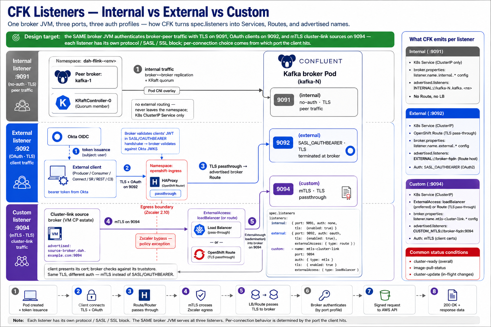

# Wednesday — CFK Listeners: Internal vs External vs Custom

**Time**: ~90 min

**Drawio source**: [`42-cfk-listeners.drawio`](42-cfk-listeners.drawio)

## Learning objective

> **How do brokers expose multiple ports with different authentication profiles**, and how does CFK turn a `listeners` block into the right Service/Route plumbing?

## Architecture Discussion (~45 min)

A Kafka broker can advertise multiple listeners (port + protocol + auth) at the same time. CFK exposes this via the `spec.listeners` block.

### The three listener types CFK knows

- **`internal`** — cluster-to-cluster (broker ↔ broker, broker ↔ KRaftController). Required.
- **`external`** — clients reaching brokers from outside the cluster. Optional, multiple allowed.
- **`custom`** — used in production for the 9094 mTLS port for cluster linking (tracker 2.10).

Each listener has:
- A **port** (e.g. 9092, 9093, 9094)
- An **authentication** profile (`SASL_OAUTHBEARER`, `SASL_PLAIN`, `MTLS`, `NONE`)
- A **TLS** setting (terminate at broker, terminate at LB, or none)
- An **externalAccess** type (only on the `external` listener — `loadBalancer`, `route`, `nodePort`, `staticForHostBased`)

### What the operator emits per listener

For each listener, the operator generates:
- A K8s **Service** (port mapping → broker container port)
- An advertised-listener entry in **broker.properties** — the host name + port the client is told to use
- One **Route / LoadBalancer** per broker if external
- TLS handling: either passthrough Route or terminating LB

### The Production listener layout

In production, broker CRs typically expose three listeners:

1. **`internal:9091` / no-auth, TLS** — broker ↔ broker over the pod network
2. **`external:9092` / SASL_OAUTHBEARER over TLS** — client → broker via HAProxy passthrough (Okta-issued tokens, tracker 2.9)
3. **`custom:9094` / mTLS** — cluster-link source brokers connecting from the VM CP estate (tracker 2.10 — the policy exception)

Each listener has its own SASL/TLS config; the broker can authenticate one client via Okta and another via mTLS on the same broker JVM.

### How a client lookup works

1. Client → bootstrap-server (e.g. `kafka.dah-flink-dev.example.com:9092`)
2. Bootstrap broker returns the **advertised listeners** for all brokers — broker.id, host, port
3. Client connects to the assigned broker's advertised host:port
4. If the advertised host is wrong (e.g. internal name returned to external client), connection fails

This is why per-broker external Routes / advertised listeners matter — the client must be told a routable name.

### Cross-listener auth — the bilingual broker

The same broker can speak OAuth on 9092 and mTLS on 9094 because each listener has its own `*.security.protocol`, `*.sasl.mechanism`, and `*.ssl.*` settings. The broker isn't choosing between them per connection — it's serving each port with its own configured profile.

This is what enables the migration architecture: VM CP brokers connect to CFK brokers over mTLS (their existing protocol), while new clients connect over OAuth.

## Diagram Walkthrough (~30 min)

Open `42-cfk-listeners.drawio`. For each listener:
- Trace the network path from client → listener
- Identify TLS termination point
- Identify auth method
- Identify the firewall / SG / network policy that must permit it

## Failure Scenarios

| Symptom | Where to look |
|---|---|
| Producer can connect to bootstrap, fails on first produce | advertised listener returning unroutable host |
| OAuth client gets 401 from broker | Okta egress (tracker 2.9), trust bundle (2.8), token audience claim |
| Cluster-link source connects but auth fails | 9094 mTLS client cert vs broker truststore |
| TLS handshake fails — `bad_certificate` | trust bundle on the broker — does it include the client's CA? |

## Q&A

1. Why does a broker need three separate listeners instead of one with multi-protocol support?
2. If `spec.externalAccess.type: route` is set, what does the operator create that it wouldn't create with `loadBalancer`?
3. Why does the platform's 9094 listener need a firewall exception when 9092 doesn't?
4. What happens to in-flight clients if you change `spec.listeners.external.port` from 9092 to 9192?

## Added Enhancement — Listener and Networking Design

Topics:
- Internal listeners
- External listeners
- Routes
- Load Balancers
- DNS

Real-world scenario:
Client can resolve broker hostname but cannot establish connection.

Students trace traffic path end-to-end.
