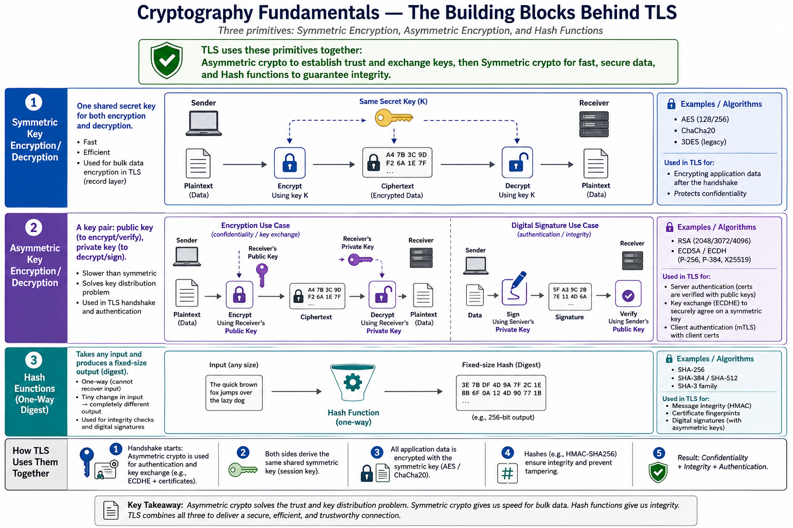
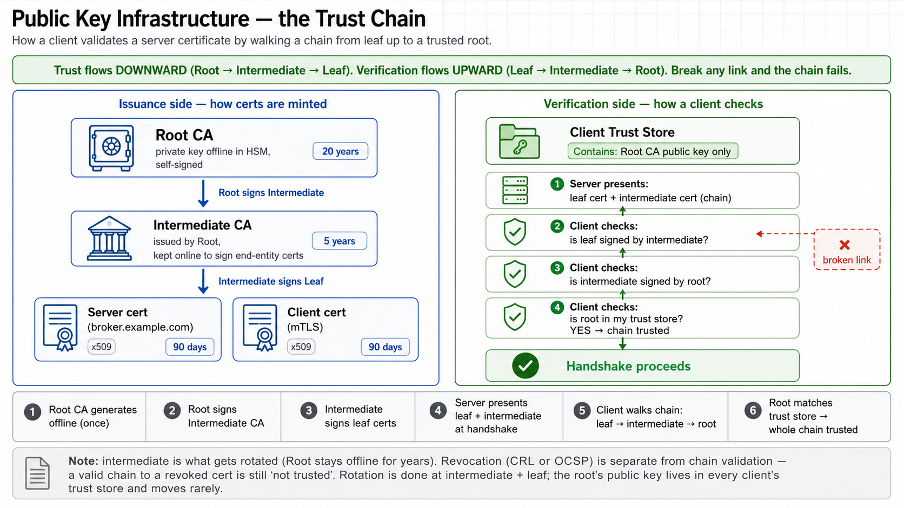
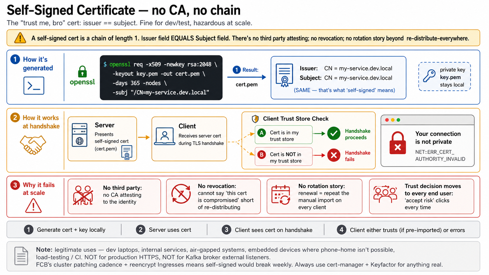
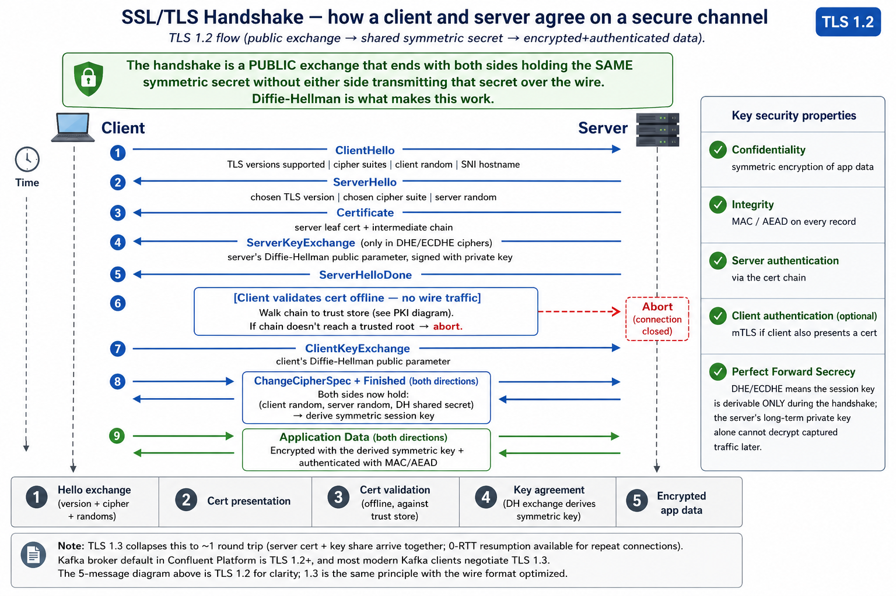
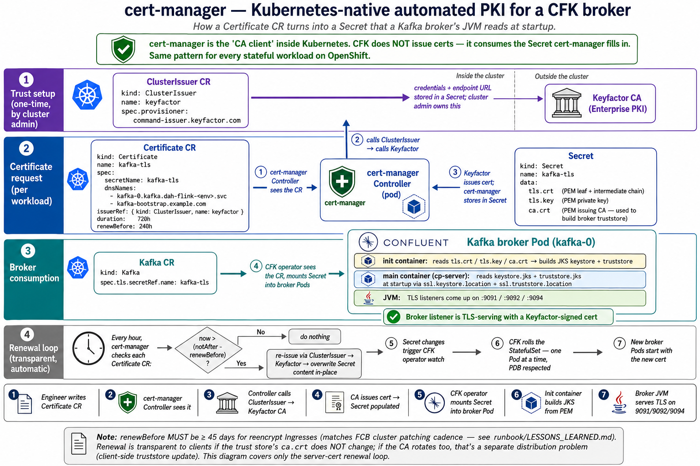

# Thursday — PKI, TLS, and cert-manager (with a CFK broker example)

**Time**: ~90 min

## Learning objective

> **How does trust get established between two machines on a network, and how does that trust show up in a CFK broker Pod?** By the end of this session you should be able to (1) walk any x509 cert chain and name each hop, (2) explain why a self-signed cert is fundamentally different from a CA-issued cert, (3) trace a TLS 1.2 handshake message by message and name what each message accomplishes, and (4) point at every artifact in a Kubernetes cluster that participates in issuing, storing, mounting, and consuming a broker's cert.

The four topics are ordered deliberately, preceded by a short **Cryptography Fundamentals** primer that names the three primitives (symmetric / asymmetric / hash) everything downstream is built from: PKI is the foundation → self-signed is the "no-CA" edge case that clarifies what PKI adds → TLS handshake is where PKI actually gets used on the wire → cert-manager is how Kubernetes automates the whole thing, with the CFK broker as the concrete consumer.

---

## Cryptography Fundamentals

### Engineers must know

Everything downstream in this session (PKI, self-signed, handshake, cert-manager) builds on three cryptographic primitives. TLS does not invent new crypto — it choreographs these three in a specific order.

- **Symmetric encryption** — ONE shared secret key handles both encrypt and decrypt. Fast, efficient, right for bulk data. Examples: AES-128 / AES-256, ChaCha20, 3DES (legacy). Weakness: how do the two sides agree on the key without either sending it in the clear? That's the problem asymmetric solves.
- **Asymmetric encryption** — a KEY PAIR: public key encrypts (or verifies), private key decrypts (or signs). Slower than symmetric by orders of magnitude, which is why it's used only during setup, not for bulk traffic. Two distinct use cases:
  1. **Confidentiality / key exchange** — encrypt data (or a proposed symmetric session key) with the *receiver's public* key; only the receiver's private key can decrypt.
  2. **Digital signature** — sign data with the *sender's private* key; anyone with the sender's public key can verify (authenticates the sender AND proves the data wasn't modified).
  - Examples: RSA (2048 / 3072 / 4096), ECDSA / ECDH (P-256, P-384, X25519).
- **Hash functions** — one-way digest: any-size input → fixed-size output. Cannot recover input from the hash. A one-bit change in the input produces a completely different hash. Examples: SHA-256, SHA-384/512, SHA-3 family. Used for message integrity (HMAC), certificate fingerprints, and as the "content to sign" inside every digital signature (you sign the hash, not the full document).

### How TLS combines them

1. **Asymmetric** does the handshake: server proves its identity with a certificate (public-key signature verification), and both sides agree on a symmetric session key via ECDHE key exchange.
2. **Symmetric** does the bulk data: once the session key is derived, all application-data records are encrypted with AES or ChaCha20 — orders of magnitude faster than doing it asymmetrically.
3. **Hashes** guarantee integrity: HMAC (or AEAD tags in modern ciphers) on every record catches tampering; certificate fingerprints uniquely identify certs for pinning; digital signatures are always over a hash of the content, not the content itself.

### Why the split matters

If TLS used asymmetric for bulk data, every browser request would be tens-of-milliseconds of CPU per record — unusable. If TLS used symmetric alone, the two sides could never establish the initial key without a prior meeting. Combining them: asymmetric solves the "how do we agree on a symmetric key with a stranger" problem, then hands off to symmetric for the actual speed. Hashes bind everything together with integrity guarantees.

**Key takeaway** (from the diagram): asymmetric solves the trust and key-distribution problem; symmetric gives us speed for bulk data; hash functions give us integrity. TLS combines all three to deliver a secure, efficient, and trustworthy connection — that's the machinery every subsequent topic in this session sits on top of.

---

## Topic 1 — Public Key Infrastructure (PKI)

### Engineers must know

- **Trust flows downward, verification flows upward.** The Root CA signs the Intermediate; the Intermediate signs the Leaf. When a client validates a server, it walks the chain in reverse: leaf → intermediate → root. The client's *trust store* holds only the Root's public key; if the walk lands there, the whole chain is trusted.
- **A "certificate" is a signed statement**: "this public key belongs to this subject (CN + SANs), from this validity window, per this issuer." The signature is over that statement, made with the issuer's private key.
- **Root CAs stay offline.** The private key lives in an HSM / vault, generates rarely (every 10–20 years), and does one job: sign intermediates. Compromise of a Root breaks every downstream cert — that's why it doesn't touch the internet.
- **Intermediates are what rotate.** Online, sign leaf certs, get rotated on the order of years. If an Intermediate is compromised, only the leaf certs under that intermediate are affected — the Root is fine.
- **Leaf certs are what services present.** Rotated on the order of hours (Let's Encrypt: 90 days) to months (enterprise: 1 year). The whole point of automation like cert-manager is to make leaf rotation invisible.

### What breaks

- Any link in the chain missing on the wire (server forgot to send the intermediate) → client validates the leaf, can't find its issuer, aborts.
- Any link in the chain has an expired cert → aborts.
- Trust store doesn't contain the root → aborts. This is the "corporate root not in the JVM default trust store" case: browser trusts it, JVM doesn't.

### Production context

FCB PKI: the Root CA and Intermediates live in Keyfactor; leaf certs are issued by cert-manager via the Keyfactor ClusterIssuer. The corporate Root CA public key ships in every workstation's browser trust store (via GPO) — but **not** in the JVM's default cacerts. That's why CFK broker truststores need explicit CA material (see Topic 4).

---

## Topic 2 — Self-Signed Certificates

### Engineers must know

- A self-signed cert is a **chain of length 1**. The `Issuer` field in the cert equals the `Subject` field. There is no third party.
- Generated with a single openssl command; the private key never leaves the machine.
- On handshake: the server presents its self-signed cert; the client's *trust store* is checked for a byte-exact match. Either the cert has been pre-shared (trust-on-first-use, or manual import), or the client aborts with a "not private" warning.
- **No revocation, no rotation story, no third-party attestation.** Every trust decision moves to the end user or admin.

### What breaks

- Every additional client that needs to trust the service requires manual import. Doesn't scale beyond ~a handful of clients.
- Cert rotation = re-distribute the new cert everywhere. Miss one client → that client breaks.
- If the private key leaks, there's no "revoke" — the only fix is generate a new one and redistribute.

### Production context

Self-signed is fine for **dev laptops**, **internal service-to-service where a mesh handles trust separately**, **embedded devices that can't phone home**, and **load-testing/CI**. It is **not fine** for production HTTPS or Kafka broker external listeners. FCB's cluster patching cadence + reencrypt Ingresses would break weekly if we tried this pattern. Always use cert-manager + Keyfactor for anything real.

The one honest use of self-signed inside CFK: the ClusterIssuer of `kind: SelfSigned` cert-manager provides is what bootstraps some webhook TLS on install day. It's an internal-only trust boundary that gets replaced by a real CA immediately.

---

## Topic 3 — SSL / TLS Handshake

### Engineers must know

The handshake is a **public exchange** that ends with both sides holding the **same symmetric secret** without either side ever transmitting that secret. Diffie-Hellman is the trick that makes this possible.

**Message flow (TLS 1.2):**

1. **ClientHello** — client says "here are the TLS versions I support, cipher suites I offer, my random number, and the hostname I'm trying to reach (SNI)."
2. **ServerHello** — server picks a version + cipher and sends back its random.
3. **Certificate** — server sends its leaf + intermediate chain.
4. **ServerKeyExchange** — for DHE/ECDHE ciphers, the server sends its Diffie-Hellman public parameter, signed with its private key. This is what enables perfect forward secrecy.
5. **ServerHelloDone** — server done talking, ball back in client's court.
6. **[Client validates cert offline]** — walks the chain (Topic 1) against its trust store. If the walk fails, abort.
7. **ClientKeyExchange** — client sends its DH public parameter.
8. **ChangeCipherSpec + Finished (both directions)** — both sides now have (client random, server random, DH shared secret) and derive a symmetric session key from those three.
9. **Application Data** — all subsequent traffic is encrypted with the derived symmetric key and authenticated with a MAC (or AEAD in modern ciphers).

**Security properties gained:**

- **Confidentiality** — symmetric encryption of the app data
- **Integrity** — MAC / AEAD on every record; tamper detection
- **Server authentication** — via the cert chain (Topic 1)
- **Client authentication (optional)** — mTLS if the client also presents a cert
- **Perfect Forward Secrecy** — DHE/ECDHE means the session key is derivable only during the handshake; capturing the server's long-term private key later doesn't decrypt past traffic

### What breaks

| Symptom | What went wrong |
|---|---|
| `SSLHandshakeException: no cipher suites in common` | Client and server can't agree on a cipher (usually TLS 1.0/1.1 client vs TLS 1.2+ server) |
| `bad_certificate` | Client couldn't validate the server's cert chain against its trust store |
| `certificate_expired` | Server's leaf cert past its `notAfter` (renewal failed) |
| `unable to find valid certification path` | Chain missing an intermediate, or trust store missing the root |
| `SNI mismatch` / `Unknown SNI hostname` | Client's SNI doesn't match any of the server's configured hostnames — common with Kafka broker external listeners hitting a router that hosts multiple hostnames |

### Production context

Kafka broker default in CP 8.1.x is TLS 1.2 minimum, most modern clients negotiate TLS 1.3. TLS 1.3 collapses the handshake to ~1 round trip; the 5-message diagram above is TLS 1.2 for clarity. Broker listener security is set per-listener (`listeners.<name>.ssl.*` configs), so the same broker can offer TLS on one port and PLAINTEXT (only for internal) on another — see Wednesday's lecture on listeners.

---

## Topic 4 — cert-manager in K8s + CFK (broker example)

### Engineers must know

cert-manager is the **"CA client" inside Kubernetes**. It turns a declarative Certificate CR into a Secret filled with `tls.crt` / `tls.key` / `ca.crt`. CFK does not issue certs; it consumes the Secret.

**The four moving parts:**

- **`ClusterIssuer`** (cluster-scoped) — points at an external CA. In FCB: `kind: ClusterIssuer, name: keyfactor` pointing at Keyfactor Command's REST API. Cluster admin (Container Platforms) owns this; workload engineers just reference it.
- **`Certificate`** (namespace-scoped) — one per Secret you need. Engineers write these. Specifies the SANs, the issuer, the duration, and the renewBefore window.
- **`Secret`** (namespace-scoped) — cert-manager fills this in. Keys: `tls.crt` (leaf + intermediate chain, PEM), `tls.key` (private key, PEM), `ca.crt` (issuing CA cert, used to build the consumer's truststore).
- **Consumer** (any workload) — mounts the Secret. In CFK's case: `Kafka.spec.tls.secretRef.name: kafka-tls`. Operator mounts into every broker Pod; init container builds JKS keystore + truststore; broker JVM reads them at startup.

**The renewal loop:**

- Every hour, cert-manager checks each Certificate: `now > (notAfter - renewBefore)`? If yes, re-issue via the ClusterIssuer and overwrite the Secret content in-place.
- CFK operator watches the Secret. On change, it rolling-restarts the StatefulSet (PDB respected) so each broker Pod picks up the new material.
- End-to-end this is invisible to Kafka clients **provided** the `ca.crt` doesn't change. If the CA rotates, that's a separate distribution problem (every client truststore needs updating).

### What breaks

- **`renewBefore` too short** — FCB's cluster patching cadence rolls every Pod ~every 45 days. If `renewBefore` is less than that, an expired cert can outlive the last patch cycle. Rule: `renewBefore` ≥ 45 days for reencrypt Ingresses. Documented in `runbook/LESSONS_LEARNED.md`.
- **Certificate CR has wrong SANs** — cert-manager issues, but the broker's advertised listener hostname isn't in the SAN list → clients hit `bad_certificate` or `SNI mismatch`.
- **ClusterIssuer misconfigured** — Keyfactor endpoint URL wrong / credentials wrong / template mismatch → Certificate stuck at `Ready=False, reason=Failed`.
- **Secret's `ca.crt` doesn't include an intermediate the broker needs to trust** (for mTLS clients presenting certs from a different CA) → `bad_certificate` on client handshake. Fix: union ca.crt with the client-side CA chain (tracker 2.8).

### Production context

Every TLS Secret in `dah-flink-<env>` comes from cert-manager via the Keyfactor ClusterIssuer. See `apps/confluent-platform/<env>/cert-manager/` for the per-component Certificate CRs. For the CFK broker specifically: `kafka-tls` (backend TLS between broker and clients on the pod network) and `kafka-mds-ingress-tls` / `schemaregistry-ingress-tls` / etc. (public Ingress TLS terminated at HAProxy).

---

## Diagram Walkthrough (~30 min)

Open the four images above in order (PKI → self-signed → handshake → cert-manager) and trace one certificate end-to-end: **from Keyfactor's Root CA all the way to the broker JVM serving TLS on port 9092.** At each layer, name (a) the artifact, (b) who owns it (Container Platforms vs FCB Security vs workload engineer), (c) what happens if it's misconfigured or missing.

## Failure Scenarios

| Symptom | Where to look |
|---|---|
| Broker won't start, log mentions `KeyStoreException` | Secret missing or malformed (Topic 4) |
| TLS handshake fails — `bad_certificate` | Truststore missing client's CA (Topic 4) or intermediate not in server chain (Topic 1) |
| TLS handshake fails — `certificate_expired` | cert-manager renewal failed or `renewBefore` was too small (Topic 4) |
| Broker SAN mismatch — `unable to find valid certification path` | External client connecting via a hostname not in the SAN — check the Certificate CR's `dnsNames` (Topic 4) |
| `no cipher suites in common` | Version/cipher mismatch — likely an old client (Topic 3) |
| Browser warning: "Your connection is not private" | Self-signed cert on the server (Topic 2), or CA not in the client's trust store (Topic 1) |

## Q&A

1. Walk a real TLS cert chain end-to-end: what tool do you use, and what should you see at each hop? (Topic 1)
2. Why is a self-signed cert fundamentally different from a CA-issued leaf, even if both are 2048-bit RSA and technically valid x509? (Topic 2)
3. In the TLS 1.2 handshake, at which specific message does the client actually validate the server's cert? What happens if that step fails? (Topic 3)
4. If cert-manager fails to renew a cert before expiry, what's the order of failure: client errors first, broker errors first, or simultaneous? (Topic 4)
5. Why does a CFK broker need a rolling restart on cert rotation but Kafka Connect workers can often reload without? (Topic 4)
6. What's the difference between `ca.crt` in the Secret and the JVM's default cacerts trust store? (Topic 1 + 4)
7. In FCB production, why are broker server certs issued by Keyfactor but operator webhook certs by OpenShift Service CA? Wouldn't one issuer simplify things? (Topic 4)

## Added Enhancement — Cert lifecycle failure workshop

Take an expired-cert scenario and reason through it end-to-end using the four diagrams:

- Where does the expiry surface first — server logs, client logs, or a monitoring alert?
- Which of PKI / self-signed / handshake / cert-manager knowledge is required to diagnose vs to fix?
- What's the fastest safe rollback if cert-manager re-issues to a Certificate CR with wrong SANs at 3am?

Deliverable: a one-page decision tree that maps `TLS symptom → topic → tool to reach for`.
