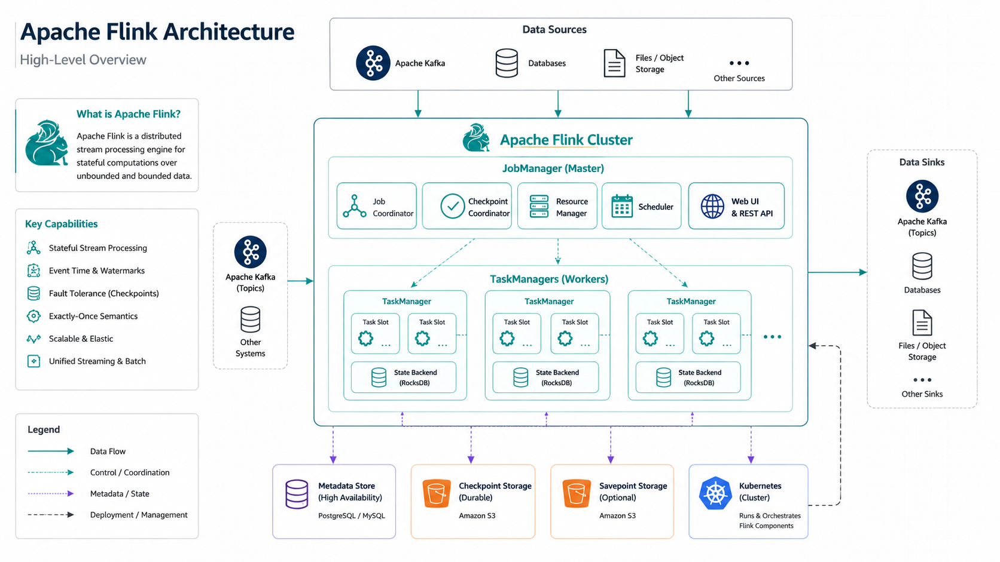

# Monday — Flink Architecture

**Time**: ~90 min



## Learning objective

> **Why does Flink exist, what does "stateful streaming" mean, and how does one Flink *job* actually live on the platform from submission to running JVM?** By the end of the session you should be able to name every top-level piece of a running Flink job and describe the lifecycle of that job — the platform pieces come Tuesday–Thursday; today is the mental model.

## Architecture Discussion (~45 min)

### Why Flink exists (not "why streaming")

Flink is a **stateful stream processor**. Every prior week has been about the platform that keeps *data* moving — Kubernetes, Kafka, TLS, RBAC. Flink is what runs *computation* on that moving data. Two things it does that batch tools don't:

1. **Continuous computation over unbounded input**. A Flink job doesn't have an "end" — it runs as long as the source has more events. No "run once at 3am then exit" pattern.
2. **Stateful operators**. Flink keeps per-key state (running counts, joined records, windowed aggregates) *inside the operators*, checkpointed to durable storage. If a TaskManager dies, state survives and the job resumes without a full replay from the source.

Everything else (SQL API, checkpoints, savepoints, DataStream API, Table API) is machinery to make stateful streaming reliable in production.

### Streaming vs Batch — the same engine

Flink treats batch as a **special case of streaming**: bounded input. Same DAG, same operators, same runtime — the batch job just knows its input has an end. Once you understand streaming, batch is free.

Practically: Flink SQL over a Kafka topic is streaming; Flink SQL over an HDFS parquet file is batch. Same code, same operator graph.

### Stateful processing — the load-bearing concept

Every non-trivial job maintains state:

- **Keyed state** — one value (or map) per key, held by the operator processing that key. Example: running count of events per `user_id`.
- **Operator state** — one value shared across all keys on that operator instance. Example: last-committed Kafka offset for a source.
- **Windowed state** — aggregations building up inside a time window before it fires.

State lives in the operator's local memory backed by a **state backend** (RocksDB on disk in production; heap for small jobs), snapshotted to durable storage (NetApp S3 in FCB) via **checkpoints**. This is what makes Flink *fault-tolerant* — Week 6 Thursday goes deep on this.

### High-level architecture — four pieces you'll see every day

- **JobManager (JM)** — the master. Accepts your job submission, schedules operators onto TaskManagers, coordinates checkpoints, decides restarts on failure. Exactly one leader (with HA replicas standing by).
- **TaskManager (TM)** — the workers. Runs your operator DAG. Each TM has N *slots*; each slot runs one operator (or one chain of operators) for one parallel instance.
- **Sources / Sinks** — Kafka is the canonical source and sink at FCB. A Flink job reads from a Kafka topic, transforms, writes to another Kafka topic (or a DB, or object storage).
- **Checkpoint storage** — where operator state gets snapshotted. NetApp S3 in production.

### Job lifecycle

```
[Application JAR / SQL statement]
       │
       ▼
[Client: CMF SQL Gateway / flink CLI / operator CR]
       │  submit
       ▼
[JobManager]
       │  parse + optimize DAG
       │  request slots from TMs
       ▼
[TaskManagers spin up operator instances in slots]
       │  running — reading from sources, emitting to sinks
       │  every N sec: checkpoint barriers flow through DAG,
       │              operators snapshot state to S3
       ▼
[Job runs indefinitely — or stops with savepoint]
       │
       ▼
[Restart / rescale / migrate — always from the last checkpoint or savepoint]
```

**Six state transitions engineers must know**: `CREATED → RUNNING → RESTARTING` (on fault) → `FINISHED` (bounded input only) → `CANCELED` (operator explicit stop) → `FAILED` (unrecoverable). Week 6 Thursday walks each transition.

## Diagram Walkthrough (~30 min)

Trace a hypothetical job — Kafka topic `payments-raw` → Flink DAG (parse → keyBy user_id → 5-min window → count → emit) → Kafka topic `payments-per-user-5min`. At each step:

- Who's running the code? (JobManager only? A TaskManager slot?)
- Where does state live?
- What happens on TaskManager restart?

## Failure Scenarios (preview — deep dives Weeks 6 Wed / Thu)

| Symptom | First place to look |
|---|---|
| Job stuck in `CREATED` | JobManager can't find enough slots — TaskManager sizing / cluster capacity |
| Job cycling `RESTARTING → RUNNING → RESTARTING` | Restart-strategy loop; check TM logs for the operator failure |
| Checkpoint failures | State backend / S3 access (see Week 5 Thursday, Enterprise Components) |
| Job runs but output missing | Sink connector auth or partitioning bug — not Flink runtime |

## Q&A

1. What makes a Flink job "stateful" — where does the state physically live between events?
2. If Flink treats batch as bounded streaming, why does the SQL syntax often distinguish them?
3. What's the smallest possible Flink deployment (how many JMs, how many TMs, how many slots) that can run one keyed-window job?
4. Who submits a job to the JobManager in FCB production — the developer, a CI pipeline, or CMF?
5. Name two things a JobManager does that a TaskManager doesn't.

## Added Enhancement

Draft your own comparison table — "stateful streaming vs batch vs micro-batch" — three columns, five rows (latency, state model, replay model, resource model, failure recovery). This grounds the rest of the week; every downstream lecture assumes you have this framework in your head.
