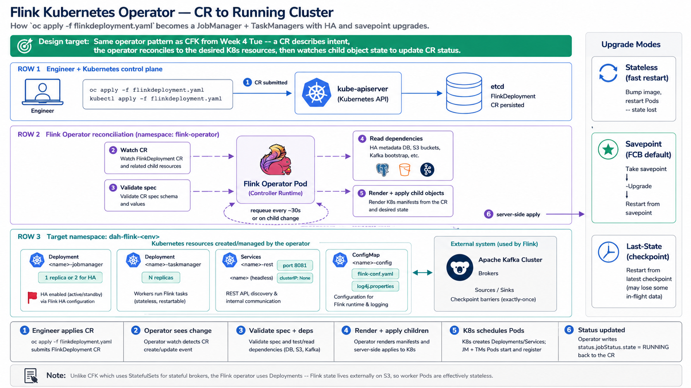

# Tuesday — Flink Operator

**Time**: ~90 min



## Learning objective

> **What does the Flink Kubernetes Operator actually do when you `oc apply` a FlinkDeployment CR?** By the end of the session you should be able to name every Kubernetes resource the operator creates on your behalf, describe the reconciliation loop, and explain HA + upgrades. This mirrors the CFK operator lesson from Week 4 Tuesday — same pattern, different workload.

## Architecture Discussion (~45 min)

### The two CRs engineers will see

The [Flink Kubernetes Operator](https://nightlies.apache.org/flink/flink-kubernetes-operator-docs-stable/) ships two Custom Resource kinds. Same operator, but they model two different things — a Flink **cluster** vs a Flink **job**:

- **`FlinkDeployment`** — models a Flink **cluster**. Sizing (JM + TMs), image, HA config, and *optionally* a job spec. Whether the job spec is present changes the whole shape of the deployment:
  - **With `spec.job` set → application mode.** The cluster runs exactly one job and dies with the CR. One CR per job, hard isolation between jobs. This is the FCB production pattern.
  - **Without `spec.job` → session mode.** The cluster comes up empty and waits. Jobs get submitted into it later via `FlinkSessionJob` CRs. One cluster, many jobs, shared slot pool.

- **`FlinkSessionJob`** — models a single **job** running inside an existing session cluster. Points at a `FlinkDeployment` by name and carries only the job spec (JAR URI + args). Multiple `FlinkSessionJob` CRs can target the same session cluster and share its TMs.

**FCB pattern.** Application mode for every production job — isolated JM+TMs give you independent scaling, independent upgrades, and a bounded blast radius when one job misbehaves. Session mode is reserved for dev / exploratory work through the CMF SQL Gateway, where the iteration speed of sharing one warm cluster outweighs the isolation loss.

### Reconciliation — the same loop you learned for CFK

When you `oc apply` a FlinkDeployment:

1. **Watch** — operator informer sees the CR
2. **Validate** — schema check, image tag, referenced Secrets exist
3. **Read dependencies** — HA metadata backend reachable? Checkpoint storage reachable? Kafka brokers reachable (via TLS)?
4. **Render child objects** — Deployment for JobManager, Deployment (or per-Pod) for TaskManagers, Services (one for JM REST, one headless for TM discovery), ConfigMaps (Flink config), Secrets are referenced (not created), maybe PVCs if state backend is local
5. **Server-side apply** each child
6. **Watch child objects** — wait until JM has `replicas == readyReplicas` and TMs register with JM
7. **Update status** — set CR conditions (`Deployed`, `JobStatus.state`, `JobStatus.jobId`)
8. **Requeue** every ~30 seconds or on child change

Familiar shape — the CFK operator does the same dance for the Kafka broker StatefulSet. The Flink operator is different in that it creates **Deployments** (Flink workers are largely stateless — state lives externally on S3), whereas CFK creates StatefulSets (broker log dir must be stable per Pod).

### Kubernetes resources the operator emits (per FlinkDeployment)

- **Deployment `<name>-jobmanager`** — usually 1 replica in non-HA, 2 in HA
- **Deployment (or JobManager-managed) `<name>-taskmanager`** — N replicas per the CR
- **Service `<name>-rest`** — ClusterIP, exposes JM REST API (port 8081)
- **Service `<name>` (headless)** — for TM registration back to JM
- **ConfigMap `<name>-config`** — flink-conf.yaml + log4j props
- **ServiceAccount + Role + RoleBinding** — if the operator needs to create/patch Pods (native K8s HA mode)

**What the operator does NOT create**: Ingress, cert-manager Certificate, external Secrets. Those are engineer-owned; the CR references them by name.

### High Availability (HA)

Two dimensions of HA in Flink:

1. **JobManager HA** — a standby JM can take over if the leader dies. Requires an **HA metadata backend** (Kubernetes native, ZooKeeper, or S3-based) so the standby knows what jobs to resume. In FCB: Kubernetes-native HA (using a K8s ConfigMap + lease election) — no ZooKeeper needed.
2. **Job HA** — the job survives *any* pod restart by resuming from the last checkpoint. This is automatic once checkpoint storage is configured (Thursday's lecture).

Set `spec.flinkConfiguration."high-availability.type": kubernetes` and `spec.jobManager.replicas: 2` to get JM HA.

### Upgrades

Three upgrade shapes engineers must know:

- **Stateless upgrade** (default): stop the job with no state, upgrade image tag, restart from scratch. Only safe for pure filtering / mapping jobs with no state.
- **Savepoint upgrade** (production default): stop-with-savepoint → upgrade image → restart from that savepoint. Preserves state across version boundaries. `spec.job.upgradeMode: savepoint`. Requires savepoint storage configured.
- **Last-state upgrade**: rely on the last successful checkpoint (no explicit savepoint). Faster but riskier — if the last checkpoint was corrupt or the job was mid-transition, restart may fail. `spec.job.upgradeMode: last-state`.

### Status the CR writes back

```yaml
status:
  jobManagerDeploymentStatus: READY
  jobStatus:
    jobId: 6a1e...
    state: RUNNING
    startTime: 2026-07-13T13:04:22.000
    savepointInfo:
      lastSavepoint:
        location: s3://.../savepoint-6a1e...
```

Reading `status.jobStatus.state` first — that's the single most useful signal for "is my job healthy right now."

## Diagram Walkthrough (~30 min)

Open the FlinkDeployment CR from Monday's Lab 2. Walk each `spec.*` block to the K8s resource it generates. Then walk `status.*` back to the running Pods. Point out: which fields cause a Pod roll (image change) vs which are hot-updatable (parallelism, in some cases).

## Failure Scenarios

| Symptom | Where to look |
|---|---|
| CR applied, no Pods appear | Operator logs in `flink-operator` namespace; operator RBAC (can it create Deployments in the target ns?) |
| JM Pod up but `jobStatus.state` stuck at `RECONCILING` | HA metadata backend unreachable — check the K8s ConfigMap lease |
| TMs come up but don't register with JM | Headless Service DNS resolution failing; check network policy allowing TM→JM |
| Upgrade fails with `Savepoint could not be created` | Savepoint storage (S3) permissions — jump ahead to Thursday's Enterprise Components |
| Job `FAILED` status after CR update | Serialization mismatch — old state can't deserialize with new operator code |

## Q&A

1. What's the difference between a FlinkDeployment application cluster and a FlinkSessionJob targeting a session cluster? When would you choose each?
2. Why does the Flink operator use Deployments and not StatefulSets, when CFK uses StatefulSets for Kafka brokers?
3. If you edit `spec.job.parallelism` from 4 to 8, does the operator restart the job immediately, at the next checkpoint, or wait for the next savepoint?
4. Name three fields the operator writes into `status` and what each one tells you.
5. In FCB HA setup, what happens if the K8s API server is briefly unreachable — does the JobManager fail over, and what triggers the recovery?

## Added Enhancement

Read the Flink Kubernetes Operator source code's reconciler for one field of your choice — trace how `spec.image` changing triggers a Deployment update through to a rolling restart. Doesn't have to be deep; even 20 minutes reading the [FlinkDeploymentController.java](https://github.com/apache/flink-kubernetes-operator) gives you a much sharper mental model than any lecture.
