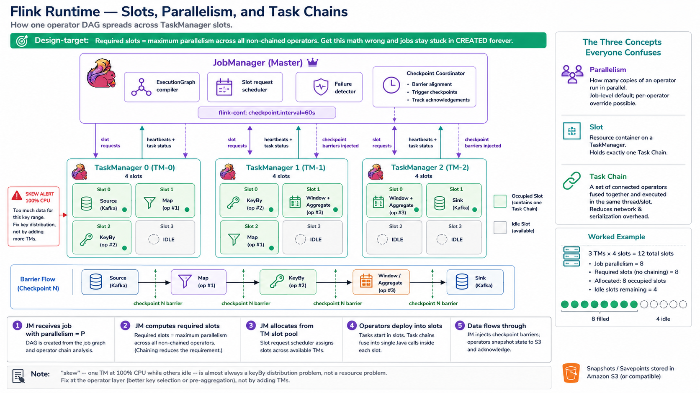

# Wednesday — Flink Runtime

**Time**: ~90 min

## Learning objective

> **What's inside a running Flink JVM, and how does one job's work get spread across TaskManagers?** By the end of the session you should be able to draw the JobManager + TaskManager relationship, explain slots vs parallelism vs task chains, and reason about resource allocation from the operator DAG.

## Architecture Discussion (~45 min)

### JobManager — the master

One JM leader per Flink cluster. Its job:

- **Accept submissions** — receives the JobGraph (compiled from your DataStream/SQL code), validates it
- **Compile ExecutionGraph** — turns the logical DAG into a physical plan: which operators run in parallel, which ones can be chained
- **Request slots** — asks TaskManagers "give me N slots for job X"
- **Deploy tasks** — sends compiled operator code to the slots
- **Coordinate checkpoints** — the *Checkpoint Coordinator* runs here; injects barriers into the source, tracks acks from operators, commits the checkpoint to durable storage
- **Handle failures** — on TM death, decide what to restart, where, and from which checkpoint

The JM does **no data processing**. It's a scheduler + coordinator. If the JM dies while TMs are running, the job survives short outages (checkpoints already stored) but new checkpoints can't be committed until a new JM leader is elected.

### TaskManager — the worker

Multiple TMs per Flink cluster. Each TM is a JVM with:

- **N slots** — configurable (`taskmanager.numberOfTaskSlots`). Each slot is a fixed share of that TM's CPU + memory.
- **One RPC endpoint back to JM** — for slot registration, task deployment, heartbeats
- **Local state backend** — RocksDB on disk in production; snapshotted to S3 on checkpoint

Slots are the unit of work allocation. If your job has parallelism 8 and each TM has 2 slots, you need 4 TMs to run the job. Whether operators chain into one slot or spread across slots depends on the DAG shape.

### Slots vs Parallelism vs Task Chains — the three concepts everyone confuses

- **Parallelism** — the number of parallel instances of an operator. Set per-job or per-operator. `keyBy → count` with parallelism 4 means 4 count operator instances, one per key subset.
- **Slot** — a resource container on a TM. Multiple operators can share one slot if they're *chained* (see below); a slot always runs exactly one "parallel task instance."
- **Task chain** — a sequence of operators that can be fused into a single Java function call (map → filter → map is fusible; anything crossing a keyBy or a network shuffle is not). Chained operators run in the same slot; unchained ones need a network boundary.

Rule of thumb: **required slots = maximum parallelism across all non-chained operators**. If your DAG is `Source(4) → map(4) → keyBy → sum(4) → Sink(4)`, you need 4 slots total (chains before/after keyBy each run in one slot per parallel instance).

### Resource allocation — the actual math

Suppose:

- Flink CR says `taskManager.replicas: 3, resource.cpu: 4, resource.memory: 8Gi, numberOfTaskSlots: 4`
- Job says `parallelism: 8`

Result:

- 3 TMs × 4 slots = 12 slots available cluster-wide
- Job needs 8 slots (one per parallel instance of the non-chained sub-DAG)
- JM places 8 tasks; 4 slots idle
- Each slot gets `4 vCPU / 4 = 1 vCPU` and `8 Gi / 4 = 2 Gi` share of its TM (approximation — Flink doesn't hard-partition CPU inside a TM, but memory is more strictly split)

If parallelism 8 with only 2 TMs × 3 slots = 6 slots, the job stays in `CREATED` state waiting for slots.

### Checkpoint Coordinator — lives on the JM

Every N seconds (configurable, default 60s in FCB):

1. JM injects a **checkpoint barrier** into all sources
2. Barriers flow through the operator DAG alongside normal events
3. When an operator sees the barrier from all its inputs, it snapshots its local state to durable storage (S3), then forwards the barrier
4. When the sink acknowledges, JM records the checkpoint as committed
5. If any operator times out during snapshot, the checkpoint is failed and the job continues on the previous one

Checkpoint machinery is Wednesday of Week 6; today's lecture just introduces the coordinator's place in the runtime.

### Common tuning knobs

- **Increase parallelism** — more slots consumed, more throughput per operator; only helps if the bottleneck is CPU-bound operators
- **Increase slot memory** — bigger keyed-state cache, less spillover to disk, but fewer parallel jobs per TM
- **Reduce chaining** — introduce a `.disableChaining()` between two operators so their work isolates in separate slots (useful when one is slow and blocks the whole chain)

## Diagram Walkthrough (~30 min)

Draw the runtime for a specific job — say the one from Monday's Lab 2. Enumerate: how many operators, which chained, which parallelism, how many slots required, how many TMs to satisfy. Then look at the actual Flink UI's "Task Managers" tab and cross-check.

## Failure Scenarios

| Symptom | Where to look |
|---|---|
| Job stuck `CREATED`, "not enough slots available" | Parallelism > (num_TMs × slots_per_TM). Increase TMs or slots per TM. |
| Skew — one TM at 100% CPU, others idle | Uneven keyBy distribution (one key dominant). Fix at operator level, not resource level. |
| Backpressure warning in Flink UI | Downstream operator slower than upstream; increase its parallelism or reduce chaining |
| Checkpoint coordinator log: "Checkpoint declined" | An operator failed to snapshot within timeout. Check TM logs for that operator's state size / disk IO |

## Q&A

1. Why is "parallelism" a job-level setting but slots are a TM-level setting — what's the mismatch about?
2. What actually gets put in a slot — a whole operator? A partial DAG chain? An event?
3. If a TM dies mid-checkpoint, what happens to the barriers already flowing through the DAG?
4. When would you deliberately disable operator chaining, given that chaining is more efficient?
5. Where does the JM get the "list of TMs and their slot capacity" it uses to schedule — is it push (TMs register) or pull (JM discovers)?

## Added Enhancement

Open the Flink UI's Task Managers tab for a real job. Compute for one TM: `used slots / total slots`, `heap used / heap max`, `direct memory used`, `network memory used`. Then look at the DAG and predict which operator is most likely to hit the memory ceiling first. Verify by watching the same TM over 10 min.
