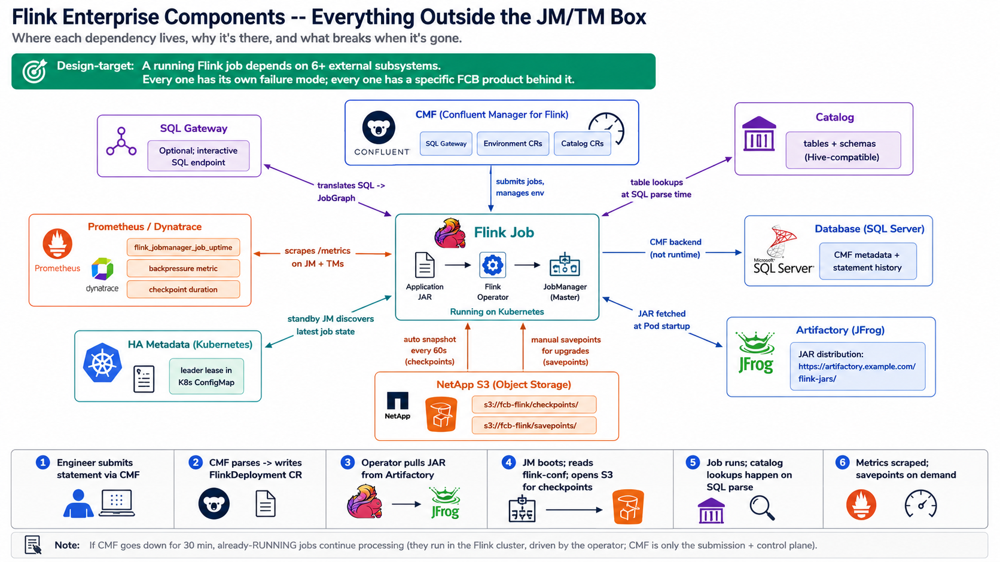

# Thursday — Enterprise Components (CMF, Catalog, Storage)

**Time**: ~90 min



## Learning objective

> **Everything the Flink runtime relies on that's NOT in the FlinkDeployment CR — where does it live, why is it there, and what breaks when it's gone?** By the end you should be able to draw the "everything outside the JM/TM box" picture and name the failure that surfaces when each piece is unreachable.

## Architecture Discussion (~45 min)

A running Flink job has dependencies on at least six external subsystems. FCB uses specific products for each; the goal today is to make the "why does each one exist" reasoning stick.

```
Application JAR
      │
      ▼
Flink Operator
      │
      ▼
JobManager
      │
      ├── Metadata (HA lease, job history)  → Kubernetes ConfigMaps / DB
      ├── Savepoints (manual snapshots)     → NetApp S3
      ├── Checkpoints (auto snapshots)      → NetApp S3
      ├── Catalog (table schemas)           → CMF Catalog CR (Hive-compatible)
      ├── Artifacts (JARs)                  → Artifactory / S3
      └── Metrics                           → Prometheus / Dynatrace
```

### 1. Confluent Manager for Apache Flink (CMF)

Not part of open-source Flink. It's the **control plane** FCB uses to submit + manage Flink jobs at scale. What it does:

- Provides the **SQL Gateway** endpoint for interactive/ad-hoc SQL statements
- Manages **Environments** (a Flink cluster + its config) and **Catalogs** (schema registry)
- Persists metadata about jobs, statements, savepoints in its own database (SQL Server in FCB)
- Talks to the underlying Flink operator to actually deploy `FlinkDeployment` CRs

Every FCB Flink workflow starts with CMF. If CMF is down, engineers can't submit new statements — but *already running* jobs keep running (they're driven by the Flink operator, not by CMF at runtime).

### 2. Catalog

Flink SQL needs to know what tables exist and what their schemas are. The **catalog** is that name-to-schema mapping. Options:

- **In-memory catalog** (dev only) — lives inside one Flink SQL session; disappears when the session ends
- **Hive-compatible catalog** — persistent, typically backed by a Hive Metastore. This is what CMF uses.
- **Custom** — Iceberg / Glue / other

At FCB: CMF Catalog CR maps to a persistent Hive-compatible metastore. Tables defined via `CREATE TABLE ... ` in a SQL statement land there and are visible to future statements.

**Without a catalog**: every SQL statement has to redeclare tables inline. Not usable at scale.

### 3. SQL Gateway (optional but common)

Hosts the interactive SQL endpoint that CMF (and other clients like JDBC drivers) connects to for submitting SQL statements. Not every FCB deployment enables it — depends on whether users write DataStream API code directly or use SQL. Where enabled: it's a separate Flink process that translates SQL into DAGs and submits them to the JM.

### 4. Database (CMF backend)

CMF persists job metadata + statement history + savepoint locations in a relational DB — **SQL Server at FCB** (per `project_fcb_infrastructure` memory). Environment CRs, statement records, deployment history all live there.

If the DB is unreachable, CMF itself won't start (encryption key + connection URL are both required at boot per `runbook/LESSONS_LEARNED.md` C5). Job runtime doesn't touch this DB directly — only CMF does.

### 5. Artifact storage — the JAR distribution problem

The FlinkDeployment CR says `spec.job.jarURI: <URI>`. Somewhere that URI has to resolve. Options:

- **HTTP** — Artifactory (FCB standard for Flink JARs, per pipeline convention). CR references `https://artifactory.example.com/flink-jars/my-job-1.2.3.jar`.
- **S3** — NetApp S3 bucket; CR references `s3://flink-jars/my-job-1.2.3.jar` (needs S3 credentials configured in Flink config).
- **Baked into image** — image has JAR at a known path; CR references `local:///opt/flink/jobs/my-job.jar`.

FCB pattern: **Artifactory + `local://` embedded JARs** depending on team preference. The operator downloads the JAR at Pod startup (except `local://` which is already there).

### 6. HA metadata store

For JobManager HA (Tuesday's lecture), the standby JM needs to know: what jobs are running, what checkpoint is the latest, who's the leader. Options:

- **Kubernetes-native HA** — leader lease in a ConfigMap + job info in ConfigMaps (FCB standard, no ZooKeeper needed)
- **ZooKeeper** — legacy, Flink < 1.12
- **S3-based** — some deployments use S3 for HA state; not common on K8s

FCB uses Kubernetes-native HA. The K8s ConfigMap is written by the leader JM and read by the standby.

### 7. Savepoint storage

**Savepoints** are user-triggered snapshots of job state (for upgrades, migrations, backups). Independent from **checkpoints** (which are automatic and internal). Both need durable storage; FCB uses **NetApp S3** for both, with different bucket paths:

- `s3://flink-state/<env>/checkpoints/<job-id>/` — automatic, frequent, tail-trimmed
- `s3://flink-state/<env>/savepoints/<job-id>/` — manual, retained per policy

Savepoint restore is what makes upgrades work with state continuity (Tuesday's Lab 3).

### 8. Metrics — Prometheus + Dynatrace

Flink exposes JMX metrics natively; a Prometheus reporter converts them to the Prometheus scrape format. FCB adds Dynatrace overlays for higher-level dashboards. Metrics engineers must know:

- `flink_jobmanager_job_uptime` — job running time
- `flink_taskmanager_job_task_backPressuredTimeMsPerSecond` — backpressure (per Wednesday's lab)
- `flink_taskmanager_Status_JVM_Memory_Heap_Used` — TM heap
- `flink_jobmanager_job_lastCheckpointDuration` — last checkpoint time

## Diagram Walkthrough (~30 min)

Walk the "everything outside the JM/TM box" diagram at the top of this doc. For each external dependency, name (a) the product FCB uses, (b) the specific failure surface when it's unreachable, (c) whether *already-running* jobs survive short outages of that dep.

## Failure Scenarios

| Symptom | Where to look |
|---|---|
| CMF UI shows "cannot list statements" | CMF ↔ SQL Server DB connection; DB down or password rotation issue |
| Job's `spec.jarURI` fails download | Artifactory reachability from Pod (network policy / firewall) |
| Job runs but Flink UI shows "no checkpoints" | Checkpoint storage (S3) unreachable or bucket policy denies write |
| JM failover doesn't happen when leader dies | HA metadata ConfigMap RBAC — operator SA can't write it |
| SQL statement fails with `catalog not found` | Catalog CR not applied, or catalog DB unreachable |
| Prometheus target scraping returns `503` | Flink metrics reporter not enabled or port not exposed |

## Q&A

1. If CMF goes down, do already-running Flink jobs continue processing? Explain why.
2. What's the difference between a checkpoint and a savepoint in *what they store* — are they different formats?
3. Why does FCB use SQL Server for CMF's backend instead of the in-cluster PostgreSQL some other CMF users run?
4. If Artifactory is down when a job Pod starts, what happens — does the CR stay in `CREATED`, does it fail, or does the operator retry?
5. In Kubernetes-native HA, where is the leader lease physically stored, and what's the granularity of failover (seconds / minutes)?

## Added Enhancement

Draw your own "dependencies diagram" for the specific Flink job you've been reading all week. For each external dependency, mark it with (a) FCB product name, (b) failure blast radius (this job only / all jobs in namespace / all jobs cluster-wide), (c) recovery pattern. That map is what you'd use when on call at 3am.
