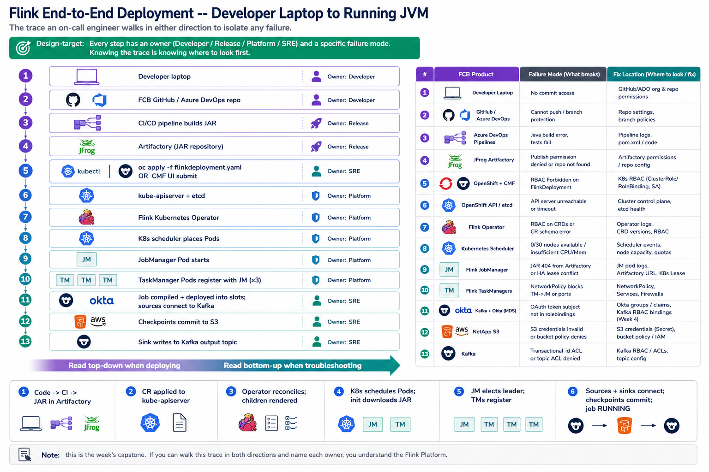

# Friday — End-to-End Deployment

**Time**: ~90 min



## Learning objective

> **Trace one job from developer laptop to a running JobManager JVM, naming every system involved.** This is the capstone for Week 5 — it ties Monday's architecture, Tuesday's operator, Wednesday's runtime, and Thursday's enterprise components into one continuous story. If you can walk this trace in both directions, you understand the Flink Platform.

## Architecture Discussion (~45 min)

### The deployment path — top to bottom

```
Developer laptop
     │
     │  git push
     ▼
FCB GitHub / Azure DevOps repo
     │
     │  CI/CD pipeline builds JAR
     ▼
Artifactory (JAR + tag)
     │
     │  Ayu / release engineer references JAR in a Flink Environment or FlinkDeployment CR
     ▼
CMF UI or `oc apply -f flinkdeployment.yaml`
     │
     ▼
Kubernetes API server accepts the CR
     │
     ▼
Flink Kubernetes Operator sees the CR (watch)
     │
     │  validate → resolve deps → render children
     ▼
Deployment/JobManager, Deployment/TaskManager,
  Service (REST), Service (headless),
  ConfigMap (flink-conf), RBAC references
     │
     │  Kubernetes scheduler places Pods
     ▼
JobManager Pod starts
     │
     ├─ downloads JAR from Artifactory
     ├─ reads flink-conf ConfigMap
     ├─ reads referenced Secrets (TLS, OAuth, DB creds)
     ▼
JobManager JVM starts, elects leader (HA)
     │
     ▼
TaskManager Pods start; register with JM's headless Service
     │
     ▼
JM compiles JobGraph → ExecutionGraph → deploys tasks into TM slots
     │
     ▼
Sources start reading from Kafka
     │
     ▼
Operators process events; state accumulates in RocksDB
     │
     ▼
Every N sec: checkpoint barriers flow → operators snapshot to S3 → JM commits checkpoint
     │
     ▼
Sinks emit results to Kafka
```

### Each step — what breaks if it's not there

- **Git push** — developer needs commit access to the release branch. If missing → CI doesn't build.
- **CI/CD builds JAR** — needs Java build env + Confluent + FCB deps. Failure surfaces before deploy.
- **Artifactory tag** — release JAR is what the CR references. Bad tag → operator can't download.
- **CR apply** — needs RBAC to create FlinkDeployment in `dah-flink-<env>`. Same class of RBAC issue that bit us on QA NetworkPolicy.
- **Operator sees CR** — operator's watch must include the namespace. Multi-tenant operators need namespace scoping.
- **Kubernetes scheduler places Pods** — cluster capacity + tolerations + PVC binding (the "0/30 nodes available" class of error from prior weeks).
- **JAR download** — Pod-to-Artifactory network reachable; TLS trust bundle correct.
- **JM leader election** — Kubernetes-native HA lease ConfigMap RBAC.
- **TM registration** — headless Service DNS + NetworkPolicy allowing TM → JM.
- **Kafka source auth** — OAuth token from Okta + trust in cluster CA + broker's rolebindings recognize the OAuth subject.
- **Checkpoint to S3** — S3 credentials, bucket policy, network to NetApp S3.
- **Sink to Kafka** — same auth as source; different topic + permissions.

### FCB-specific pipeline actions

FCB doesn't use `oc apply` from a laptop; it uses Azure DevOps pipelines. For Flink, the relevant pipelines:

- **`flink-environments.yaml`** — creates/updates the CMF Environment + Catalog CRs
- **`.azure-pipelines/verify-flink-setup.yaml`** — smoke-tests the environment
- The CMF UI or SQL Gateway is the surface end-users touch to submit statements — statements produce FlinkDeployments under the hood

Engineers running this end-to-end deploy from scratch will use these pipelines in order:
1. `confluent-platform.yaml` → `install-or-update` (Kafka must exist first, sources need brokers)
2. `cmf.yaml` → `install` (CMF must be up to accept statement submissions)
3. `flink-environments.yaml` → create the Environment + Catalog
4. Submit the SQL statement (via CMF UI) or apply a FlinkDeployment CR directly

## Diagram Walkthrough (~30 min)

Trace one *specific* job through every step. Use the DAG from Week 5 Wednesday's Lab 2. For each step in the flow diagram above, name the FCB pipeline / system / credential involved, and one thing that could have gone wrong today that would leave the job stuck at that step.

## Failure Scenarios (the composite view)

| Step in the trace | Symptom | Fix location |
|---|---|---|
| CI/CD | JAR build fails | Developer / build owner |
| CR apply | RBAC Forbidden on FlinkDeployment | Container Platforms |
| Operator watch | Operator not watching this namespace | Operator config (Container Platforms) |
| Pod schedule | 0/N nodes available, insufficient CPU | Container Platforms (cluster capacity) |
| JAR download | 404 / 403 from Artifactory | Release engineer / Artifactory perms |
| Secrets missing | JM crashloops on Secret not found | `create-prereqs` pipeline run |
| JM HA lease | Standby never elected | Operator SA can't write ConfigMap |
| TM ↔ JM | TMs never register | NetworkPolicy or DNS |
| Source auth | Broker returns 401 | OAuth + rolebindings (Week 4 pattern) |
| Checkpoint | S3 write fails | S3 credentials / bucket policy |
| Sink write | Cannot produce to output topic | ACL / rolebinding on the sink topic |

## Q&A

1. Order these by "closest to the developer" → "closest to the JVM": Artifactory, JobManager, CMF, Flink Operator, kube-apiserver, Kafka. Which are user-facing vs cluster-side vs library-embedded?
2. If the JAR download fails at Pod startup, does the CR stay in `RECONCILING` or move to `FAILED`? Where do you look for the actual HTTP status code?
3. Where in the flow does OAuth first come into play — at CR apply, at Pod startup, at Kafka source connection, or at checkpoint write?
4. In FCB's flow, who owns each step (Developer / Release / Platform / SRE)?
5. What's the single change that would make an end-to-end deploy fastest to iterate — where's the current bottleneck?

## Added Enhancement

Time-box a real end-to-end deploy. Note: how long between `git push` and `job RUNNING` in dev? How much of that is CI build, how much is pipeline run, how much is Pod startup + JAR download + JM init? Which single segment dominates? That's the answer to Q5 above.
