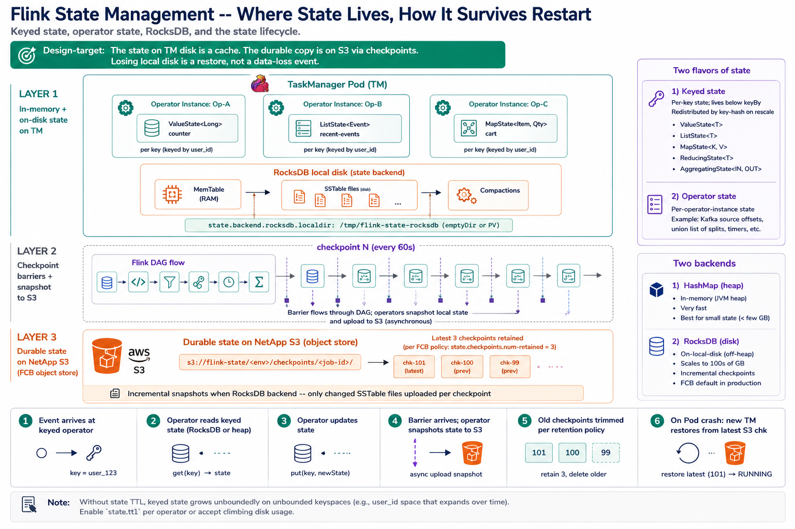

# Wednesday — State Management

**Time**: ~90 min



## Learning objective

> **Where does Flink's per-operator state actually live, in what shape, and how does it survive a Pod restart?** Without this, Thursday's checkpoint/savepoint story doesn't make sense. State is the single most important concept in Week 6.

## Architecture Discussion (~45 min)

### Two flavors of state — Keyed vs Operator

**Keyed state** — bound to a *key* (the key emitted by the upstream `keyBy`). Each key gets its own private state. Common shapes:

- `ValueState<T>` — one value per key. Example: current running total per user.
- `ListState<T>` — a list per key. Example: last N events per user for pattern detection.
- `MapState<K,V>` — a map per key. Example: per-user session-attribute cache.
- `ReducingState<T>` / `AggregatingState<IN,OUT>` — pre-reducing state; incrementally combines new values into a single accumulator.

Keyed state is what most jobs use. It only exists on operators downstream of `keyBy` — the runtime physically routes each key to exactly one operator instance, and that instance has exclusive access to that key's state.

**Operator state** — not keyed. Bound to the operator instance itself. Common uses:

- Kafka source's last-committed offset per partition (`ListState<PartitionOffset>`)
- Sink buffers that need to survive restarts

Operator state is redistributed on rescale — if you go from parallelism 4 to 8, Flink splits the operator state across the new instances. Contrast with keyed state, which is redistributed by key hash.

### State backends — where the state physically sits

Two options, chosen per-job:

- **HashMap state backend** (default in Flink ≥ 1.13) — keyed state in JVM heap. Fast; limited by TM heap size. Fine for small state (< a few GB per TM).
- **RocksDB state backend** — keyed state on local disk via RocksDB. Almost-unbounded (limited by disk size). Slower reads than heap but scales to hundreds of GB per TM. Standard for FCB production.

The backend also decides how snapshots work:

- HashMap → snapshot serializes JVM objects to S3 (fast, all-in-one)
- RocksDB → snapshot writes SST files to S3 (incremental — only changed files uploaded per checkpoint)

For any job with >5 GB total state, RocksDB is the answer.

### RocksDB — what it actually is

An embedded key-value store (LevelDB fork from Facebook). Runs inside the TM JVM process, writes to the local disk mounted at `state.backend.rocksdb.localdir`.

Structure:

- **MemTable** — recent writes in memory
- **SSTables** — sorted, immutable files on disk
- **Compactions** — background merges of SSTables (this is what eats disk IO)
- **Column Families** — one per keyed-state descriptor; independently compactable

Ops considerations:

- Local disk = ephemeral in K8s (PV or emptyDir). Loss on Pod restart is fine because checkpoint has the durable copy.
- Compaction pauses can spike latency; tune with `state.backend.rocksdb.compaction.level.max-size-level-base`
- Disk sizing: 3–5× the working-set size is a safe starting point

### The state lifecycle

```
[Job starts, no prior state]
       │
       ▼
[Operator initializes empty state]
       │
       ▼
[Events flow: operators read/write state]
       │
       ▼
[Checkpoint N: snapshot state to S3]
       │
       ▼
[More events; more state changes]
       │
       ▼
[Checkpoint N+1: incremental snapshot]
       │
       ▼
[Pod crashes; JM decides to restart]
       │
       ▼
[New TM Pod restores state from checkpoint N+1]
       │
       ▼
[Operators resume; source rewinds to checkpoint offset]
       │
       ▼
[Job continues; effectively no data loss]
```

The single most important property: **the state on disk in the TM is a cache. The durable copy is in S3 (via checkpoints).** Losing the local disk is a full restore from S3 — inconvenient but not catastrophic.

### TTL — state that expires

Flink supports **state TTL** — automatic cleanup of state entries older than a configured duration. Critical for unbounded keyspaces (e.g., user IDs that come and go over time).

```java
StateTtlConfig ttl = StateTtlConfig
    .newBuilder(Time.hours(24))
    .setUpdateType(StateTtlConfig.UpdateType.OnCreateAndWrite)
    .setStateVisibility(StateTtlConfig.StateVisibility.NeverReturnExpired)
    .build();
```

Without TTL, keyed state can grow unboundedly — a common cause of "why is our Flink disk usage climbing forever?" tickets.

## Diagram Walkthrough (~30 min)

Draw the state model for the payment-count job: 3 TMs, each with 2 slots, parallelism 6, `keyBy(user_id)`. Show:

- Which operator holds keyed state
- How keys distribute across slots
- Where RocksDB files sit (per-slot / per-TM)
- What happens on TM restart

## Failure Scenarios

| Symptom | Where to look |
|---|---|
| TM disk running out | RocksDB directory unbounded — enable state TTL or add disk |
| Job restart from checkpoint takes very long | Large state (RocksDB restore) + slow S3 read — sizing / network issue |
| State grew but count of unique keys stable | Per-key state size bloated (e.g., unbounded ListState) — audit state accessors |
| Rescale from parallelism 4 to 8 corrupts data | Keyed-state hash redistribution is deterministic; suspect operator-state migration bug |
| RocksDB compaction pauses cause backpressure | Tune compaction; consider offloading to separate disk |

## Q&A

1. What's the physical difference between `ValueState<T>` and `MapState<K,V>` when stored in RocksDB?
2. Why does the HashMap state backend get faster reads than RocksDB — and why isn't it the default in production?
3. If a TM dies mid-checkpoint, what happens to the checkpoint-in-progress? Does the job lose the state changes that happened after the last successful checkpoint?
4. Operator state gets redistributed on rescale. Keyed state gets redistributed by key hash. In which scenario is redistribution *problematic*?
5. Why is state TTL a job-level concern rather than something the operator handles automatically?

## Added Enhancement

For one FCB Flink job with large state, look at the last successful checkpoint size (Flink UI → Checkpoints tab). Trace: what state does that job hold, per key roughly how big, and would TTL help shrink it? Sketch the RocksDB directory layout on disk.
