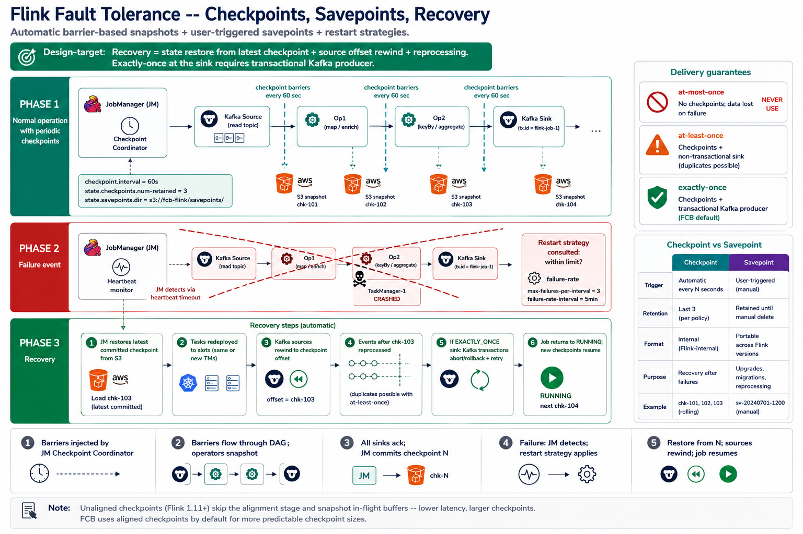

# Thursday — Fault Tolerance

**Time**: ~90 min



## Learning objective

> **Given Wednesday's state model, how does Flink recover from any failure without losing data or double-processing?** By the end of the session you should be able to explain checkpoints vs savepoints, exactly-once vs at-least-once, and pick the right restart strategy per workload.

## Architecture Discussion (~45 min)

### Checkpoints — automatic, frequent, tail-trimmed

A **checkpoint** is Flink's periodic snapshot of *every operator's state* to durable storage (S3 in FCB). Coordinated by the JM's Checkpoint Coordinator (Week 5 Wednesday introduced this).

The mechanism (Chandy-Lamport-style barriers):

1. JM sends a **checkpoint barrier** into every source
2. Barrier flows downstream alongside normal records
3. When an operator sees the barrier on *all* its inputs, it snapshots its state to S3 and forwards the barrier
4. Sink sees the barrier, acks to JM
5. Once ALL sinks ack, JM commits the checkpoint as successful

Key properties:

- **Consistent snapshot** — because barriers flow with the data, every operator's snapshot corresponds to the "same" moment in the stream (in terms of what records have been processed)
- **Alignment** — when an operator has multiple inputs, it buffers records from faster inputs until the barrier arrives on the slower one. This is the "align" that costs latency in `EXACTLY_ONCE` mode.
- **Unaligned checkpoints** (Flink 1.11+) — skip alignment, snapshot the in-flight buffers too. Lower latency, larger checkpoints. FCB uses aligned by default.

Cadence: every 60 sec at FCB. Older checkpoints are retained (`state.checkpoints.num-retained: 3`) so a bad checkpoint can be recovered from the previous one.

### Savepoints — manual, retained, portable

A **savepoint** is a *user-triggered* checkpoint with different characteristics:

- Triggered explicitly via `flink savepoint <job-id> <path>` or via the operator's `spec.job.upgradeMode: savepoint`
- Retained by policy (typically forever until explicitly deleted)
- Portable — can restart a *different* job from the same savepoint (as long as operator DAG is compatible)
- Format is stable across Flink minor versions; safe for upgrades

Use savepoints for: upgrades, migrations, rescale operations, "backup before a risky change." Use checkpoints for: automatic recovery from crashes.

### Exactly-once vs At-least-once

The **delivery guarantee** Flink offers depends on:

- Whether the source can rewind (Kafka: yes; message queues without offset commit: no)
- Whether the sink supports transactions (Kafka: yes via `EXACTLY_ONCE`; most databases: no natively)
- Whether checkpoints are enabled

Levels:

- **At-most-once** — no checkpoints. On failure, some data lost. Never use.
- **At-least-once** — checkpoints enabled, non-transactional sink. On failure, some data reprocessed → possible duplicates downstream. Fine if downstream is idempotent.
- **Exactly-once** — checkpoints + transactional sink (or idempotent). On failure, no duplicates, no losses. FCB default for anything writing to Kafka.

Exactly-once at the sink requires either:

- **Transactional sink** — Kafka sink using `DeliveryGuarantee.EXACTLY_ONCE` (commits transaction on checkpoint success)
- **Idempotent sink** — sink guarantees that writing the same record N times has the same effect as writing it once (e.g., upserts by primary key)

### Restart strategies

When a task fails, the JM decides what to restart. Strategies:

- **`none`** — job fails immediately on any task failure. For batch jobs where re-run is preferred.
- **`fixed-delay`** — retry N times with a fixed delay. `restart-strategy: fixed-delay, restart-strategy.fixed-delay.attempts: 5, delay: 10s`. Simple, predictable.
- **`failure-rate`** — retry unless failures exceed a rate within a window. `restart-strategy.failure-rate.max-failures-per-interval: 3, restart-strategy.failure-rate.failure-rate-interval: 5min`. Distinguishes transient from persistent failures.
- **`exponential-delay`** — exponential backoff. Rarely used in streaming.

FCB default: `failure-rate` with a low tolerance (5 failures in 5 min → fail the job, escalate to on-call). Rationale: masking chronic failures with infinite retries hides bugs.

### Recovery — the full sequence

```
[Task fails: e.g., TM Pod crashed]
       │
       ▼
[JM detects failure via heartbeat timeout]
       │
       ▼
[Restart strategy consulted: within limit?]
       │
       ▼
[JM restores latest committed checkpoint]
       │
       │  For each operator: state read from S3
       │  For each source: offset rewound to checkpoint position
       ▼
[Tasks redeployed to slots — same or different TMs]
       │
       ▼
[Sources resume from checkpoint offset]
       │
       ▼
[Duplicate events (post-last-checkpoint) reprocessed]
       │
       │  If EXACTLY_ONCE sink: transactions abort/rollback + retry
       │  If AT_LEAST_ONCE: downstream sees duplicates
       ▼
[Job returns to RUNNING; new checkpoints resume]
```

Recovery time = state restore duration + task deploy + source rewind + reprocess. For large jobs, this is minutes; for small ones, seconds.

## Diagram Walkthrough (~30 min)

Trace a specific fault-recovery: TM Pod dies at wall-clock 12:00, latest checkpoint was 11:59:15. Walk through what happens up to job returning to RUNNING. Note: how many seconds of events get reprocessed? What does the sink see? What does downstream see?

## Failure Scenarios

| Symptom | Where to look |
|---|---|
| Job restart loop (`RESTARTING → RUNNING → RESTARTING`) | Restart strategy triggering; find the root cause in TM logs, not just increase attempts |
| Job restart succeeds but output is duplicated | AT_LEAST_ONCE mode; downstream needs to be idempotent |
| Checkpoint size growing forever | State growth (Wednesday's lab) — enable TTL |
| Checkpoint N declined, job stays on N-1 | Operator failed to snapshot; check that operator's TM log for the specific error |
| Savepoint restore fails with `SerializationException` | Operator schema changed; use `savepoint` upgrade mode and confirm state schema evolution rules |

## Q&A

1. What's the *specific* difference between a checkpoint and a savepoint at the storage level — are the files different, or just the metadata about them?
2. If a job is running EXACTLY_ONCE with a Kafka sink and the TM dies mid-transaction, what does Kafka's transaction log show — an aborted transaction, a committed one, or neither?
3. Why does the checkpoint interval affect recovery time — what specifically does a longer interval cost?
4. Under `failure-rate` restart strategy, if the job fails 3 times in 4 minutes then fails a 4th time, does it restart?
5. When would you deliberately choose AT_LEAST_ONCE over EXACTLY_ONCE?

## Added Enhancement

Take one FCB job and check its actual restart-strategy config. Compute: given the current settings, what's the maximum time between "first task failure" and "job in FAILED state" if the failure is chronic? Is that acceptable for the workload's on-call SLA?
