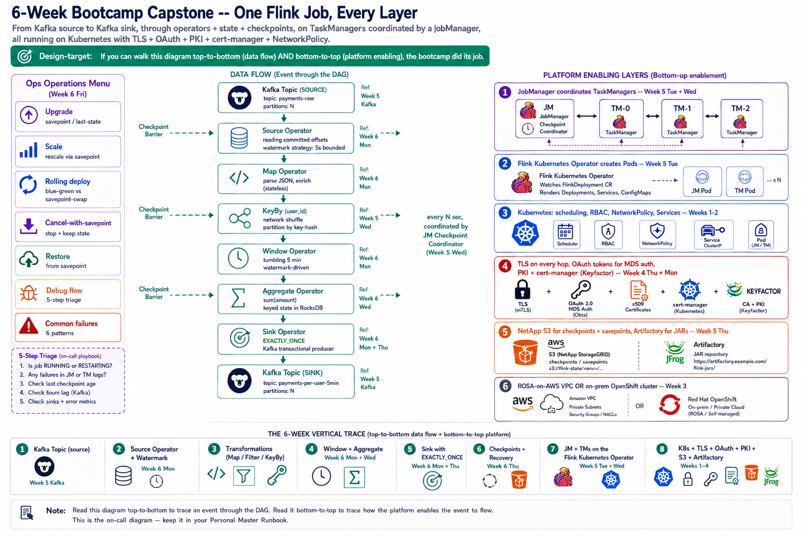

# Friday — Production Operations + 6-Week Capstone

**Time**: ~90 min



## Learning objective

> **What does an on-call engineer actually do with a running Flink job — upgrade, scale, debug, restore?** By the end of the session you should have a mental checklist for each production operation, and you should be able to walk one job's traffic through EVERY layer this bootcamp covered — Kubernetes, networking, Kafka, TLS, cert-manager, CFK, Flink platform, Flink application.

## Architecture Discussion (~45 min)

### Upgrade — the daily operation

Three shapes (from Week 5 Tuesday):

- **Stateless upgrade** — job has no state; bump image, restart. Only viable for pure filter/map jobs.
- **Savepoint upgrade** — take savepoint, upgrade image, restart from savepoint. FCB default for stateful jobs.
- **Last-state upgrade** — resume from latest checkpoint (no explicit savepoint). Faster; only use when the state is small and checkpoints are known-good.

Upgrade checklist:
1. Confirm current checkpoint / savepoint health before starting
2. Set `spec.job.upgradeMode` and `spec.image` in the CR
3. Apply; watch `status.jobStatus.state` transition (RUNNING → SUSPENDED → RECONCILING → RUNNING)
4. Verify downstream output continuity (no gaps, no duplicates)
5. If failure: rollback to prior image with the same savepoint

### Scaling — parallelism, TMs, and slots

Scale up (need more throughput):
1. Take a savepoint
2. Cancel the job
3. Increase `spec.job.parallelism` and/or `spec.taskManager.replicas`
4. Restart from savepoint

Scale down (over-provisioned):
1. Take a savepoint
2. Cancel
3. Reduce parallelism/replicas
4. Restart from savepoint

Rescale changes key-hash distribution → each parallel operator instance gets a different key subset than before. State redistribution happens automatically during savepoint restore (that's why we savepoint before rescaling).

### Rolling deployments — the "zero downtime" pattern

Not a Flink built-in. Two options:

- **Blue-green** — deploy new job in parallel to old; verify output on a shadow topic; cut over the downstream consumer. Highest confidence, most infra.
- **Savepoint-swap** — take savepoint on old, cancel old, restart new from savepoint. Downtime = restart duration (seconds to minutes). Simpler but not truly zero-downtime.

FCB pattern: savepoint-swap for most jobs; blue-green only when a bad output would be visible externally.

### Cancel with savepoint

Standard end-of-life for a job. Cancel-with-savepoint captures state, then stops the job. Restart later from the savepoint to resume. Contrast with plain cancel (state is lost — only okay if you don't care about resuming).

### Restore from savepoint

`spec.job.initialSavepointPath: s3://.../savepoint-<id>` on a fresh FlinkDeployment CR. The operator points the JobManager at that savepoint on start; JM restores state before beginning consumption.

Restore checklist:
1. Confirm savepoint exists at the referenced path
2. Confirm the job's operator DAG hasn't changed incompatibly (adding operators is usually fine; removing keyed state is not)
3. Verify downstream state assumptions (has downstream advanced past the savepoint's output? Duplicates coming?)

### Debugging — where to look, in what order

The 5-step triage flow for a Flink job:

1. **`status.jobStatus.state`** — what does the CR say? RUNNING / RESTARTING / FAILED / CANCELED?
2. **Flink UI Overview** — job DAG showing per-vertex status, backpressure, rates
3. **JM log** — checkpoint decisions, restart decisions, deployment events
4. **TM logs** — actual operator failures, deserialization errors, source/sink errors
5. **External systems** — Kafka broker (source auth failed?), S3 (checkpoint write failed?), DB (CMF metadata unavailable?)

### Reading the Flink UI

Panels engineers must know:

- **Overview** — DAG, per-vertex records/sec + backpressure indicator
- **Task Managers** — one row per TM: slot usage, heap, JVM stats, log link
- **Checkpoints** — history, latest size, latest duration, failure count
- **Job Manager** — its own logs + config
- **Metrics** — pull-your-own dashboards; useful for spot-checks

### Common failures — the top six patterns

1. **Backpressure** (Week 5 Wed) — downstream slower than upstream; widen parallelism or reduce chaining
2. **State growth** (Week 6 Wed) — unbounded keyspace + no TTL; add TTL or accept the disk cost
3. **Checkpoint decline** (Week 6 Thu) — operator failed to snapshot within timeout; check that operator's state size
4. **Kafka source auth** (Week 4 Thu + Week 5 rebuilds) — OAuth token subject not in rolebindings; correct client-IDs
5. **Sink transaction abort** (Week 6 Thu) — EXACTLY_ONCE sink couldn't commit transaction; check ACLs and broker health
6. **Pod scheduling** (Week 5 + platform) — cluster capacity or missing toleration; capacity or CR fix

---

## The 6-Week Capstone Diagram

By now you can trace every hop in the diagram below. Take 15 minutes and walk it out loud with someone, top to bottom AND bottom to top.

```
                   Kafka Topic (source)
                          │
                          ▼
                    Source Operator      ◄── reading committed offsets
                          │                    (Week 5 Kafka)
                          ▼
                        Map              ◄── stateless transform
                          │                    (Week 6 Mon)
                          ▼
                       KeyBy             ◄── partitions by key
                          │                    (network shuffle, Week 5 Wed)
                          ▼
                       Window            ◄── time-based grouping
                          │                    (Week 6 Mon; watermarks)
                          ▼
                     Aggregate           ◄── keyed state; RocksDB
                          │                    (Week 6 Wed)
                          ▼
                        Sink             ◄── exactly-once transactional producer
                          │                    (Week 6 Mon + Thu)
                          ▼
                   Kafka Topic (sink)

  ── Checkpoint Barrier ────►────►────►────►────►────►
     (every N sec, coordinated by JM Checkpoint Coordinator, Week 5 Wed)

     JobManager             ◄── coordinates checkpoints,
     coordinates                 restarts, HA leader election
     TaskManagers                (Week 5 Tue + Wed)

     Operator                ◄── the Flink Kubernetes Operator
     creates                     (Week 5 Tue)
     Pods

     Kubernetes               ◄── scheduling, RBAC, NetworkPolicy,
                                  Services (Weeks 1-2)

                              ◄── TLS on every hop (Week 4 Thu)
                              ◄── OAuth tokens for MDS auth (Week 4 Thu + Mon)
                              ◄── PKI + cert-manager (Week 4 Thu)
                              ◄── all inside a ROSA-on-AWS VPC or on-prem
                                  cluster (Week 3)
```

Read the diagram in two directions:

- **Top to bottom** — how data flows. An event enters the source, hits every operator, lands in the sink.
- **Bottom to top** — how the platform enables the flow. Kubernetes scheduled the Pods; the operator authored them; the JM coordinates; the TMs run the operators; PKI + OAuth authenticate every hop; TLS encrypts the wire; the network policy allows the traffic.

If both directions read cleanly to you, the bootcamp did its job.

## Failure Scenarios — cross-referencing to prior weeks

| Symptom | Root cause layer | Week / Day covered |
|---|---|---|
| Pod stuck Pending | Cluster capacity / RBAC / NetworkPolicy | Week 3, Week 5 Tue |
| Kafka source `bad_certificate` | Truststore / PKI | Week 4 Thu |
| Kafka source `Invalid Token : User Identity not found` | OAuth rolebindings / client-ID | Week 4 Thu, Week 4 Tue (recent UAT fix) |
| Job stuck CREATED — no slots | Parallelism > cluster capacity | Week 5 Wed |
| Checkpoint declined | State size / S3 access | Week 6 Wed, Thu |
| Backpressure red on one operator | Skew or under-parallelized downstream | Week 5 Wed |
| Sink transaction abort | Kafka ACL / transactional-id auth | Week 4 Thu + Week 6 Mon |
| Recovery loop | Restart-strategy exhausted | Week 6 Thu |

## Q&A — the graduation questions

1. Walk the DAG in the capstone diagram top-to-bottom, naming every layer's role.
2. Where would you look FIRST if a job's output stopped 10 min ago and everything else looks green?
3. What's the difference between the operational surface an SRE handles (Pod / cert / RBAC) and the one a Flink developer handles (DAG / operators / state)? Where do they overlap?
4. Given the six common failures listed above, which one would surface fastest as an alert? Which would be silent longest?
5. If you had to pick ONE thing from this bootcamp to teach the next cohort first, what would it be and why?

## Added Enhancement — Personal Master Runbook (final)

Consolidate every day's runbook artifact into one document. Structure it around the capstone diagram: for each layer top-to-bottom, one page of "what breaks, how to detect, how to fix." This is what you reference at 3am for the next six months of on-call.
